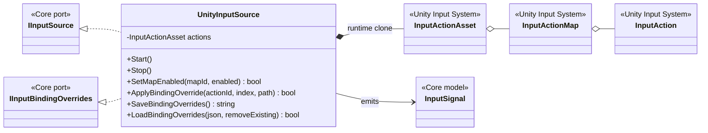
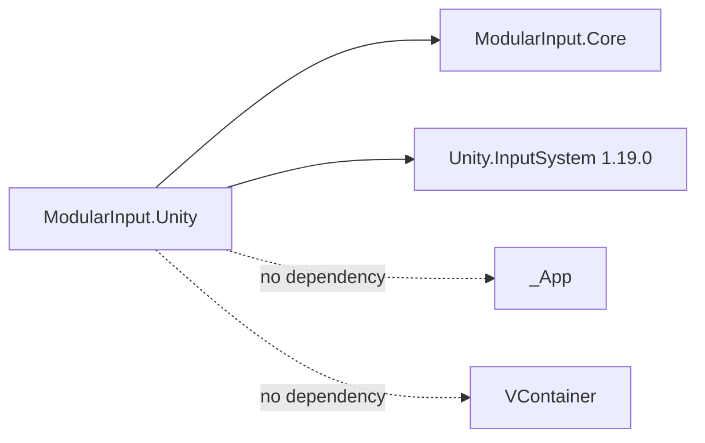

# Modular Input — Unity Input System adapter

## Ответственность

`UnityInputSource` — единственный класс модуля, который знает о `com.unity.inputsystem`. Он клонирует authoring asset для runtime-instance, подписывается на все actions без сгенерированного C# wrapper и переводит callback Unity в `InputSignal`.

Основа решения сверена с официальной документацией Unity Input System 1.19: [Actions](https://docs.unity3d.com/Packages/com.unity.inputsystem@1.19/manual/Actions.html), [bindings и runtime rebinding](https://docs.unity3d.com/Packages/com.unity.inputsystem@1.19/manual/ActionBindings.html), [On-Screen Controls](https://docs.unity3d.com/Packages/com.unity.inputsystem@1.19/manual/OnScreen.html).

## Дерево классов

## Зависимости assembly

Runtime clone не изменяет исходный `.inputactions` asset и позволяет независимо хранить binding overrides. `ReadValueAsObject` не используется: он создаёт boxing allocation; известные value types читаются через generic API.

## Платформы

- Keyboard и Mouse могут иметь разные bindings одного action, но наружу имеют общую семантику.
- Xbox/PlayStation/Nintendo-compatible controllers проходят как `Gamepad`; gameplay не проверяет конкретную модель устройства.
- Mobile UI использует `OnScreenButton`/`OnScreenStick` и направляет их в те же gamepad control paths. Визуальный mobile layout остаётся отдельным UI-модулем.
- Touch actions также могут иметь прямые `<Touchscreen>` bindings.
- Не-native устройства помечаются как `Virtual`, что позволяет UI отличать on-screen/emulated input.

## Добавление или изменение action

1. Action добавляется в `ProjectSInput.inputactions` и получает bindings для нужных control schemes.
2. `UnityInputSource` увидит его автоматически: wrapper и изменение модуля не нужны.
3. Если action имеет gameplay-смысл Project S, его GUID добавляется в `PlayerInputIds`, а преобразование — в `PlayerInputAdapter`.
4. Runtime переназначение выполняется через `IInputBindingOverrides`; JSON overrides передаётся Save-модулю без обратной зависимости.

Control scheme не должен определять бизнес-смысл. Например, `Launcher` существует как отдельный action; смысл не вычисляется из имени клавиши `F` или кнопки gamepad.
