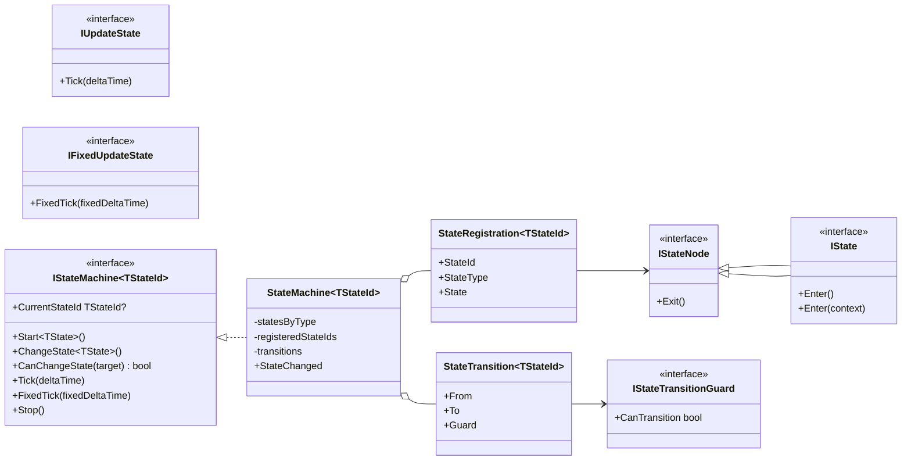
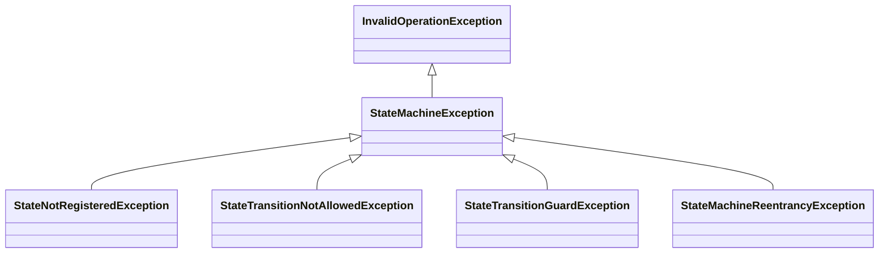
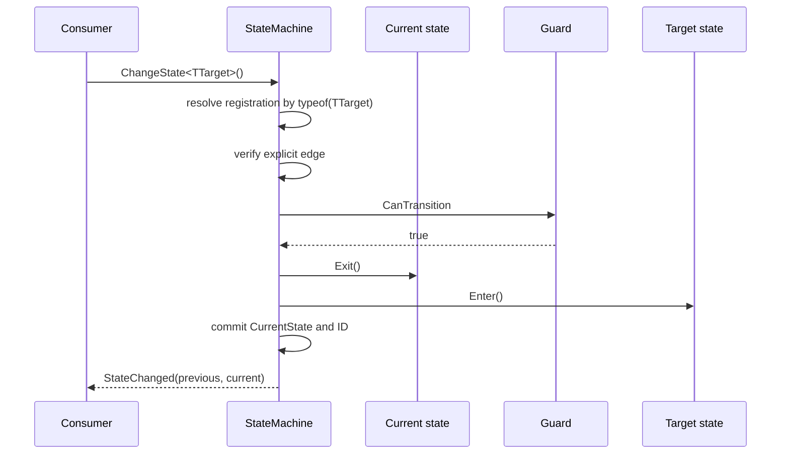

# Modular State Machine — Core

## Ответственность

`ModularStateMachine.Core` предоставляет синхронную конечную машину состояний для покадровых gameplay-систем. Машина:

- получает уже созданные экземпляры состояний;
- связывает каждый конкретный тип состояния с уникальным enum ID;
- разрешает только явно зарегистрированные переходы;
- проверяет guards;
- маршрутизирует `Tick` и `FixedTick` только текущему состоянию;
- блокирует переход из `Enter`/`Exit` другого перехода;
- не создаёт и не уничтожает состояния самостоятельно.

## Дерево классов

`IState<TContext>` не наследует parameterless `IState`: контекстное состояние не обязано иметь фиктивный `Enter()`. Тип контекста проверяется компилятором в `ChangeState<TState, TContext>(context)`.

Иерархия ошибок отделяет неверную конфигурацию/команду от исключения внутри lifecycle состояния:

## Lifecycle перехода

- `StateChanged` публикуется после завершения перехода и снятия reentrancy lock.
- Переход, запрошенный внутри `Enter` или `Exit`, отклоняется `StateMachineReentrancyException`.
- Переход из `Tick` разрешён. После него старое состояние должно немедленно завершить свой метод `Tick`.
- Self-transition возможен, только если соответствующее ребро явно зарегистрировано.
- При исключении в `Exit` или `Enter` машина переходит в stopped state: `CurrentState` и `CurrentStateId` очищаются. Для частично вошедшего target вызывается best-effort `Exit`, но предыдущий потенциально завершённый state не восстанавливается магически.
- При `Stop` текущий state получает `Exit`, после чего ссылка очищается даже при исключении.

## Guards и переходы

Guard — уже созданный объект с единственным read-only условием `CanTransition`. Guard не должен иметь side effects. Он может получать gameplay-зависимости через constructor injection вне Core.

Машина выполняет только явно запрошенные переходы. Автоматический выбор перехода и priority отсутствуют намеренно: без конкретной семантики они скрывают ownership решения. Приоритет нескольких gameplay intents должен определять владелец feature — например Combat Command Arbiter или Locomotion Controller — и отправлять машине один итоговый переход.

## Ownership

- Composition root создаёт состояния и машину.
- DI scope владеет состояниями и освобождает их зависимости.
- Машина владеет текущим ID, текущей ссылкой и процессом перехода.
- State владеет только runtime-данными своего состояния.
- `Dispose` машины останавливает lifecycle, но не вызывает `Dispose` состояний: их owner — внешний scope.

Не регистрировать один экземпляр машины как глобальный singleton для независимых actors. Каждый actor или feature получает собственную машину в соответствующем scope.
