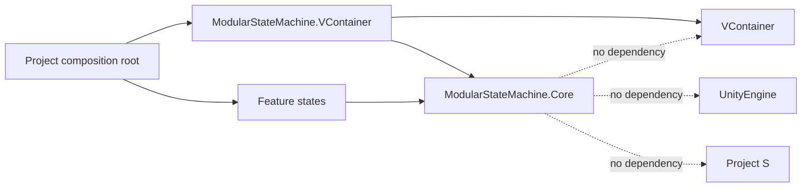
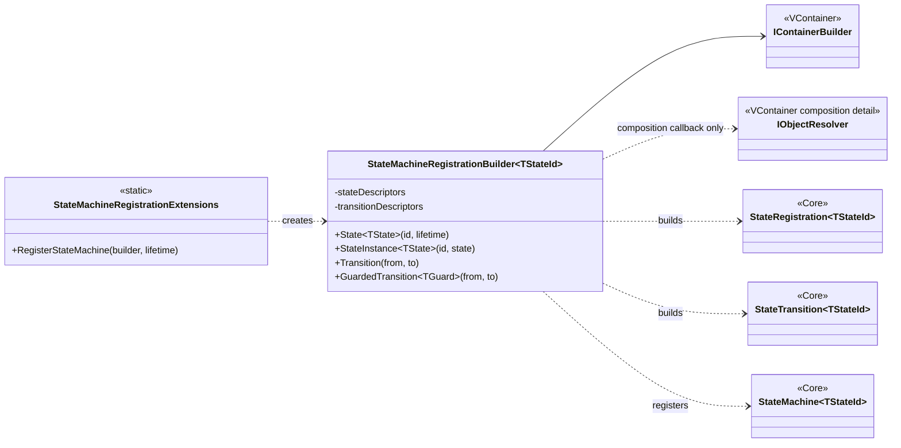

# Modular State Machine — VContainer integration

## Направление зависимостей



VContainer создаёт состояния через их конструкторы. Затем integration assembly формирует `StateRegistration<TStateId>`, а сама машина получает коллекции registrations и transitions через constructor injection. `IObjectResolver` не сохраняется и не передаётся в runtime-машину.

## Дерево integration-классов



## Регистрация

```csharp
public enum LocomotionStateId
{
    Grounded,
    Airborne,
    Dodge
}

protected override void Configure(IContainerBuilder builder)
{
    builder.RegisterStateMachine<LocomotionStateId>(Lifetime.Scoped)
        .State<GroundedState>(LocomotionStateId.Grounded, Lifetime.Scoped)
        .State<AirborneState>(LocomotionStateId.Airborne, Lifetime.Scoped)
        .State<DodgeState>(LocomotionStateId.Dodge, Lifetime.Scoped)
        .Transition(LocomotionStateId.Grounded, LocomotionStateId.Airborne)
        .Transition(LocomotionStateId.Airborne, LocomotionStateId.Grounded)
        .Transition(LocomotionStateId.Grounded, LocomotionStateId.Dodge)
        .Transition(LocomotionStateId.Dodge, LocomotionStateId.Grounded);
}
```

Composition Root импортирует `ModularStateMachine.VContainerIntegration` вместе с `VContainer`.

Потребитель получает узкий контракт:

```csharp
public sealed class LocomotionController
{
    private readonly IStateMachine<LocomotionStateId> _machine;

    public LocomotionController(IStateMachine<LocomotionStateId> machine)
    {
        _machine = machine;
    }
}
```

State получает настоящие зависимости непосредственно:

```csharp
public sealed class DodgeState : IState, IUpdateState
{
    private readonly ICharacterMotor _motor;
    private readonly IDodgeSettings _settings;

    public DodgeState(ICharacterMotor motor, IDodgeSettings settings)
    {
        _motor = motor;
        _settings = settings;
    }

    public void Enter() { }
    public void Tick(float deltaTime) { }
    public void Exit() { }
}
```

## Guard с зависимостями

Guard регистрируется как обычная зависимость, затем связывается с ребром:

```csharp
builder.Register<CanDodgeGuard>(Lifetime.Scoped);
builder.RegisterStateMachine<LocomotionStateId>(Lifetime.Scoped)
    .State<GroundedState>(LocomotionStateId.Grounded, Lifetime.Scoped)
    .State<DodgeState>(LocomotionStateId.Dodge, Lifetime.Scoped)
    .GuardedTransition<CanDodgeGuard>(
        LocomotionStateId.Grounded,
        LocomotionStateId.Dodge);
```

## Scope policy

- `Lifetime.Scoped` — значение по умолчанию для gameplay machine и её states.
- Application/Game Flow machine может жить в application scope.
- Scene Flow machine — в scene scope.
- Actor machine — в scope конкретного prefab/actor. Нельзя помещать машины всех противников в один общий scoped instance.
- Новый DI scope на каждый переход не создаётся: это дорого, усложняет ownership и не требуется для краткоживущего gameplay-state.

VContainer используется только для композиции. Состояния не получают `IObjectResolver`, `IContainerBuilder` или `LifetimeScope` и не выполняют `Resolve()`.
