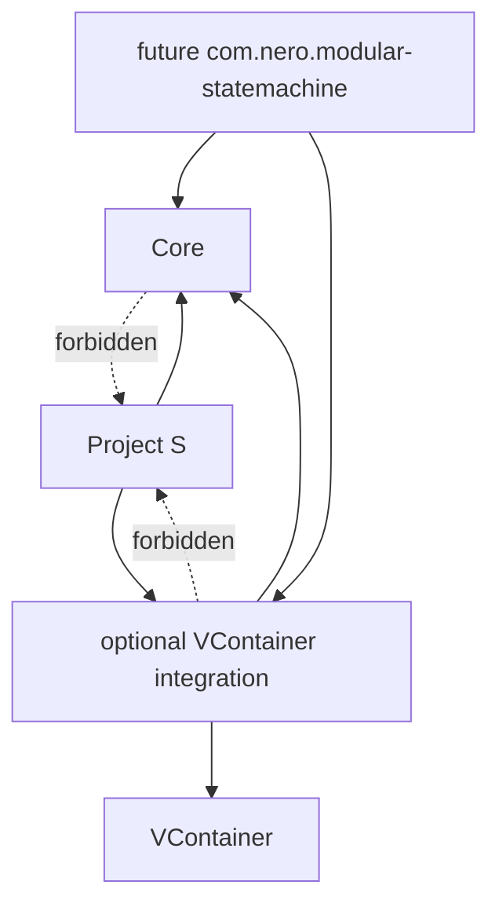

# Modular State Machine — граница пакета

## Структура

```text
StateMachine/
├── Runtime/
│   ├── Core/                       # ModularStateMachine.Core
│   └── VContainer/                 # ModularStateMachine.VContainer
├── Documentation~/
└── README.md
```



Каталог уже использует package-friendly layout и отдельные asmdef. Для физического переноса в UPM package корень `Assets/_Modules/StateMachine` становится корнем пакета, после чего добавляется `package.json`.

## Публичная граница

В будущий пакет входят только:

- lifecycle contracts;
- `StateRegistration<TStateId>` и `StateTransition<TStateId>`;
- `IStateMachine<TStateId>` и реализация;
- исключения конфигурации/lifecycle;
- VContainer registration extensions.

Не входят:

- enum и состояния Project S;
- Character, Combat, Enemy и UI contracts;
- Animator, physics и time policy;
- input buffering;
- фабрики игровых prefab;
- ScriptableObject-конфигурация.

Единственная внешняя зависимость integration assembly — VContainer. Core не имеет package dependencies и собран с `noEngineReferences: true`.

`package.json` пока не добавляется: сначала API должен пройти реальное использование как минимум в двух разных feature-машинах. Это позволяет корректировать границу без преждевременного package versioning.
