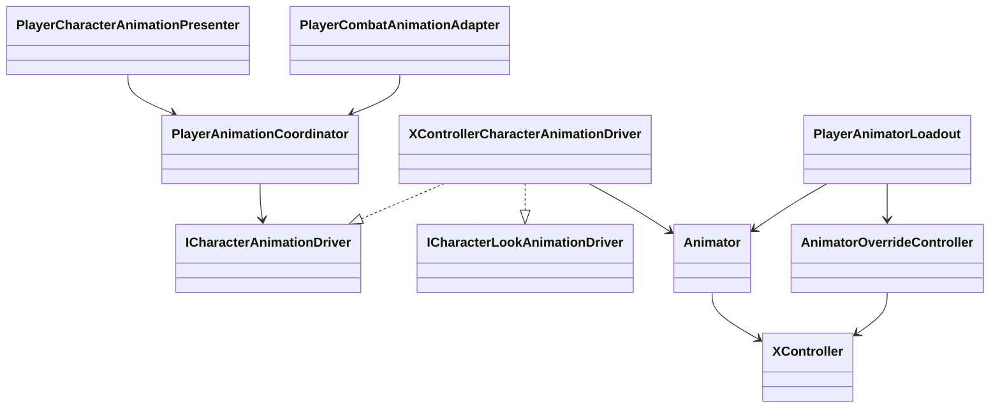
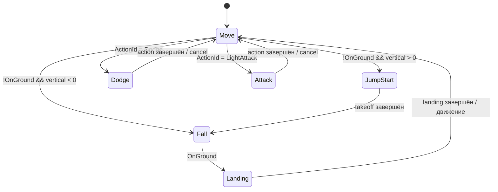

# Character Animation Core

## Назначение

`XController.controller` остаётся обычным Mecanim Animator Controller и отвечает
только за presentation: выбор поз, blend trees и визуальное смешивание состояний.
Gameplay-состояние принадлежит locomotion/combat/reaction-коду и передаётся в
Animator через один адаптер `XControllerCharacterAnimationDriver`.

В качестве общего Humanoid-набора используется курированный поднабор
`CLazyRunnerActionAnimPack`. Исходные vendor-FBX не подключаются к контроллеру
напрямую: 44 нужных клипа извлечены в самостоятельные `.anim` с явными loop
settings.

```text
Assets/_Game/Animations/Character/
├── 1. Controllers/
│   └── XController.controller
└── 2. Basic/CLazyCore/
    ├── Locomotion/       # idle + walk/run/sprint, восемь направлений
    ├── Airborne/         # jump start, rise, fall, landing
    ├── Actions/          # четыре направления dodge
    ├── Combat/Unarmed/   # BaseAttack1..4
    └── Reactions/        # подготовленные reaction/death/recovery candidates
```

## Зависимости



- `_App/Modules/Animation` объявляет семантические кадры и команды.
- `_App/Core` адаптирует их к контракту конкретного `XController`.
- Animator не читает input, не определяет damage/cancel windows и не перемещает
  motor самостоятельно.
- `PlayerAnimatorLoadout` меняет только таблицу клипов через
  `AnimatorOverrideController`; граф и параметры остаются общими.

## Locomotion graph



Состояние `Move` содержит верхний 1D blend по `MovementType`:

- `0` — общий Idle;
- `1` — Walk 8-Way;
- `2` — Run 8-Way;
- `3` — Sprint 8-Way.

Каждый gait использует `Simple Directional 2D` по `MoveX/MoveY` с центром и
восемью направлениями. Вектор нормализуется и демпфируется в единственном
driver. Старые `MovementDirection`, `MovementType`, `FallingDuration` и
`OnGround` сохранены, потому что существующие jump/landing transitions на них
опираются.

## Контракт параметров

| Параметр | Owner | Назначение |
|---|---|---|
| `MoveX`, `MoveY` | locomotion presentation driver | локальное направление движения |
| `MovementType` | locomotion presentation driver | idle/walk/run/sprint |
| `MovementDirection` | locomotion presentation driver | legacy forward/back transition contract |
| `FallingDuration` | locomotion presentation driver | вертикальная скорость для airborne graph |
| `OnGround` | locomotion presentation driver | подтверждённый grounded state |
| `Action`, `ActionId`, `ActionVariant` | animation coordinator/driver | семантический action request |
| `ActionSpeed` | animation driver | согласование длины клипа с gameplay duration |
| `CancelAction` | animation coordinator/driver | явный выход из action state |
| `BodyLookX/Y`, `HeadLookX/Y` | look driver | additive BodyLook/HeadLook layers |

## Переходы и root motion

- Idle/walk/run/sprint смешиваются внутри одного state, без резких state jumps.
- Направление демпфируется `0.12 s`, gait — `0.33 s`.
- Вход в dodge/attack смешивается `0.12 s`.
- Обычный выход из dodge происходит после `82%` клипа с blend `0.18 s`.
- Обычный выход из атаки происходит после `88%` клипа с blend `0.16 s`.
- Landing начинает штатный выход после `78%`; движение не обрывает его раньше
  `45%`.

Текущая политика — motor-owned motion: `Animator.applyRootMotion = false`.
Locomotion, dodge и combat movement проходят через collision-safe motor/intents.
Root-варианты, смещавшие Humanoid skeleton относительно capsule, исключены из
интегрированного набора и заменены in-place источниками.

## Weapon overrides

Общие locomotion, jump, dodge и reactions не меняются вместе с оружием.
Оружейный `AnimatorOverrideController` должен переопределять стабильные combat
slots (`BaseAttack1`...`BaseAttack4`, а затем дополнительные именованные slots),
не копируя Animator graph. Слои `BodyLook` и `HeadLook` остаются общими.

## Отложенный traversal

Ladder-клипы уже присутствуют в
`Assets/_Game/Animations/Shared/External/Amplify/Traversal`, а semantic slots —
в существующем traversal-коде. Они намеренно не смешаны с CLazy wall-run и не
подключены в этой итерации. Ladder, ledge, wall-climb и swimming должны получить
отдельный traversal graph после стабилизации привязки персонажа к геометрии.

## Выполненная проверка

- все 44 клипа — валидные Humanoid clips: 29 loops и 15 one-shots;
- `XControllerCharacterAnimationDriver` успешно валидирует Avatar, layers,
  states и новые параметры на `Player.prefab`;
- Animator evaluation подтвердил `Move`, `Jump`, `DodgeForward` и
  `BaseAttack1` transitions;
- визуальный прогон idle-to-run и attack не выявил T-pose или сломанного
  retargeting;
- измеренное смещение visual root для интегрированных backward run, forward
  sprint и forward dodge — `0 m`;
- после изменений Unity Console не содержит errors и warnings.
