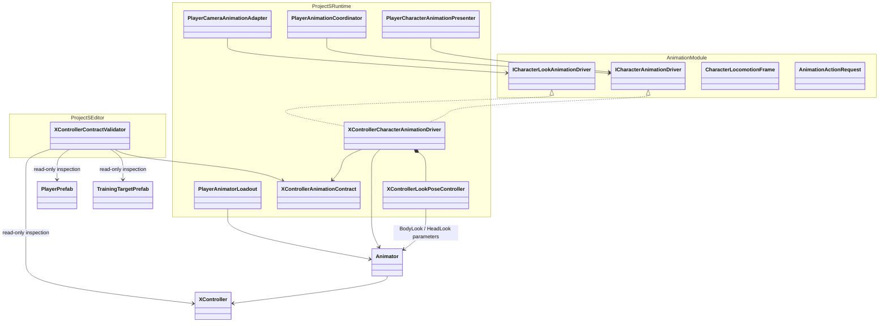
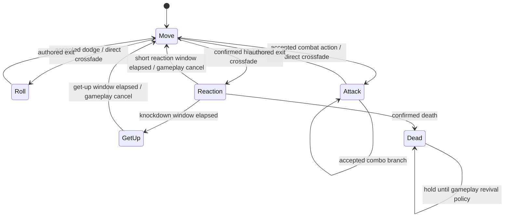

# Character Animation Core

## Назначение

`XController.controller` — единый вручную редактируемый Mecanim-граф персонажа
Project S. Он отвечает за выбор motion, Blend Trees, слои и визуальные
переходы. Locomotion, допустимость действий, combat/reaction timeline, cancel
windows, damage и collision-safe перемещение остаются в gameplay-коде.

Runtime не создаёт и не перестраивает Animator Controller. Единственный
Project-S-specific writer — `XControllerCharacterAnimationDriver`; он переводит
семантические кадры и действия модуля `ModularAnimation` в контракт XController.

```text
Assets/_Game/Animations/Character/
├── 1. Controllers/
│   └── XController.controller
├── 2. Basic/                 # locomotion, jump, roll и базовые attacks
└── Knight/                   # текущие proxy reaction/death motions

Assets/_Game/Animations/Masks/
└── SwitchMask.mask
```

## Дерево классов и зависимости



Направление first-party dependencies сохраняется:

```text
ProjectS.Core.Runtime -> ModularAnimation.Unity -> ModularAnimation.Core
ProjectS.Core.Editor  -> ProjectS.Core.Runtime
```

`ModularAnimation` не знает о XController, клипах и assets Project S.
`XControllerAnimationContract` находится в Core, потому что описывает конкретный
контент игры. Editor validator использует этот же runtime-контракт, но runtime
assembly не ссылается на editor assembly.

## Контракт XController

Обязательные слои:

| Layer | Mode | Назначение |
| --- | --- | --- |
| `Base Layer` | Override | locomotion, roll, attacks, reactions |
| `SwitchWeapon Layer` | Override + Avatar Mask | draw/sheathe presentation |
| `BodyLook` | Additive | ограниченный поворот корпуса |
| `HeadLook` | Additive | остаточный поворот головы |

Обязательные параметры:

| Parameter | Type | Owner / назначение |
| --- | --- | --- |
| `OnGround` | Bool | подтверждённый grounded state motor |
| `MovementDirection` | Float | signed forward/backward presentation |
| `MovementType` | Float | idle/walk/run/sprint gait |
| `FallingDuration` | Float | signed vertical velocity для airborne graph |
| `SpeedMultiplier` | Float | общий presentation playback speed |
| `BodyLookX`, `BodyLookY` | Float | additive body pose |
| `HeadLookX`, `HeadLookY` | Float | additive head pose |

Параметры `MoveX`, `MoveY`, `Action`, `ActionId`, `ActionVariant` и
`CancelAction` относятся к универсальному optional Mecanim backend, но не входят
в текущий XController. Принятые finite actions входят напрямую в стабильные
state paths через `CrossFadeInFixedTime`.

Обязательные semantic state slots:

- `Base Layer.Locomotion.Move`;
- `Base Layer.Locomotion.Roll.RollFront` и `RollBack`;
- `Base Layer.Attack.BaseAttack1...3` для light combo;
- `Base Layer.Attack.BaseAttack4` для самостоятельной heavy attack;
- `Base Layer.Attack.Skill` для самостоятельной special action;
- `Base Layer.Reaction.HitStun`, `HitStun_Back`, `HitStun_Left`,
  `HitStun_Right`, `Knockdown`, `GetUp`, `Airborne`, `Dead_1`, `Dead_2`;
- `SwitchWeapon Layer.Waiting`, `TwoHanded_Sheathe`,
  `TwoHanded_Unsheathe`.

Все имена объявлены один раз в `XControllerAnimationContract`. Driver и editor
validator не поддерживают собственные копии строк.

## Runtime flow и переходы



- Locomotion parameters обновляются непрерывно и сглаживаются только на уровне
  presentation: gait `0.33 s`, direction `0.12 s`.
- Dodge и attacks входят с fixed-time crossfade `0.12 s`.
- Штатное завершение не форсирует переход: controller доигрывает authored exit.
- Interruption вызывает `CancelAction`: Base Layer возвращается в `Move`,
  weapon layer — в `Waiting`.
- Reaction states не имеют собственных выходов. Recovery/death authority
  принадлежит gameplay reaction state machine: `Knockdown` явно сменяется на
  `GetUp`, а завершение GetUp возвращает presentation в locomotion.
- `BodyLook` и `HeadLook` получают camera-relative yaw/pitch через отдельный
  look adapter. Dodge/reaction подавляют look, attacks и weapon transitions
  используют ограниченный tracking.
- `XControllerLookPoseController` является единственным owner calibration,
  body/head angle split, grounded/action weights и экспоненциального smoothing
  четырёх look-параметров. Driver только выбирает presentation weights и не
  дублирует накопленные значения.

## Timing и root motion

`CombatActionDefinition.DurationSeconds` и reaction durations определяют
gameplay timeline. Текущий driver не растягивает клипы до этой длительности и
не читает Animator normalized time как источник gameplay state. По умолчанию
actions воспроизводятся с authored speed `1`.

Политика перемещения — motor-owned motion:

- `Animator.applyRootMotion = false` на Player и training target;
- driver повторно фиксирует это при композиции;
- locomotion, dodge и combat movement проходят через `CharacterMotor`, его
  sweeps, grounding и collision response;
- root motion можно вводить позднее только как явный movement intent с одним
  owner, а не параллельно motor translation.

## Weapon overrides

`AnimatorOverrideController` является опциональной таблицей замены motion для
оружия. Его base controller обязан разрешаться в `XController`; граф, layers,
parameters и state names не копируются. Если override для weapon type не задан,
`PlayerAnimatorLoadout` оставляет базовый XController.

Текущий Player prefab содержит binding `DualHand → DualSwords.overrideController`.
Остальные weapon types используют базовый XController, пока для них не появится
полный совместимый набор semantic slots.

## Editor validation

Команда `Tools/Animation/Validate XController Contract` выполняет read-only
проверку:

- обязательных layers, blending modes, mask, parameters и state paths;
- наличия motions и их Humanoid/legacy compatibility;
- authored exits у roll/attack и gameplay-owned exits у reactions;
- non-loop policy для hit-stun, knockdown, get-up и death;
- совместимости AnimatorOverrideController с базовым XController;
- Humanoid Avatar, controller и отключённого root motion в Player и training
  target prefabs;
- отсутствующих/дублирующихся weapon override bindings.

Validator ничего не генерирует и не исправляет автоматически. После текущей
синхронизации результат: `PASS — 0 error(s), 0 warning(s)`.

## Отложенные блоки

Swimming, ladder, ledge, wall-climb, parkour, directional hit reactions и
расширенная knockdown/ragdoll-модель остаются отдельными content/gameplay
задачами. Они не добавляются в базовый controller до появления соответствующей
gameplay-семантики и проверенного набора клипов.
