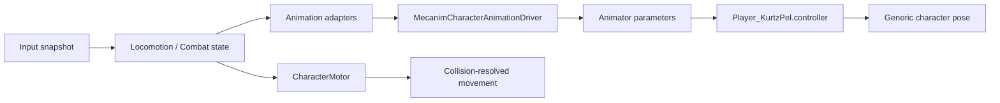

# KurtzPel animation audit and runtime selection

## Structural audit result

The imported pack contains 437 uniquely named Generic clips in 13 FBX packs:

| Group | Clips | Runtime status |
| --- | ---: | --- |
| Movement and character states | 336 | audited; selected subset used |
| Reactions | 26 | audited; deferred |
| Miscellaneous | 4 | audited; not gameplay runtime content |
| Blazing Fist combat | 71 | audited; first light attack selected |

`KurtzPel_AnimationManifest.csv` is the row-level catalog for every clip. It
records group, exact clip name, source frame count, source frame rate and source
path. `KurtzPelReferenceAnimationImporter` cross-checks all 437 manifest rows
against all imported clips, verifies unique names, non-empty animation curves
and valid timing metadata, and fails if either side contains an unmatched clip.

This is a structural import audit, not proof that every clip is suitable for a
particular gameplay state. Runtime selection additionally checks the semantic
motion, source forward axis and visual result on the reference rig.

## Timing correction

Unity currently imports the converted FBX clips at 24 FPS, while their source
frame rates range from roughly 30 to more than 60 FPS for the chosen set.
Playing the raw imported motions at state speed `1` therefore produces visibly
slow animation.

The controller generator applies:

```text
state or blend-child speed = source FPS / imported clip FPS
```

Dodge is the deliberate exception: its state speed is fitted to the motor-owned
0.48 second dodge window. Combat gameplay uses its own 1.30 second action
duration and never reads a clip length as a rule.

## Selected runtime clips

| State | Clip | Source group | Notes |
| --- | --- | --- | --- |
| Idle | `HM_ENFJ_Wait` | Male ENFJ | looping |
| Walk | `HM_ENFJ_Walk` | Male ENFJ | genuine walk cycle; not a slowed run |
| Run | `HM_ENFJ_Run` | Male ENFJ | looping |
| Sprint | `HM_ENFJ_Run_Fast` | Male ENFJ | looping |
| Jump ascent | `HM_ENFJ_Air_JumpUp` | Male ENFJ | motor vertical velocity selects transition |
| Fall | `HM_ENFJ_Air_JumpDown` | Male ENFJ | held until grounding |
| Landing | `HM_ENFJ_Air_JumpLanding` | Male ENFJ | finite exit transition |
| Forward dodge | `HM_ENFJ_Dash` | Male ENFJ | motor owns displacement |
| Backward dodge | `CC_C_Rage_Avoid` | Common Ninja | semantic variant `1` |
| Unarmed light | `HMGT_BasicCombo_01` | Blazing Fist | first grounded attack only |

No swimming or ladder clip is mapped. Those presentation states are deferred
and traversal remains unavailable when its animation slot is unsupported.

## Runtime dependency flow



The Animator never applies root motion to the Player transform. This keeps
animation smoothing independent from authoritative movement and permits a later
Humanoid content migration without changing gameplay contracts.

KurtzPel authored character motion faces local `+X`. The visual adapter applies
a constant `-90` degree yaw so the animated body faces Unity/gameplay `+Z`; the
Player motor and physics root remain unrotated. `MotionSpeed` is planar world
speed in metres per second. The grounded blend thresholds mirror the current
movement settings: idle `0`, walk `3`, run `5`, sprint `10`.

## Extension order

Combo steps, air combat and reactions should be added only after the current
movement/dodge/single-hit flow has been tuned in Play Mode. Each new action must
add a semantic action ID or variant, an Animator state/transition, and a gameplay
timeline duration. Swimming and ladder animation are separate later work.
