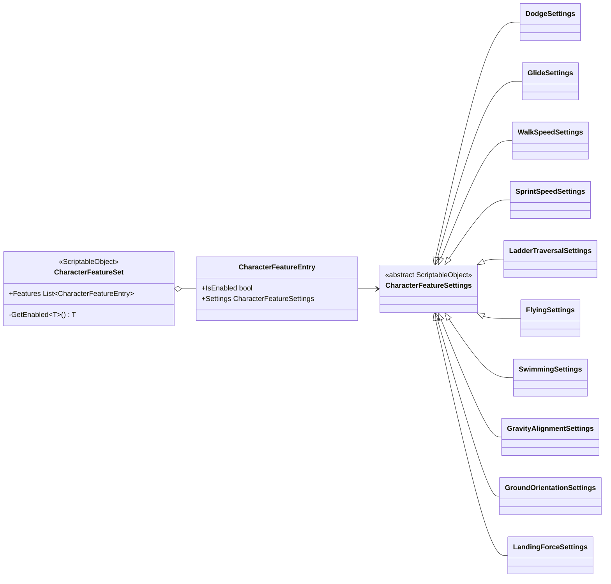
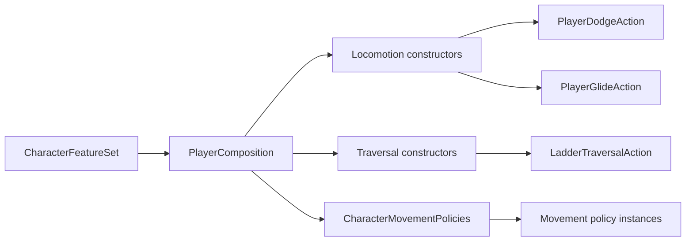

# Project S — Character Features

## Назначение

У Project S больше нет общей runtime ability-системы. Удалены `IAbility`, `AbilityController`, `CharacterAbilityRuntime`, generic lookup по типу и фабрики `CreateAbilityInstance`.

`CharacterFeatureSet` — только immutable authoring-каталог ScriptableObject-настроек. Он отвечает на вопрос «какие опциональные возможности включены у этого персонажа и с какими параметрами», но не создаёт runtime-объекты и не управляет lifecycle.

Runtime-поведение принадлежит gameplay feature:

- Locomotion владеет dodge, glide и speed modes;
- Traversal владеет ladder workflow;
- Character Movement Policies владеют fly, swim, gravity alignment, ground orientation и landing force.

## Дерево authoring-классов

`GetEnabled<T>` имеет `internal` visibility и используется только composition/feature constructors. Gameplay controller не получает `CharacterFeatureSet` и не выполняет runtime lookup.

Composition вызывает `ValidateConfiguration`: включённая запись обязана иметь settings, а два включённых settings одного concrete-типа считаются ошибкой authoring, а не неявным приоритетом порядка списка.

## Ownership map

Созданный feature runtime не хранит ссылку на общий каталог после composition: он копирует нужные scalar/reference settings в конкретного владельца состояния.

## Serialization migration

ScriptableObject GUID сохранены. Поэтому существующий `Assets/Settings/Character/AbillityData/AbilitiesData.asset` и вложенные settings assets продолжают загружаться без переназначения ссылок. `FormerlySerializedAs` мигрирует:

- backing field `Abilities` в `Features`;
- `Ability.IsActive` в `CharacterFeatureEntry.IsEnabled`;
- `Ability.Data` в `CharacterFeatureEntry.Settings`;
- ошибочное поле `_maxSprintSpeed` старого walk asset в `_maxWalkSpeed`.

Legacy-путь и имена самих `.asset` пока не перемещаются: это content migration и должно выполняться отдельным Unity Editor изменением с проверкой всех references. Новые assets создаются через меню `Project S/Character/*`.

## Ограничение границы

`CharacterFeatureSet` остаётся в `_App/Core`, потому что набор settings и их потребители специфичны для Project S. В `_App/Modules` можно будет вынести отдельный Locomotion или Character Motion только после стабилизации собственного authoring API; общий feature/ability framework для этого не нужен.
