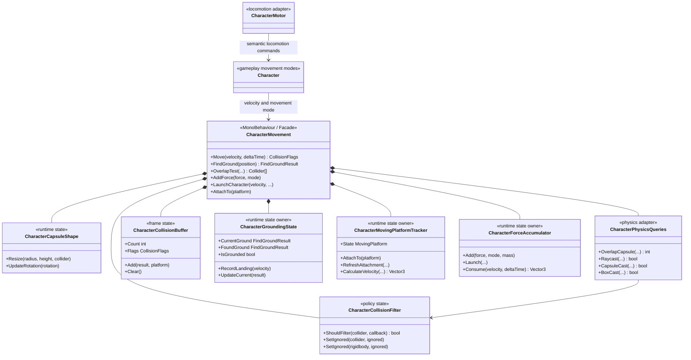
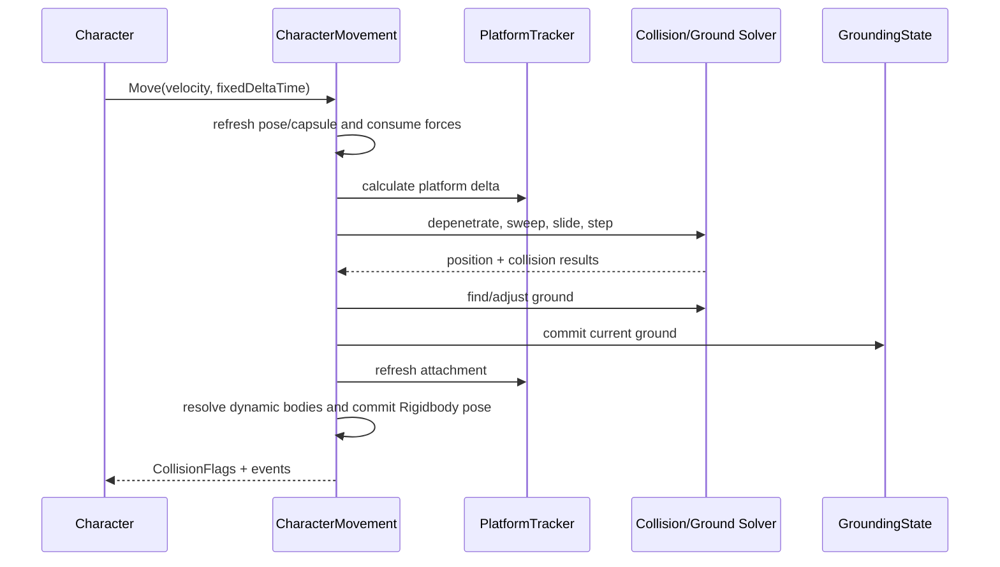

# Character Movement

## Назначение

`CharacterMovement` — низкоуровневый кинематический motor на базе `Rigidbody` и `CapsuleCollider`.
Он принимает world-space velocity, выполняет collision/depenetration, определяет опору, учитывает moving
platforms и публикует подтверждённый результат движения. Семантический input, locomotion states, combat,
Animator и Cinemachine в это дерево не входят.

Публичный API и serialized-поля исходного компонента сохранены. Это позволяет сценам, prefab references,
`Character` и `CharacterMotor` продолжать использовать тот же Unity-компонент после внутреннего рефакторинга.

## Дерево классов



## Файлы solver

`CharacterMovement` остаётся одной runtime-сущностью, но численная реализация разделена по ответственности:

- `CharacterMovement.cs` — serialized configuration, Unity lifecycle, публичный фасад и orchestration одного move;
- `CharacterMovement.Collision.cs` — collision queries, depenetration, slide solver и формирование `CollisionResult`;
- `CharacterMovement.Grounding.cs` — ground sweeps, perch/step rules и ground height constraint;
- `CharacterMovement.Platforms.cs` — platform displacement и dynamic-body interaction;
- `CharacterMovement.Math.cs` — geometric normals и velocity math;
- `CharacterMovement.Editor.cs` — только editor visualization, полностью исключённая из player build.

Это `partial`-граница одной реализации, а не отдельные модули. Методы solver имеют общий набор инвариантов
одного movement tick, поэтому интерфейсы между каждым алгоритмом добавили бы связность и передачу mutable
context вместо реальной сменяемости.

## Владение состоянием

- `CharacterMovement` владеет Unity references, serialized configuration, position/rotation и итоговой velocity.
- `CharacterCapsuleShape` — единственный owner локальной и повёрнутой геометрии capsule.
- `CharacterCollisionFilter` — единственный owner runtime ignore sets.
- `CharacterCollisionBuffer` — единственный owner frame-local collisions и `CollisionFlags`.
- `CharacterGroundingState` — единственный owner current/previous/candidate ground и landing transition.
- `CharacterMovingPlatformTracker` — единственный owner platform attachment и platform deltas.
- `CharacterForceAccumulator` — единственный owner pending force/impulse/launch до следующего `Move`.
- `Advanced` и другие serialized данные остаются authoring configuration, но не становятся global state.

Все runtime collaborators создаются самим `CharacterMovement`: у них тот же lifecycle, нет scene references и
нет причины регистрировать их в VContainer. DI применяется выше, на границе `ICharacterMotor`/locomotion, где
реализация действительно сменяема.

## Зависимости и правила использования

Разрешённое направление:

```text
Input -> PlayerLocomotionController -> ICharacterMotor -> CharacterMotor
                                                     -> Character -> CharacterMovement
```

- Gameplay передаёт velocity/intents через `Character`/`ICharacterMotor`, а не вызывает внутренний solver.
- `CharacterMovement` не читает Input System и не знает о locomotion/combat states.
- Animation и camera adapters читают подтверждённое состояние верхнего locomotion-слоя.
- Combat не получает доступ к внутренним collaborators. Для рывка/knockback используются ограниченные
  команды motor/`Character`, а не изменение grounding/platform state.
- `Internal/*` не является публичным extension API. Новый behaviour добавляется через существующие callbacks
  (`ColliderFilter`, `CollisionBehaviour`, `CollisionResponse`) либо отдельное архитектурное решение.

## Lifecycle одного шага



## Инварианты

- Симуляция выполняется только через `Move` в fixed-step владельца `Character`.
- Physics queries используют заранее выделенные buffers и один collision filter.
- Serialized field names не менять без `FormerlySerializedAs` и проверки scene/prefab migration.
- `Rigidbody` остаётся kinematic, `useGravity` выключен; gravity интегрирует `Character`.
- Platform displacement добавляется к character displacement; при сходе сохранённая скорость платформы
  добавляется один раз, а при входе velocity персонажа не вычитает platform velocity.
- Ground height correction обновляет измеренную дистанцию дельтой позиции; landing не обнуляет
  `GroundDistance`, когда blocking contact не позволяет выполнить всю коррекцию вниз.
- `FindGroundResult`, `CollisionResult` и `MovingPlatform` — snapshot/value types, не owners состояния.
- `UnityEditor` API разрешён только в `CharacterMovement.Editor.cs` под `UNITY_EDITOR`.
- `Internal`-классы не регистрировать в VContainer и не выдавать наружу.

## Ручная проверка после изменений

- idle на ровной поверхности: grounded, стабильная ground distance;
- run и остановка, wall collision, узкое препятствие;
- jump/fall/landing и повторный прыжок;
- slope limit, edge/perch и step offset;
- dodge при высоком и низком frame rate;
- moving platform: вход, движение/поворот, сход и impart velocity;
- force/impulse/launch, disable/enable и повторный вход в gameplay scene;
- отсутствие новых compile errors и runtime exceptions.
