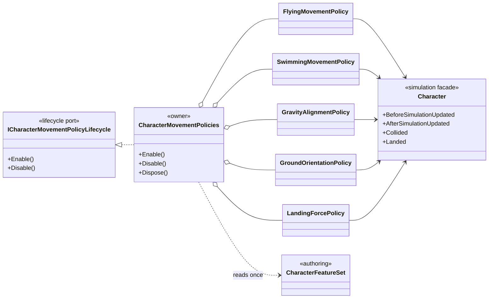

# Project S — Character Movement Policies

## Ответственность

`CharacterMovementPolicies` — scoped lifecycle-owner небольших опциональных правил, расширяющих simulation `Character`. Это не state machine и не service locator. Каждая policy подписывается только на необходимую фазу simulation и хранит только собственное runtime-состояние.

## Дерево классов

## Подписки и фазы

| Policy | Simulation hook | Ответственность |
|---|---|---|
| `FlyingMovementPolicy` | `BeforeSimulationUpdated`, `Collided` | вход в flying при удержании jump и выход при walkable collision |
| `SwimmingMovementPolicy` | `BeforeSimulationUpdated` | вертикальный swim input и выход из воды вверх |
| `GravityAlignmentPolicy` | `AfterSimulationUpdated` | ориентация up-vector по gravity direction |
| `GroundOrientationPolicy` | `AfterSimulationUpdated` | усреднение ground normals и визуально-физический наклон |
| `LandingForcePolicy` | `Landed` | передача подтверждённого landing impulse ground Rigidbody |

`Enable / Disable` владельца идемпотентны и симметричны. `PlayerActorController` знает только `ICharacterMovementPolicyLifecycle`; VContainer создаёт owner из `CharacterFeatureSet`. При уничтожении scope `Dispose` гарантирует снятие подписок.

## Границы

- Policies не читают Input System и используют подтверждённые semantic flags/state `Character`.
- Policies не доступны через generic registry.
- Отсутствующая либо выключенная настройка означает, что экземпляр policy не создаётся.
- Locomotion actions и ladder traversal не входят в этот набор: у них собственные controllers и lifecycle.
- Collision motor `CharacterMovement` не зависит от policies; направление остаётся `policy -> Character -> CharacterMovement`.
