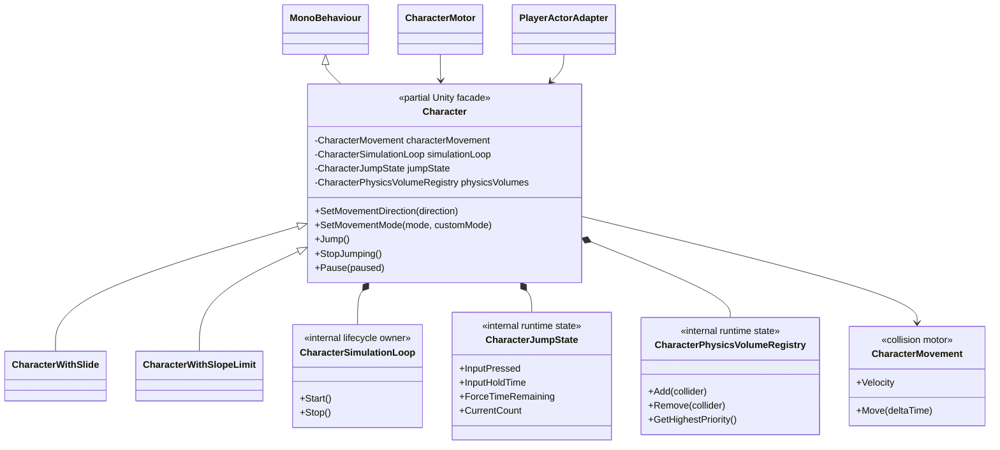
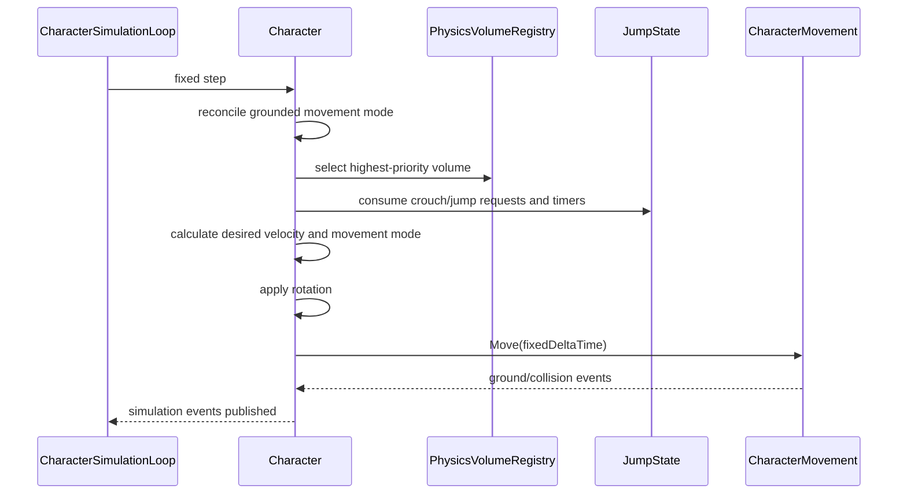

# Character — simulation facade

`Character` остаётся Unity-компонентом и совместимым facade над `CharacterMovement`. Его ответственность — хранить authoring-конфигурацию, принимать ограниченные команды персонажа, владеть режимом движения и выполнять один упорядоченный fixed-step. Collision solver остаётся в `CharacterMovement`, а Player-логика обращается к этой границе через `CharacterMotor` и consumer-specific actor ports.

Рефакторинг намеренно сохраняет имя типа, GUID `Character.cs`, все serialized field names, public/protected API, events и virtual hooks. Поэтому существующие prefabs, scene instances, `CharacterWithSlide` и `CharacterWithSlopeLimit` не требуют миграции.

## Дерево классов



`partial`-файлы не являются отдельными runtime-объектами: это области одной совместимой `Character`-сущности.

- `Character.cs` — serialized configuration, facade properties/events, Unity lifecycle и validation.
- `Character.Simulation.cs` — единственный порядок fixed-step и pause boundary.
- `Character.Movement.cs` — movement modes, velocity calculation и mode transitions.
- `Character.Jump.cs` — jump policy и переходы jump runtime state.
- `Character.Crouch.cs` — crouch request и проверка доступной высоты.
- `Character.Rotation.cs` — rotation policy и накопленный rotation input.
- `Character.Kinematics.cs` — gravity, position/rotation/velocity и force commands.
- `Character.PhysicsVolumes.cs` — water/volume integration.
- `Internal/*` — непубличные owners runtime state и lifecycle; они не являются extension API и не регистрируются в VContainer.

## Зависимости

```text
PlayerLocomotionController -> ICharacterMotor -> CharacterMotor -> Character
Player actor consumers     -> focused ports  -> PlayerActorAdapter -> Character
Character                  -> CharacterMovement -> Unity Physics
```

- `Character` не читает Input System, не знает о combat state machine и не управляет Cinemachine.
- `CharacterMovement` не выбирает gameplay mode и не хранит jump/crouch rules.
- `CharacterSimulationLoop` владеет только cancellable UniTask loop. `Character.OnEnable/OnDisable` определяют его lifecycle.
- `CharacterJumpState` — единственный owner jump counters/timers/flags; публичные свойства `Character` остаются совместимым facade.
- `CharacterPhysicsVolumeRegistry` — единственный owner списка пересечённых volumes и выбора приоритета.
- VContainer применяется на границе Player composition. Внутренние части `Character` создаются самим владельцем, поскольку полностью разделяют его lifecycle и не имеют сменяемых реализаций.

## Fixed-step



Порядок `BeforeSimulation -> movement/rotation -> AfterSimulation -> CharacterMovement.Move` сохранён. При disable loop отменяется, а collision/ground subscriptions снимаются; повторный enable создаёт один новый loop без накопления подписок.

## Инварианты и расширение

- Новые game-specific movement modes добавляются через существующие virtual hooks или отдельную верхнеуровневую ability/state machine; `Internal`-классы не наследуются снаружи.
- Нельзя вызывать внутренние шаги симуляции из Combat, Animation или Camera. Эти системы отправляют intent через свои порты.
- Serialized fields нельзя переносить в новые settings-классы без отдельной prefab/scene migration. Текущий split безопасен для существующего authoring data.
- `Character` пока остаётся legacy-compatible facade, а не кандидатом в `_Modules`: его API содержит Project S abilities и inheritance hooks. Стабильная переиспользуемая граница находится ниже (`CharacterMovement`) и выше (`ICharacterMotor`).
- Не добавлять DI к `CharacterJumpState`, `CharacterPhysicsVolumeRegistry` и `CharacterSimulationLoop`: у них нет независимого lifecycle или реальной сменяемости.

## Ручная проверка

- enter Play Mode: один fixed-step loop, нет Console exceptions;
- idle/run/stop и wall collision;
- jump press/hold/release, landing и повторный jump;
- disable/enable объекта: loop и события возобновляются один раз;
- pause/unpause: collider и velocity восстанавливают согласованное состояние;
- вход/выход из перекрывающихся physics volumes и выбор highest priority;
- `CharacterWithSlide` и `CharacterWithSlopeLimit` продолжают вызывать virtual hooks;
- prefab/scene diff не появляется только из-за перекомпиляции.
