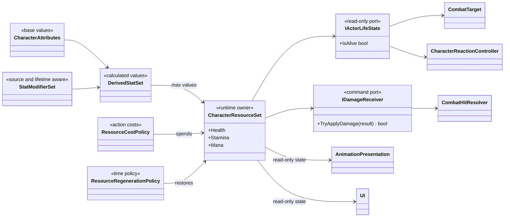

# Project S — Character Stats and Resources

## Статус решения

Полноценная система характеристик пока не реализуется. Текущий `Health` — временная prototype-обёртка, которая позволяет проверять damage, reactions, hit stop и death flow. Она не является целевой моделью персонажа и не должна расширяться до универсального контейнера здоровья, стамины, маны, атрибутов и эффектов.

Этот документ фиксирует границы будущей системы, чтобы текущий Core не закреплял зависимости от prototype `Health` как от стабильного API.

## Целевая модель

Имена на диаграмме обозначают ответственности, а не утверждённый набор C#-классов. Public API и физическое разделение будут определены только при реализации первого реального vertical slice.

## Разделение ответственностей

- **Attributes** — базовые характеристики персонажа: например сила, ловкость и живучесть. Они не содержат текущее здоровье или таймер восстановления стамины.
- **Derived Stats** — рассчитанные значения: максимальный запас ресурса, урон, защита, скорость регенерации. У вычисления должен быть один owner и предсказуемый порядок применения modifiers.
- **Resources** — изменяемые runtime-значения `Current / Maximum`: здоровье, стамина, мана и возможные последующие ресурсы. Clamp, расход и восстановление выполняются только владельцем ресурса.
- **Modifiers** — изменения от экипировки, состояний, баффов и дебаффов. Modifier хранит источник, операцию и lifetime; он не меняет authoring asset и не становится отдельной копией итогового stat.
- **Costs** — проверка и подтверждённый расход ресурса конкретным действием. Attack, dodge или ability не изменяют поле stamina напрямую.
- **Regeneration** — отдельная policy с явным time source, задержкой после расхода и условиями блокировки восстановления.
- **Life State** — узкий read-only результат состояния здоровья. Targeting, animation и другие observers не должны зависеть от реализации всего stat container.
- **Damage Receiving** — отдельная command-граница. Возможность принять damage не объединяется с чтением всех характеристик персонажа.

## Архитектурные ограничения

- Не создавать `SoulsStats`, `CharacterStatsManager` или другой MonoBehaviour, владеющий всеми правилами персонажа.
- ScriptableObject хранит только immutable authoring data. Текущие ресурсы, активные modifiers, cooldowns и regeneration timers принадлежат runtime-экземпляру.
- У каждого ресурса и рассчитанного значения один mutable owner.
- Gameplay получает узкие command/state ports; UI и animation не изменяют ресурсы напрямую.
- Damage, resource cost и regeneration публикуют результат только после принятой операции.
- Идентификаторы характеристик должны допускать расширение без изменения общего enum при каждом новом stat. Конкретный формат идентификатора пока не фиксируется.
- Порядок modifiers, округление, clamp и stacking должны быть детерминированы до подключения экипировки и status effects.
- Scaled/unscaled time для regeneration и временных modifiers выбирается явно с учётом pause и hit stop.
- Система сначала остаётся в `_App/Core`. Извлечение независимой математики в `_App/Modules` допустимо только после реального использования несколькими типами персонажей без ссылок на Project S content.

## Миграция prototype Health

До реализации нового vertical slice `Health` остаётся рабочим владельцем hit points, событий `Damaged / Died / Revived` и счётчика активных immunity leases. Lease-модель нужна уже сейчас для безопасного пересечения dodge/combat windows, но не превращает `Health` в контейнер будущих статов. Существующая документация Combat описывает фактическое состояние проекта, а не финальный stats API.

При замене `Health` зависимости должны разделиться по назначению:

- `CombatTarget` и другие read-only consumers получают только будущий `IActorLifeState`;
- `CombatHitResolver` работает через damage command boundary;
- `IDamageImmunityTarget` перенаправляется на узкий damage-acceptance gate новой модели без изменения Dodge и Combat Action Executor;
- reactions подписываются на подтверждённые локальные damage/life events;
- UI и animation получают read-only resource snapshots;
- старый `Health` удаляется только после миграции всех consumers и проверки death/revive lifecycle.

## Отложенный scope

Пока не проектируются leveling, классы персонажей, equipment scaling, resistances, status effects, poise integration, persistence, multiplayer replication и UI статов. Эти возможности не должны расширять текущий scope состояний и анимаций игрока.

Следующий активный архитектурный scope — согласование gameplay states игрока и единого animation presentation flow. Система статов остаётся зафиксированным будущим направлением до возвращения к resource-driven combat.
