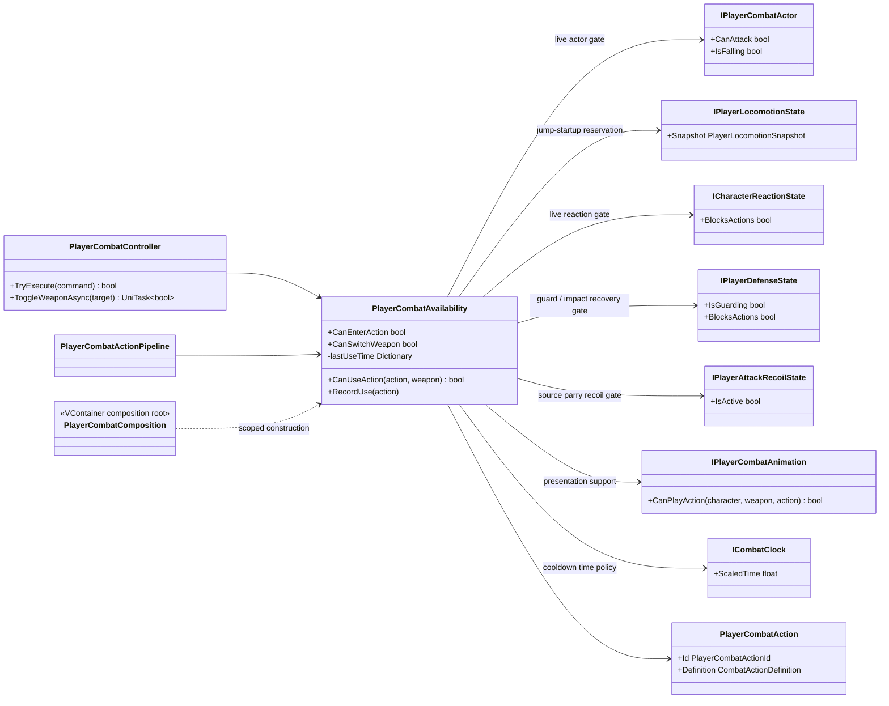

# Project S — combat action availability

## Назначение

`PlayerCombatAvailability` отвечает на узкий вопрос: можно ли сейчас принять
боевую операцию и доступна ли конкретная action. Он объединяет уже существующие
live gates, проверку semantic animation presentation и cooldown timestamps,
которые раньше хранились непосредственно в `PlayerCombatController`.

Объект не запускает action, не потребляет input buffer, не выбирает graph edge,
не меняет combat phase и не управляет Animator. `PlayerCombatActionPipeline`
координирует action admission/chain, `PlayerCombatController` сохраняет weapon
switch boundary, `PlayerCombatActionGraph` — владельцем routes, а
`IPlayerCombatAnimation` — presentation port.

## Дерево классов и зависимости

Класс остаётся в `_App/Core`: его правила используют Project S actor, reaction,
weapon и combat-action contracts. Это не универсальный модуль и не кандидат на
`_App/Modules` в текущем виде.

## Правила

`CanEnterAction` вычисляется из актуального состояния при каждом обращении:

- reaction state не блокирует действия;
- ни Guard, ни block/parry impact recovery не активны;
- source-side parry recoil не активен;
- принятый ground-jump startup ещё не подтверждён motor как takeoff;
- actor допускает атаку в текущем movement mode.

`CanBufferEntry` отделён от немедленного admission. Он отклоняет команды во
время удерживаемого Guard и после смерти, но позволяет сохранить поздний ввод
во время jump startup, hit reaction, dodge, block/parry recovery либо
source-side recoil. Команда, сохранённая во время jump startup, после takeoff
повторно разрешается уже против airborne entry rules. Она всё равно запускается
только после `CanEnterAction`; её lifetime остаётся ограничен общим unscaled
input buffer.

`CanSwitchWeapon` сохраняет отдельную политику существующего поведения:

- reaction state не блокирует действия;
- ни Guard, ни block/parry impact recovery не активны;
- source-side parry recoil не активен;
- jump/dodge startup не зарезервирован;
- locomotion не находится в активном `Dodge`;
- actor не находится в воздухе.

Проверки `targetWeapon`, combat phase и lifecycle `enabled` остаются у публичного
controller boundary и не дублируются в availability.

`CanUseAction` проверяет:

1. action существует;
2. её cooldown уже истёк по `ICombatClock.ScaledTime`;
3. текущий character/weapon animation loadout поддерживает semantic
   presentation через `IPlayerCombatAnimation.CanPlayAction`.

Graph environment, transition window и hit outcome проверяются до этого в
`PlayerCombatActionGraph`. Presentation adapter сообщает только наличие слота и
не получает authority над gameplay rules.

## Cooldown ownership

Cooldown записывается сразу после того, как semantic presentation успешно
запущена, до старта gameplay session. С этого момента action считается
committed: dodge, reaction, disable, landing или иной interruption не обходят
стоимость уже начатого действия. Если presentation slot отсутствует и action не
стартовала, timestamp не создаётся.

Dictionary принадлежит scoped `PlayerCombatAvailability` и не очищается при
обычном disable/enable controller. Он исчезает вместе с gameplay scope. Время
намеренно scaled: hit stop и gameplay pause не расходуют cooldown, как и раньше.

Эта модель пока не является системой ресурсов. Будущие stamina/mana costs,
attributes, modifiers и regeneration должны иметь собственного owner согласно
`Character.StatsAndResources.md`; availability сможет читать их узкий контракт,
но не будет хранить второй экземпляр ресурсов.
