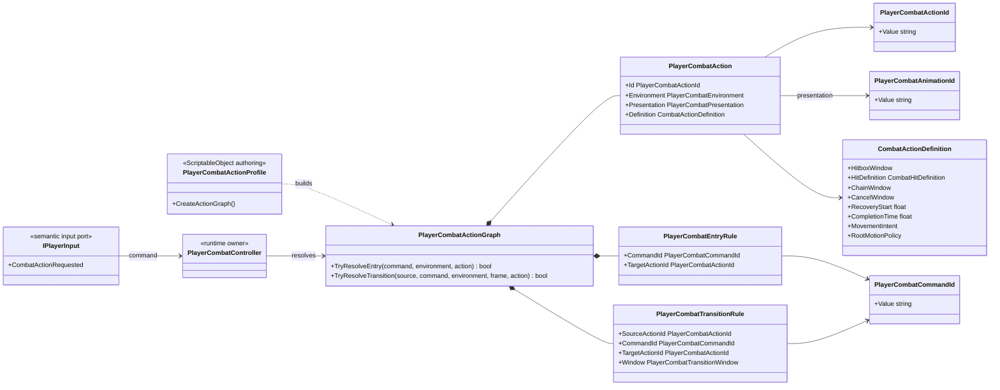

# Project S — Combat Action Model

## Ответственность

`PlayerCombatActionGraph` описывает доступные действия игрока и разрешённые переходы между ними. Он находится в `_App/Core`, потому что команды, moveset, наземные и воздушные ветки являются правилами конкретной игры.

Граф не читает устройства ввода, не запускает Animator, не хранит прогресс атаки и не меняет состояние персонажа. Его вход — семантическая команда, окружение и подтверждённый `CombatActionFrame`; выход — конкретный `PlayerCombatAction`.

## Дерево классов



## Команда, действие и presentation

- `PlayerCombatCommandId` отвечает на вопрос «что запросил игрок»: `attack.light`, `attack.heavy`, `skill.special` и будущие `launcher`, `item.use`.
- `PlayerCombatActionId` идентифицирует узел moveset: `combo.0`, `combo.1`, `air.combo.0`.
- `PlayerCombatAnimationId` выбирает named animation slot (`attack.heavy`, `skill.special`) и не определяет gameplay transition.
- `PlayerCombatPresentation` сообщает animation adapter, как отобразить уже выбранное действие: combo index либо named `PlayerCombatAnimationId`.
- `CombatActionDefinition` хранит immutable timeline и impact: hitbox, damage, stagger, knockback, reaction id, chain/cancel, recovery, movement, invulnerability, commit, completion и cooldown.
- `CombatActionExecutor` удерживает отдельный damage-immunity lease только внутри authored invulnerability window. Он не восстанавливает сохранённый boolean, поэтому не может снять иммунитет, которым одновременно владеет dodge или другой gameplay flow.

Одна команда может иметь несколько entry/transition rules, если целевые actions принадлежат непересекающимся environment masks. Поэтому `attack.light` может выбирать отдельные наземную и воздушную ветки без проверки платформы или устройства в gameplay-коде. Неоднозначные правила с пересекающимися masks отклоняются при построении graph.

## Authoring и prototype fallback

`PlayerCombatActionProfile` содержит только graph authoring: actions, entries и transitions. Параллельного legacy catalog больше нет. Пока profile не назначен, composition создаёт небольшой prototype graph:

- default input входит в первый combo step;
- следующий combo step требует `ChainWindow`;
- переход к skill требует `CancelWindow`;
- skill может вернуться к первой combo action через `CancelWindow`;
- prototype создаёт ограниченный запас combo nodes, а animation adapter определяет реально доступное число через `ComboCount`; поэтому graph строится до `Enable/ApplyLoadout`, не теряет будущие steps и безопасно поддерживает skill-only loadout.

ScriptableObject хранит только authoring data. Очередь input, текущая action, cooldown timestamps и progress timeline принадлежат scoped runtime objects.

### Текущая конфигурация Player

`Assets/_Game/Settings/Combat/Player/PlayerCombatActionProfile.asset` назначен на
`Assets/_Game/Prefabs/Character/Player.prefab` и является штатным authoring-профилем игрока.
Он содержит две environment-specific ветки команды `attack.light` и одну
named action:

- три наземных actions `combo.ground.0 → 1 → 2`;
- три воздушных actions `combo.air.0 → 1 → 2`;
- самостоятельную наземную `attack.heavy`, доступную entry и из cancel window
  любого наземного light-combo step;
- наземную `skill.special`, доступную отдельным entry и из cancel window любого
  наземного light-combo step; её cancel window возвращает в `combo.ground.0`.

Grounded и Airborne entries не конфликтуют: `PlayerCombatActionGraph` выбирает
ветку по подтверждённому movement mode персонажа. Поэтому `attack.heavy` и
`skill.special` отклоняются в воздухе без проверки Animator или устройства ввода.

Input buffer настроен на четыре команды и при переполнении отбрасывает действие с
наименьшим приоритетом. `attack.light` использует default priority `0`,
`attack.heavy` — `10`, `skill.special` — `20`; named commands обновляют одну
совпавшую запись вместо накопления дублей. Planar и vertical combat motion описываются
в action definition и исполняются через character motor с разрешением столкновений.
Текущие timings, damage и distances являются стартовыми tuning values. Воздушная
ветка ограничивает падение до `-1.5 m/s` только внутри combat-motion window; после
окна gravity снова полностью принадлежит character motor. Gameplay graph не хранит
ссылки на клипы: animation adapter передаёт ground/air combo index либо
`PlayerCombatAnimationId` и ожидаемую длительность в общий Animator contract.
Текущий `attack.heavy` отображается существующим `BaseAttack4`, а
`skill.special` — `Base Layer.Attack.Skill`; hit/cancel/cooldown остаются
gameplay-authoring data. Heavy и special могут переходить друг в друга только
через собственные cancel windows.

## Зависимости

Разрешено:

```text
PlayerInputAdapter -> PlayerCombatCommandId
PlayerCombatController -> PlayerCombatActionGraph
PlayerCombatActionGraph -> CombatActionDefinition
PlayerCombatActionProfile -> PlayerCombatActionGraph (build only)
```

Запрещено:

```text
PlayerCombatActionGraph -> Unity Input System / Animator / Character / Cinemachine
PlayerCombatActionProfile -> runtime progress
_App/Modules -> Project S combat ids or graph
```

Граф остаётся game-specific. Обобщать его в `_App/Modules` следует только после появления второго реального consumer с совпадающей стабильной границей.
