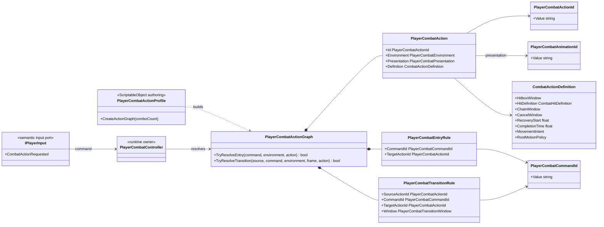

# Project S — Combat Action Model

## Ответственность

`PlayerCombatActionGraph` описывает доступные действия игрока и разрешённые переходы между ними. Он находится в `_App/Core`, потому что команды, moveset, наземные и воздушные ветки являются правилами конкретной игры.

Граф не читает устройства ввода, не запускает Animator, не хранит прогресс атаки и не меняет состояние персонажа. Его вход — семантическая команда, окружение и подтверждённый `CombatActionFrame`; выход — конкретный `PlayerCombatAction`.

## Дерево классов



## Команда, действие и presentation

- `PlayerCombatCommandId` отвечает на вопрос «что запросил игрок»: `attack.light`, `skill.special` и будущие `attack.heavy`, `launcher`, `item.use`.
- `PlayerCombatActionId` идентифицирует узел moveset: `combo.0`, `combo.1`, `air.combo.0`.
- `PlayerCombatAnimationId` выбирает named animation slot (`skill.special`) и не определяет gameplay transition.
- `PlayerCombatPresentation` сообщает animation adapter, как отобразить уже выбранное действие: combo index либо named `PlayerCombatAnimationId`.
- `CombatActionDefinition` хранит immutable timeline и impact: hitbox, damage, stagger, knockback, reaction id, chain/cancel, recovery, movement, invulnerability, commit, completion и cooldown.

Одна команда может иметь несколько entry/transition rules, если целевые actions принадлежат непересекающимся environment masks. Поэтому `attack.light` может выбирать отдельные наземную и воздушную ветки без проверки платформы или устройства в gameplay-коде. Неоднозначные правила с пересекающимися masks отклоняются при построении graph.

## Authoring и prototype fallback

`PlayerCombatActionProfile` содержит только graph authoring: actions, entries и transitions. Параллельного legacy catalog больше нет. Пока profile не назначен, composition создаёт небольшой prototype graph:

- default input входит в первый combo step;
- следующий combo step требует `ChainWindow`;
- переход к skill требует `CancelWindow`;
- skill может вернуться к первой combo action через `CancelWindow`;
- prototype создаёт ограниченный запас combo nodes, а animation adapter определяет реально доступное число через `ComboCount`; поэтому graph строится до `Enable/ApplyLoadout`, не теряет будущие steps и безопасно поддерживает skill-only loadout.

ScriptableObject хранит только authoring data. Очередь input, текущая action, cooldown timestamps и progress timeline принадлежат scoped runtime objects.

## Зависимости

Разрешено:

```text
PlayerInputAdapter -> PlayerCombatCommandId
PlayerCombatController -> PlayerCombatActionGraph
PlayerCombatActionGraph -> CombatActionDefinition
PlayerCombatActionProfile -> PlayerCombatActionGraph (build only)
```

Запрещено:

```text
PlayerCombatActionGraph -> Unity Input System / Animator / Character / Cinemachine
PlayerCombatActionProfile -> runtime progress
_App/Modules -> Project S combat ids or graph
```

Граф остаётся game-specific. Обобщать его в `_App/Modules` следует только после появления второго реального consumer с совпадающей стабильной границей.
