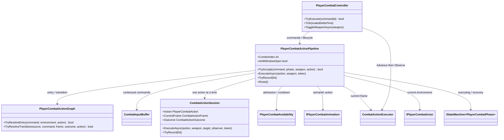
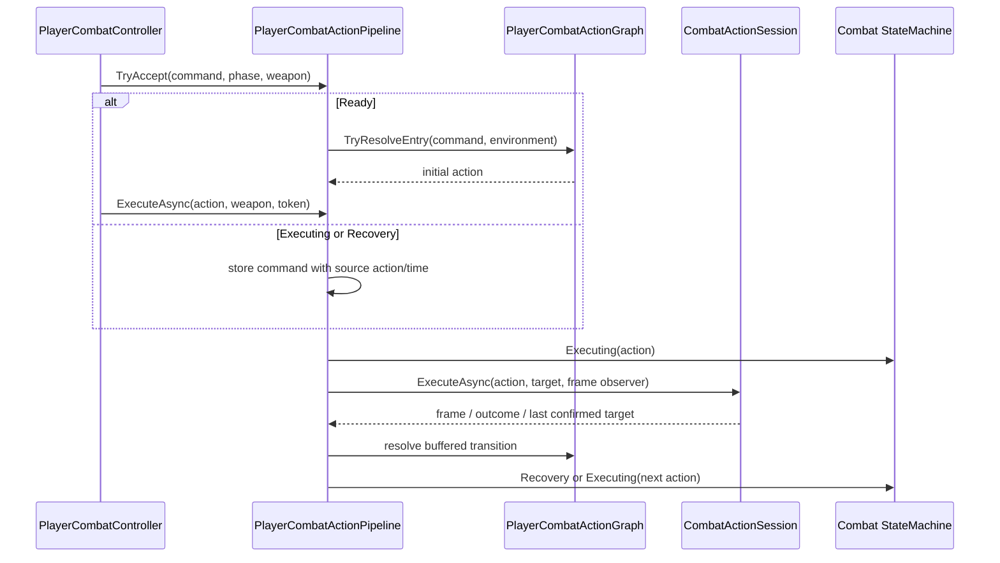

# Project S — Combat Action Pipeline

## Boundary

`PlayerCombatActionPipeline` owns the execution of an already accepted player
action and the selection of its next action. It is a scoped Core service, not a
reusable module and not an interface. Its boundary exists because graph
traversal, buffering, action-session observation and target carry form one
cohesive lifecycle that is independent from input subscriptions and weapon
switching.

## Ownership

- `PlayerCombatController` owns input/event subscriptions, the pre-tick command
  inbox, the shared operation cancellation boundary, persistent weapon state and
  weapon transitions.
- `PlayerCombatActionPipeline` owns the buffered transition candidate, combo
  index, graph entry/transition selection, action-to-action loop, landing exit
  and confirmed-target carry between launcher, air chase and air combo.
- `CombatActionSession` remains the owner of one active execution, its hitbox,
  outcome and combat motion. The pipeline does not duplicate those values.
- `CombatActionExecutor` remains the only timeline clock. The controller calls
  `Advance`, consumes queued commands through the pipeline, then calls
  `Observe`; the async pipeline never advances time itself.
- `PlayerCombatOperationLifetime` still owns cancellation across both the action
  pipeline and weapon-transition session. A late async completion cannot release
  a newer operation.

## Command and chain flow

The equipped weapon is captured when the pipeline starts. Weapon switching is
not legal during execution, so every action in one chain uses the same graph and
animation loadout context. `Reset` clears only pipeline-owned transient state;
session cancellation and presentation cancellation are performed by the shared
operation lifetime before reset.

When an airborne-only action detects a grounded actor, landing wins over a
buffered transition. The session returns `Landed`, the pipeline cancels the
finite animation and completion returns the controller to `Ready`. A late
buffered command that did not match a transition may still resolve as a fresh
entry after the current session finishes.
