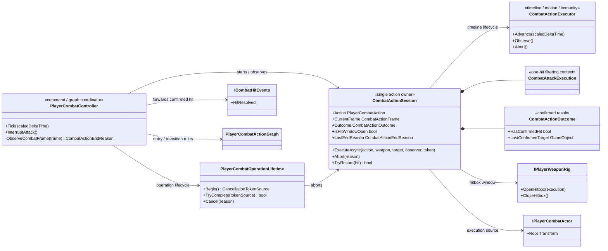
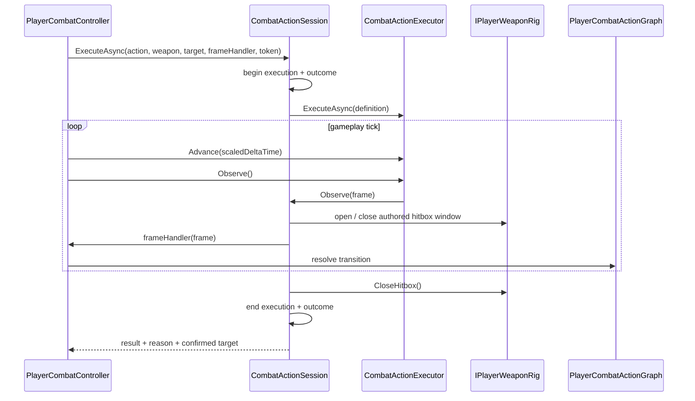

# Project S — Combat Action Session

## Назначение

`CombatActionSession` является runtime-owner одной выполняемой боевой action.
Она объединяет данные, которые обязаны начинаться и завершаться на одной
lifecycle-границе: текущую action и frame, уникальный attack execution, outcome,
hitbox window и timeline execution.

Session не выбирает следующую action, не меняет combat phase и не знает правил
combo graph. Эти решения остаются у `PlayerCombatController`. Animator также не
становится владельцем gameplay-состояния.

## Дерево классов

## Lifecycle

Начало session транзакционно: частично созданные execution/outcome закрываются,
если actor или adapter отклоняет запуск. `finally` завершает session при обычном
completion, graph transition, landing, cancellation и исключении. Поэтому
hitbox и per-action hit filtering не могут пережить свою action.

`CombatActionEndReason` описывает причину завершения без набора несогласованных
boolean flags:

- `Completed` — timeline дошёл до completion boundary;
- `Transitioned` — graph принял следующую action;
- `Landed` — airborne-only action потеряла допустимый environment;
- `Reaction`, `Interrupted`, `Cancelled`, `Disabled` — внешние lifecycle boundaries;
- `Failed` — запуск или выполнение завершились исключением.

Последняя подтверждённая цель копируется в immutable result до очистки outcome.
Это позволяет переносить цель из launcher в air chase, не оставляя mutable
outcome жить между actions.

## Границы зависимостей

- Session находится в `_App/Core`: она использует Project S action, actor и
  weapon contracts и пока не является кандидатом в `_App/Modules`.
- `PlayerCombatController` не открывает hitbox и не создаёт execution id.
- `CombatActionExecutor` не знает о combo graph, weapon rig и confirmed hits.
- Weapon draw/sheathe не создаёт damage execution и намеренно не входит в
  `CombatActionSession`; это отдельный equipment transition на том же
  сериализованном timeline executor.
- Session и `PlayerCombatOperationLifetime` создаются `PlayerCombatComposition`
  в gameplay scope через VContainer. Общая cancellation boundary описана в
  `Docs/Architecture/Combat.OperationLifetime.md`.
