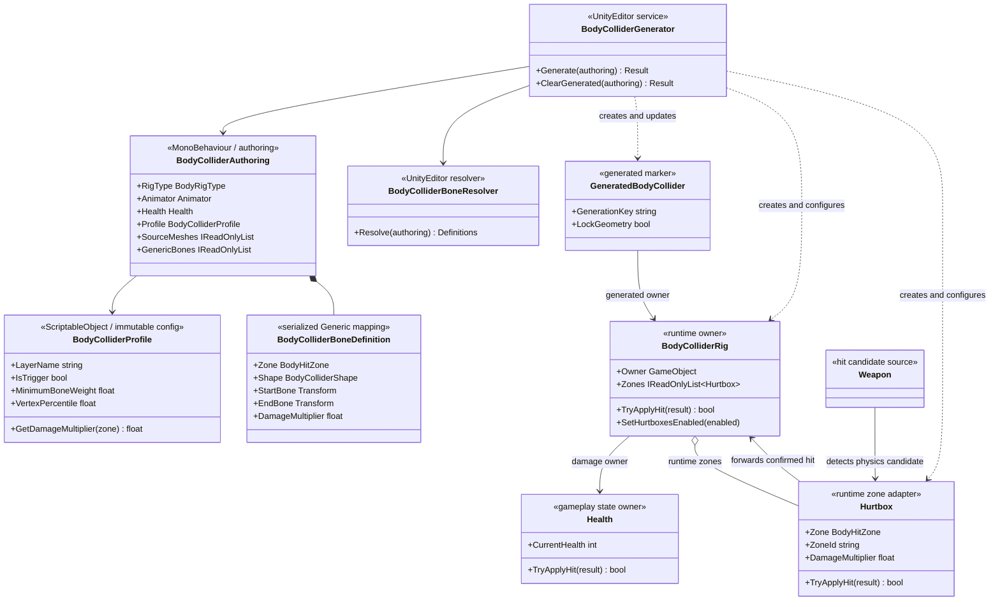

# Combat Body Colliders

## Назначение

Система создаёт составной набор боевых `hurtbox`-коллайдеров для персонажа или существа. Она одинаково используется игроком, противником и другими damageable actors: различается только authoring-конфигурация скелета.

Система не заменяет:

- корневой `CapsuleCollider`, который использует `CharacterMovement` для навигации и столкновений с миром;
- weapon hitbox, который активируется атакой;
- ragdoll colliders и joints;
- точную collision mesh, если она действительно нужна отдельной механике.

Generated body colliders являются trigger-зонами попадания и следуют за костями анимации. Они не участвуют в locomotion physics.

## Дерево классов



## Направление зависимостей

```text
Editor generation -> Runtime authoring data -> generated primitive colliders
Weapon -> CombatHitResolver -> Hurtbox -> BodyColliderRig -> Health
CharacterMovement -> root CapsuleCollider                 (отдельная ветка)
Animator bones -> generated collider transforms           (presentation pose)
```

- Runtime-классы не зависят от `UnityEditor`.
- Gameplay не знает, был скелет импортирован как Humanoid или Generic.
- `Health` остаётся единственным owner здоровья.
- `Hurtbox` владеет только метаданными зоны и передаёт подтверждённый `CombatHitResult` в `BodyColliderRig`; multiplier зоны применяет `CombatHitResolver`.
- `GeneratedBodyCollider` — маркер владения для безопасной повторной генерации. Очистка никогда не удаляет неизвестные или пользовательские colliders.
- VContainer здесь не применяется: объекты принадлежат prefab/scene и связаны явными serialized references. DI container не улучшил бы эту локальную границу.

## Поддерживаемые модели

### Humanoid

Для валидного Humanoid Avatar кости читаются через `Animator.GetBoneTransform`. Генерируются зоны головы, шеи, груди, живота, таза, рук, кистей, ног и стоп. Отсутствующая необязательная кость пропускается без создания повреждённого объекта.

### Generic biped

Если Avatar не Humanoid, resolver ищет распространённые названия костей: pelvis/hips, spine/chest, neck/head, upper arm/forearm/hand, thigh/calf/foot и варианты `Left/Right`, `L/R`, prefix/suffix. Этот путь покрывает текущий Generic-риг гоблина.

### Произвольный Generic rig

Для quadruped, хвоста, крыльев, щупалец или нестандартных имён используются `Generic Bones` в `BodyColliderAuthoring`. Каждая запись явно задаёт:

- стабильный id;
- стандартную либо custom-зону;
- `Capsule`, `Box` или `Sphere`;
- start/end bones;
- anchor mode, padding, radius scale и damage multiplier.

Если хотя бы одна валидная explicit mapping существует, автоматическая biped-эвристика не смешивается с ней. Поэтому один runtime-контракт поддерживает humanoid-персонажа, generic-врага и существо с произвольной топологией.

## Алгоритм генерации

1. `BodyColliderBoneResolver` преобразует Humanoid bones, Generic aliases либо explicit mappings в единые build definitions.
2. Выбранные `SkinnedMeshRenderer` один раз запекаются в текущей позе через `BakeMesh`.
3. Для каждой зоны выбираются вершины, у которых вес start bone выше `Minimum Bone Weight`.
4. `Capsule`, `Box` или `Sphere` подгоняется в локальном пространстве generated node. Для радиуса используется настраиваемый percentile, чтобы единичная выбивающаяся вершина не раздувала collider.
5. Если mesh недоступен или кость не имеет подходящих weighted vertices, применяется детерминированный fallback от длины bone segment.
6. Generated node становится дочерним объектом соответствующей кости и получает `Hurtbox`, marker и слой профиля.
7. Повторная генерация обновляет объект с тем же generation key вместо создания дубля. Устаревшие generated nodes удаляются через Undo.

Генерация выполняется только в Editor. В runtime нет skin baking, vertex traversal, LINQ или per-frame работы этой системы.

## Профиль и ручные корректировки

`BodyColliderProfile` хранит общие authoring-настройки:

- physics layer и trigger mode;
- минимальный радиус;
- порог веса кости;
- percentile подгонки;
- zone-specific radius, padding и damage multiplier.

Профиль создаётся через `Create > Project S > Combat > Body Collider Profile`. Он не хранит runtime state и может переиспользоваться несколькими актёрами.

### Текущая конфигурация Player

`Assets/_Game/Settings/Combat/Player/PlayerBodyColliderProfile.asset` назначен
`BodyColliderAuthoring` внутри `Assets/_Game/Prefabs/Character/Player.prefab`.
Authoring использует единственный Humanoid Animator `Player/TPose` и явно выбранный
`CLazyRunner` как skin-fitting source. В prefab хранятся `Health`, `BodyColliderRig`
и 17 generated hurtbox-зон; scene instance не владеет их overrides.

Корневой movement `CapsuleCollider` не является `Hurtbox`. Он отвечает только за
locomotion collisions и не конкурирует с составными зонами за первое попадание.
Отдельный пустой Animator на actor root запрещён: animation, root motion, IK и
body-collider authoring используют один `TPose` Animator.

На `GeneratedBodyCollider` можно включить `Lock Geometry`. Следующая генерация сохранит transform, тип и размеры этого collider, но продолжит обновлять owner, layer и zone metadata. Это позволяет вручную поправить проблемную область без потери правки при регенерации.

## Использование

1. Выбрать actor root с `Health` и дочерним `Animator`.
2. Выполнить `Tools > Project S > Body Colliders > Generate Selected` либо добавить `BodyColliderAuthoring` и нажать `Generate / Update` в Inspector.
3. Для Generic biped проверить результат автоматического mapping. Для нестандартного rig заполнить `Generic Bones` явно.
4. При необходимости назначить профиль и перегенерировать.
5. Включить `Lock Geometry` только на вручную скорректированных generated nodes.
6. Проверить collision matrix: `Weapon` должен взаимодействовать со слоем `Hitbox`, а locomotion/world queries — игнорировать его.

Команда `Clear Generated` удаляет только GameObjects с `GeneratedBodyCollider`. Корневой movement capsule, weapon colliders, manual colliders и сторонние компоненты не затрагиваются. Все операции поддерживают Unity Undo и создают обычные prefab overrides; автоматически применять или сохранять prefab tool не будет.

## Файлы и ownership

```text
Assets/_App/Core/Runtime/Combat/BodyColliders/
├── BodyColliderAuthoring.cs       # scene/prefab authoring references
├── BodyColliderProfile.cs         # shared immutable configuration
├── BodyColliderRig.cs             # runtime owner and Health gateway
├── BodyColliderTypes.cs           # enums and explicit Generic mapping
└── GeneratedBodyCollider.cs       # safe regeneration marker

Assets/_App/Core/Editor/BodyColliders/
├── BodyColliderAuthoringEditor.cs # Inspector workflow and warnings
├── BodyColliderBoneResolver.cs    # Humanoid/Generic resolution
└── BodyColliderGenerator.cs       # fitting, Undo and lifecycle
```

Код остаётся в `_App/Core`, поскольку damage zones, `Health` и текущий `Weapon` — контракты конкретной игры. Перенос в `_App/Modules` допустим только после стабилизации независимого hit-result API и реального повторного использования вне Project S.

## Выполненная проверка

- Current Player Humanoid: 17 zones, повторная генерация без дублей.
- Current Enemy_goblin Generic: 17 zones, автоматическое распознавание имён, повторная генерация без дублей.
- Explicit Generic synthetic rig: custom `Tail` mapping с fallback geometry.
- Слой `Hitbox` и trigger mode применены ко всем generated colliders.
- Root `CapsuleCollider` и manual collider сохраняются после generate/clear.
- Zone multiplier `2.0` преобразует базовый damage action `10` в подтверждённый `CombatHitResult.Damage = 20` у `Health`.
