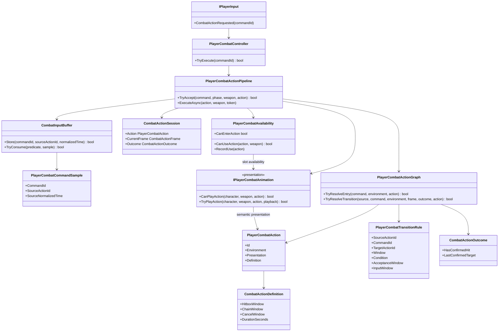

# Project S — combo graph

## Цель

Комбо строится как ориентированный граф gameplay-действий, а не как счётчик
ударов и не как набор переходов внутри Animator. Узел хранит combat timeline,
окружение и presentation slot. Ребро отвечает на вопрос: какой semantic input,
в каком окне и при каком результате текущего удара разрешает следующий узел.

## Правила разрешения перехода

Переход принимается только если одновременно выполняются условия:

1. совпали текущий action и semantic command;
2. открыт выбранный `Chain` либо `Cancel` window исходного action;
3. command sample принадлежит текущему action, а normalized time фактического
   нажатия попадает в optional `InputWindow`;
4. выполнено условие `Any`, `OnHit` либо `OnWhiff`;
5. target action поддерживает текущее окружение `Grounded/Airborne`;
6. target action доступен по cooldown и имеет animation presentation.

`InputWindow` позволяет одному вводу иметь быстрый и pause-вариант. Такие ветки
обязаны использовать непересекающиеся диапазоны. `AcceptanceWindow` при
необходимости дополнительно сужает момент исполнения внутри `Chain/Cancel`.
Профиль отклоняется при пересекающихся execution/input ranges, неоднозначном
окружении, выключенном исходном окне или выходе input-поддиапазона за completion
source action.

## Семантические команды

Схема управления не попадает в combo graph. Keyboard/mouse, gamepad и mobile UI
выдают один набор команд:

- `attack.light` — быстрый основной удар и продолжение серии;
- `attack.heavy` — силовая ветка или finisher;
- `attack.launcher` — вертикальный launcher;
- `skill.special` — оружейный special;
- dodge остаётся locomotion-командой и прерывает combat только в разрешённом
  action timeline.

Новый input pattern добавляется новым semantic command и graph route. Gameplay
не читает физическую кнопку и не просит Animator решить, какой удар следующий.

## Первый playable moveset

Первым полируется `DualSwords`. До расширения XController используются его
существующие универсальные presentation slots.

| Контекст | Ввод | Результат |
| --- | --- | --- |
| Ground | `Light → Light → Light` | основная безопасная трёхударная серия |
| Ground | `Light → pause → Light` | поздний силовой finisher через отдельный graph node |
| Ground | `Light/Light2 → Heavy` | ранний выход в тяжёлый finisher |
| Ground | `Heavy` | самостоятельный силовой удар |
| Ground, hit confirm | `Light/Light2 → Launcher → Light` | launcher, air chase и переход в aerial chain |
| Air | `Light → Light → Light` | воздушная серия с завершающим slam |
| Ground | `Special` | отдельный оружейный skill с cooldown |

Первая дополнительная ветка `Light → pause → Light` уже использует поздний
`InputWindow`: ввод, полученный до `0.63` первого action, выбирает обычный
`combo.ground.1`, а ввод в диапазоне `0.67–0.86` выбирает
`combo.ground.pause-finisher`; его `AcceptanceWindow` совпадает с поздним
диапазоном и не позволяет исполнить finisher раньше паузы. Между диапазонами
оставлен небольшой dead zone,
чтобы колебание frame time не делало выбор неоднозначным. Pause-finisher пока
переиспользует универсальный heavy presentation slot и его authored impact;
отдельный клип можно подключить позже без изменения input semantics. Hold-,
directional- и lock-on-specific команды добавляются только когда для них выбраны
клипы и подтверждена польза в combat UX.
## DualSwords vertical slice

`DualSwords.overrideController` использует `XController` как неизменяемый base
graph и заменяет только уникальные Humanoid motion slots. Общая locomotion и
реакции не зависят от оружия.

| Presentation slot | Frank Humanoid clip | Gameplay role |
| --- | --- | --- |
| `BaseAttack1` | `Frank_RPG_Dual_Combo01_1_IP` | Light 1 |
| `BaseAttack2` | `Frank_RPG_Dual_Combo01_2_IP` | Light 2 |
| `BaseAttack3` | `Frank_RPG_Dual_Combo01_3_IP` | Light 3 |
| `BaseAttack4` | `Frank_RPG_Dual_Skill03_PowerAttack_IP` | Heavy finisher |
| `Launcher` | `Frank_RPG_Dual_Air_Combo_Start_ZeroHeight_IP` | hit-confirm launcher |
| `AirAttack1...3` | `Frank_RPG_Dual_Air_Combo_1...3_ZeroHeight_IP` | aerial chain |
| `Skill` | `Frank_RPG_Dual_Skill01_WhirlWind_IP` | weapon special |
| `RollFront/Back` | `Frank_RPG_Dual_Evade_F/B_IP` | dodge presentation |

Профиль использует длительности исходных 60 FPS клипов. Hitbox windows сверены
с пиками скорости обеих кистей на общем Frank Humanoid rig: Light 1 — около
`0.36`, Light 2 — `0.27`, Light 3 — `0.23`, Heavy — `0.48`, Launcher — `0.36`
normalized time. Поэтому hitbox, chain и cancel windows принадлежат gameplay
профилю, но соответствуют видимым фазам конкретного moveset.

Все выбранные combat и dodge клипы — `InPlace`. `Animator.applyRootMotion`
остаётся выключенным: translation, air chase и target correction выполняются
через `CharacterMotor` и проходят обычные collision sweeps. Draw/Putup также не
передают root delta в gameplay.

Player стартует с `EWeaponType.DualHand`; привязанный override выбирается
`PlayerAnimatorLoadout`. `PlayerWeaponLoadout` содержит два независимых
DualSwords attachment и два capsule hitbox. Геометрия клинков пока прототипная,
но hand-hitbox fallback удалён: экипированное оружие всегда использует свои
явно настроенные hitboxes.

## Animation boundary

Animator отвечает за позу, blend и визуальный выход. Combo graph отвечает за
доступность следующего действия, buffering, hit-confirm и cancel. Все оружейные
Animator Override Controller должны сохранять одинаковые state/slot names;
конкретное оружие заменяет клипы, а его combat profile задаёт timings, damage,
motion и graph routes.

На текущем этапе XController предоставляет три ground light slot, три air light
slot, heavy, launcher mapping и special. Новые визуально уникальные ветки нельзя
подключать к уже занятому state: сначала требуется явно согласовать и добавить
универсальный presentation slot в базовый controller, после чего его смогут
override-ить все виды оружия.
