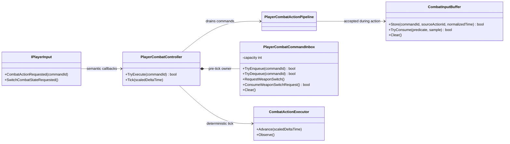

# Project S — Combat Command Inbox

## Ответственность

`PlayerCombatCommandInbox` хранит только события, пришедшие между gameplay ticks.
Он не решает, допустима ли команда, не знает текущую action и не задаёт время
жизни combo input. Контроллер дренирует inbox после продвижения combat timeline,
поэтому все semantic callbacks оцениваются относительно одного определённого
`CombatActionFrame`.

## Inbox и input buffer

- Inbox — bounded FIFO на `8` команд, живущий только до следующего gameplay tick.
- `CombatInputBuffer` — gameplay-очередь с timestamp, expiration, priority,
  duplicate policy и source action context.
- Команда переносится из inbox в buffer только когда action уже находится в
  `Executing` или `Recovery`.
- Запрос смены оружия является защёлкой, а не повторяемой очередью: несколько
  callbacks между соседними ticks дают одну попытку переключения.

Inbox принадлежит `PlayerCombatController` и не регистрируется в VContainer:
это локальная деталь порядка обработки одного controller, а не scoped service.
`Clear` атомарно удаляет команды и запрос смены оружия при disable/interruption.
