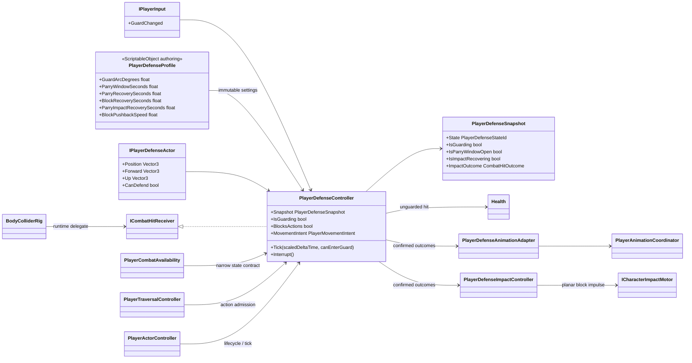
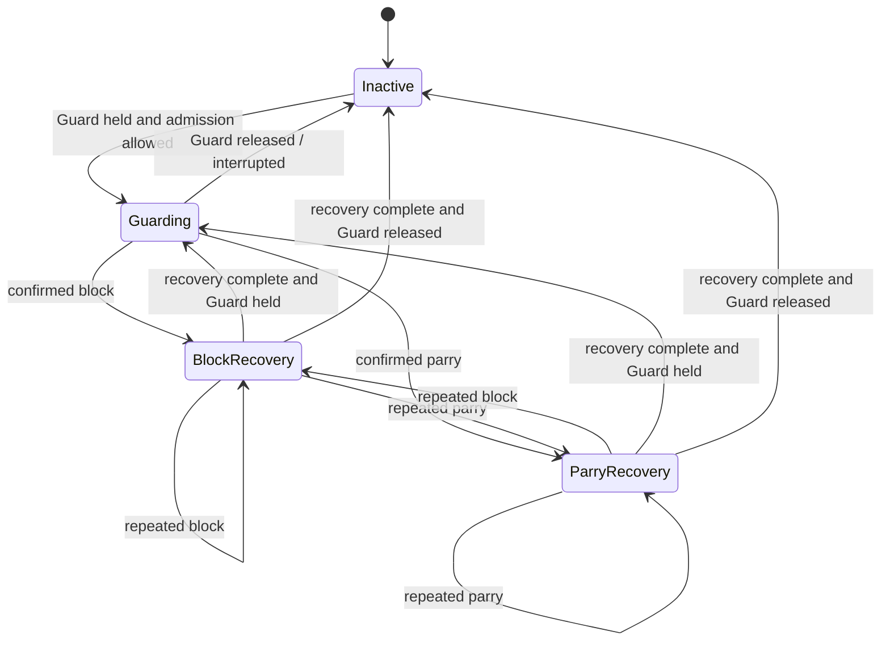

# Project S — Player Defense

## Ответственность

`PlayerDefenseController` — единственный gameplay owner удержания Guard,
направленного допуска защиты, parry window и block/parry recovery. Он принимает
предложенный `CombatHitResult` через `ICombatHitReceiver` и либо возвращает
подтверждённый `Blocked`/`Parried`, либо делегирует обычный damage текущему
`Health`. Animator, feedback и motor не принимают решение о результате удара.

## Дерево классов и зависимости

## Состояния

`PlayerDefenseSnapshot.State` всегда содержит одно приоритетное состояние.
Recovery имеет приоритет над удерживаемой защитой; `IsGuarding` отдельно сообщает,
продолжает ли игрок держать Guard. Поэтому UI и presentation не интерпретируют
противоречивую пару `Guarding + recovery`.

## Временная политика и gameplay границы

- Направление защиты проверяется в плоскости actor up по authored arc.
- Parry window и re-entry cooldown используют unscaled clock: hit stop не
  продлевает реальное окно точного ввода.
- Block/parry recovery используют scaled delta time и замораживаются вместе с
  gameplay и Animator во время hit stop.
- Одни `PlayerDefenseSettings` передаются gameplay controller и animation
  adapter, поэтому визуальная и логическая длительности совпадают.
- Block создаёт только ограниченный planar impulse через
  `ICharacterImpactMotor`; collision и фактическая позиция остаются у motor.
- Parry не двигает defender: подтверждённый outcome прерывает source action и
  запускает отдельный attacker recoil/stagger flow.
- `BlocksActions` закрывает combat, weapon switch и traversal. После отпускания
  Guard поздний combat input можно сохранить в buffer, но исполнить только после
  завершения recovery.
- Guard не является безусловным animation cancel. Из активной атаки он входит
  только при `MovementIntent.AllowGuard && CancelWindow`; до открытия окна
  удержание защёлкивается в defense owner, но не прерывает startup или hitbox.
  Из `Ready` Guard выигрывает same-frame arbitration у ещё не исполненной атаки.

## Lifecycle

- `Enable` назначает controller единственным receiver в `BodyColliderRig` и
  симметрично подписывается на semantic input и locomotion events.
- Dodge, jump, damage reaction, death и scope shutdown проходят через
  `Interrupt`, очищая guard и impact recovery в одном месте.
- `Disable` снимает receiver только если он всё ещё принадлежит этому controller;
  stale delegate после reload/destroy не остаётся.
- Presentation и pushback adapters подписаны только на подтверждённый
  `Defended`; они не могут изменить damage outcome или defense state.
- При допустимом attack cancel combat освобождает animation ownership без
  промежуточного `CancelAction` в locomotion. Следующий синхронный Defense
  request создаёт прямой `Attack -> Guard` переход в том же simulation tick.

Текущие численные значения и краткое описание runtime integration находятся в
`Assets/_App/Core/Runtime/Combat/Defense/README.md`.
