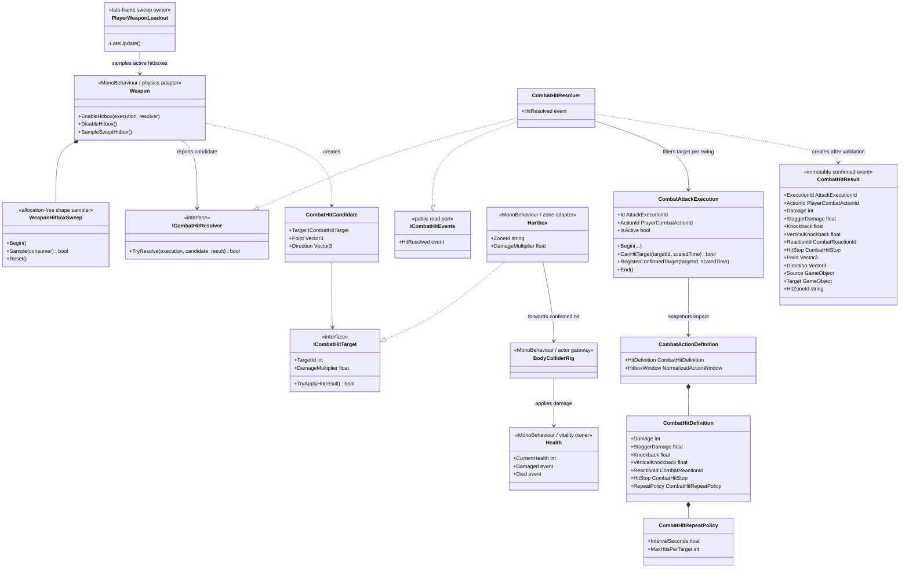
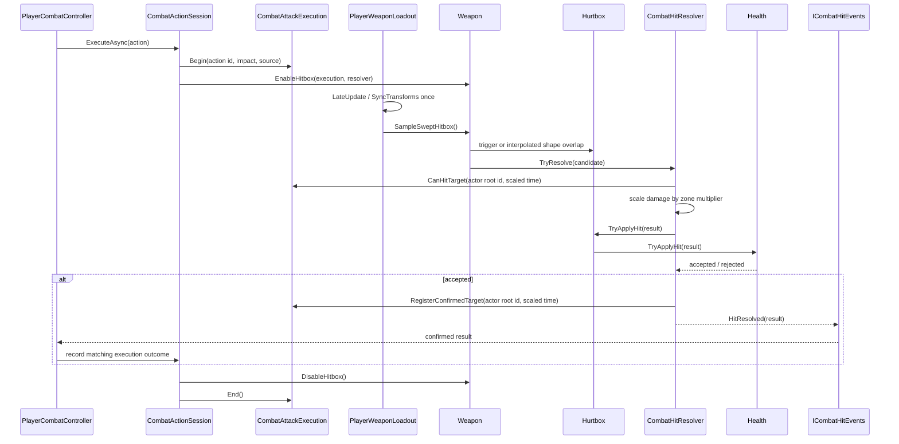

# Project S — Combat Hit Resolution

## Ответственность

Система превращает физическое пересечение weapon hitbox с `Hurtbox` в один подтверждённый `CombatHitResult`. Правила удара принадлежат выполняемому combat action, а не prefab оружия. Поэтому один и тот же `Weapon` может использоваться разными moveset без изменения компонента.

Граница решает четыре задачи:

- связывает попадание с конкретным `AttackExecutionId` и `PlayerCombatActionId`;
- применяет per-action repeat policy: по умолчанию запрещает повторно поразить
  одного actor несколькими hurtbox в рамках одного execution;
- применяет multiplier зоны к базовому damage;
- публикует событие только после того, как `Health` действительно принял удар.

Reaction и poise/stagger обрабатываются отдельным target-local consumer, описанным в `Docs/Architecture/Combat.Reactions.md`. Hit stop передаётся как immutable часть результата и обрабатывается отдельным consumer из `Docs/Architecture/Combat.HitStop.md`. VFX, audio и camera impulse пока не реализуются и не должны возвращать эти обязанности в `Weapon`.

## Дерево классов



## Поток попадания



`Health.Damaged`, `Health.Died` и глобальный для gameplay scope
`ICombatHitEvents.HitResolved` получают один и тот же immutable result. Событие
resolver означает подтверждённое попадание; overlap, иммунитет или запрещённое
repeat policy повторение событие не создают. Target record обновляется только
после принятого damage: overlap во время i-frame не «съедает» удар навсегда и
может быть повторно проверен, пока hitbox остаётся открытым.

`Health` сначала атомарно изменяет `CurrentHealth`, затем независимо публикует
`Damaged` и, при достижении нуля, `Died`. Исключение reaction/presentation
subscriber логируется и не может оставить мёртвого actor без death event;
`Revived` использует ту же изоляцию.

Подписчики `HitResolved` являются независимыми read-consumers. Исключение VFX,
audio, camera либо UI adapter логируется на source actor, но не блокирует
остальные подписки и не отменяет уже применённый damage, action outcome или hit
stop.

## Ownership и зависимости

```text
CombatActionAuthoring -> CombatActionDefinition -> CombatHitDefinition
PlayerCombatController -> CombatActionSession -> CombatAttackExecution -> IPlayerWeaponRig
Weapon -> ICombatHitResolver -> ICombatHitTarget
Hurtbox -> BodyColliderRig -> Health
ICombatHitEvents -> PlayerCombatController outcome / hit stop / future VFX / audio adapters
Health.Damaged -> target-local reaction / incoming hit stop
```

- `CombatActionSession` владеет lifecycle execution: новый id на каждое фактически запущенное action, завершение при completion, chain transition, interruption, cancellation и disable.
- `PlayerCombatController` принимает `ICombatHitEvents` и передаёт result через `PlayerCombatActionPipeline` активной session; `CombatActionOutcome` принимает только совпадающие execution/action ids. Outcome используется graph conditions и не изменяет результат damage resolution.
- `CombatAttackExecution` владеет record каждого поражённого actor root: числом
  подтверждённых попаданий и scaled time последнего. По умолчанию второй hit
  запрещён; multi-hit action должен явно задать положительный interval и bounded
  maximum. Эти records не находятся в `Weapon`, поэтому смена collider или
  несколько зон тела не меняют policy.
- `Weapon` принадлежит scene/prefab и знает только Physics, активный execution и resolver. Он не хранит damage, cooldown, combo или reaction rules.
- `WeaponHitboxSweep` интерполирует предыдущую и текущую форму
  `CapsuleCollider`, `SphereCollider` либо `BoxCollider` и выполняет bounded
  `Physics.*NonAlloc` overlaps. Поэтому быстрый клинок не зависит только от
  дискретного `OnTriggerEnter` между physics ticks.
- `PlayerWeaponLoadout` вызывает `Physics.SyncTransforms` один раз за late frame
  и только пока открыт хотя бы один hitbox, после чего семплирует все активные
  attachments. Каждый `Weapon` не запускает глобальную синхронизацию отдельно.
- Physics query имеет явный layer mask. На Player prefab это только слой
  `Hitbox`; movement capsule, environment и weapon geometry не заполняют overlap
  buffer. Переполнение bounded buffer выдаёт одно предупреждение за activation.
- `Hurtbox` предоставляет zone metadata и путь к владельцу здоровья. Он не вычисляет итог атаки.
- Текущий resolver является damage pipeline: action с включённым hitbox обязана
  иметь положительный base damage. Нулевая damage-атака не может притворяться
  рабочим hit и отклоняется при сборке profile. Будущий guard/parry либо
  stagger-only контакт должен получить отдельный явный resolver contract, а не
  обходить это правило.
- Movement capsule не является `Hurtbox`: попадания принимает только compound body rig, поэтому физический порядок overlap не подменяет выбранную зону тела.
- `Health` — единственный owner текущего здоровья и подсчёта активных immunity leases. Lease очищается идемпотентно; отключение Health инвалидирует старые leases.
- `CombatHitResolver` имеет scoped lifecycle, получает `ICombatClock` через
  composition и регистрируется только в `PlayerCombatComposition`. Scaled clock
  синхронизирует repeat interval с action timeline и не выдаёт бесплатные hits
  во время hit stop. Публичный read-port `ICombatHitEvents` не разрешает внешним
  системам создавать попадания.

## Расширение

- Новый тип оружия должен давать `CombatHitCandidate` тому же resolver; правила damage остаются в action profile.
- Projectile или area attack могут иметь собственный physics adapter и отдельный `CombatAttackExecution`, не меняя `Health` и `Hurtbox`.
- Stagger/poise consumer читает `StaggerDamage` и `ReactionId` из подтверждённого result.
- Knockback consumer интерпретирует `Knockback` как направленную составляющую,
  а `VerticalKnockback` как знаковую скорость вдоль
  `ICharacterImpactMotor.Up`: положительное значение запускает цель вверх,
  отрицательное выполняет slam вниз.
  Разделение не заставляет resolver или weapon угадывать вертикаль из геометрии
  overlap; обе составляющие применяются одним target-local motor impact.
- Исходящий hit stop и outcome текущего player action подписываются на `ICombatHitEvents`, входящий hit stop — на target-local `Health.Damaged`. Future VFX, audio и camera adapters также потребляют подтверждённый result и не участвуют в расчёте damage.

Система остаётся в `_App/Core`: `PlayerCombatActionId`, damage rules и ожидаемые reactions являются правилами Project S. Извлечение в `_App/Modules` возможно только после второго реального consumer и стабилизации game-agnostic контракта.
