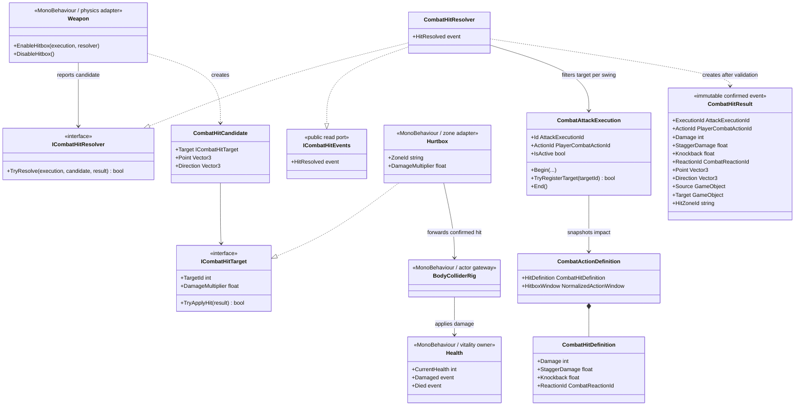
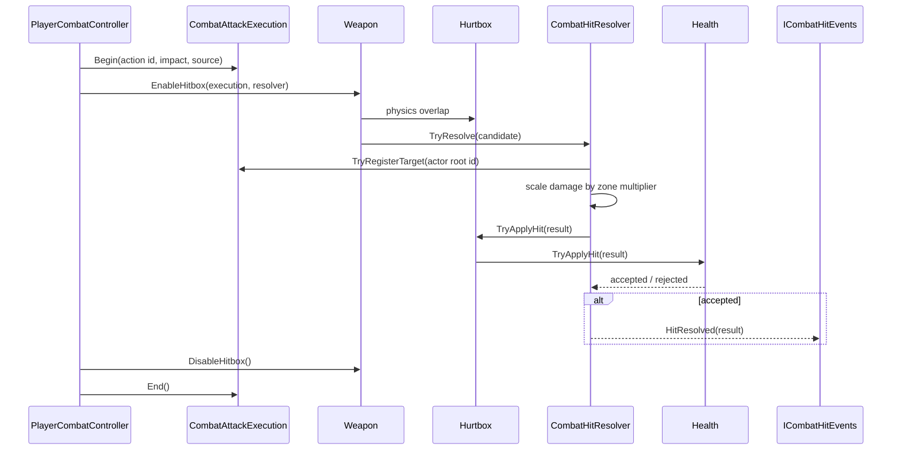

# Project S — Combat Hit Resolution

## Ответственность

Система превращает физическое пересечение weapon hitbox с `Hurtbox` в один подтверждённый `CombatHitResult`. Правила удара принадлежат выполняемому combat action, а не prefab оружия. Поэтому один и тот же `Weapon` может использоваться разными moveset без изменения компонента.

Граница решает четыре задачи:

- связывает попадание с конкретным `AttackExecutionId` и `PlayerCombatActionId`;
- запрещает повторно поразить одного actor несколькими hurtbox в рамках одного execution;
- применяет multiplier зоны к базовому damage;
- публикует событие только после того, как `Health` действительно принял удар.

Hit reaction, poise/stagger state, hit stop, VFX, audio и camera impulse пока не реализуются. Они должны подписываться на подтверждённый результат и не возвращать эти обязанности в `Weapon`.

## Дерево классов



## Поток попадания



`Health.Damaged`, `Health.Died` и глобальный для gameplay scope `ICombatHitEvents.HitResolved` получают один и тот же immutable result. Событие resolver означает подтверждённое попадание; overlap, иммунитет или уже поражённая в этом execution цель событие не создают.

## Ownership и зависимости

```text
CombatActionAuthoring -> CombatActionDefinition -> CombatHitDefinition
PlayerCombatController -> CombatAttackExecution -> IPlayerWeaponRig
Weapon -> ICombatHitResolver -> ICombatHitTarget
Hurtbox -> BodyColliderRig -> Health
ICombatHitEvents -> reaction / hit stop / VFX / audio adapters (следующие системы)
```

- `PlayerCombatController` владеет lifecycle execution: новый id на каждое фактически запущенное action, завершение при completion, chain transition, interruption, cancellation и disable.
- `CombatAttackExecution` владеет множеством уже поражённых actor root. Оно не находится в `Weapon`, поэтому смена collider или несколько зон тела не меняют правило одного попадания.
- `Weapon` принадлежит scene/prefab и знает только Physics, активный execution и resolver. Он не хранит damage, cooldown, combo или reaction rules.
- `Hurtbox` предоставляет zone metadata и путь к владельцу здоровья. Он не вычисляет итог атаки.
- `Health` — единственный owner текущего здоровья и immunity check.
- `CombatHitResolver` имеет scoped lifecycle и регистрируется только в `PlayerCombatComposition`. Публичный read-port `ICombatHitEvents` не разрешает внешним системам создавать попадания.

## Расширение

- Новый тип оружия должен давать `CombatHitCandidate` тому же resolver; правила damage остаются в action profile.
- Projectile или area attack могут иметь собственный physics adapter и отдельный `CombatAttackExecution`, не меняя `Health` и `Hurtbox`.
- Stagger/poise consumer читает `StaggerDamage` и `ReactionId` из подтверждённого result.
- Knockback consumer интерпретирует `Knockback` вместе с нормализованным `Direction`, но применяет движение через предназначенный motor intent.
- Hit stop, VFX, audio и camera adapters подписываются на `ICombatHitEvents`; они не участвуют в подтверждении damage.

Система остаётся в `_App/Core`: `PlayerCombatActionId`, damage rules и ожидаемые reactions являются правилами Project S. Извлечение в `_App/Modules` возможно только после второго реального consumer и стабилизации game-agnostic контракта.
