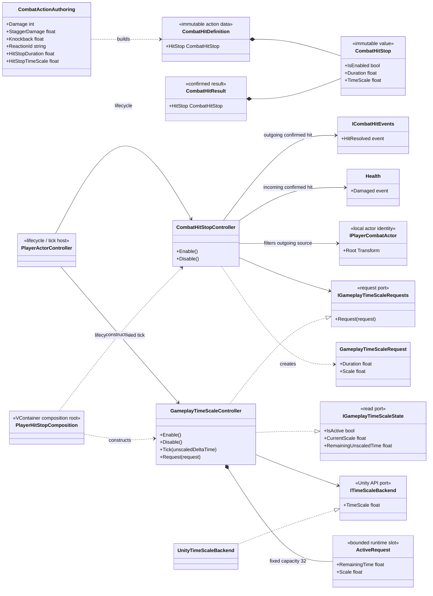
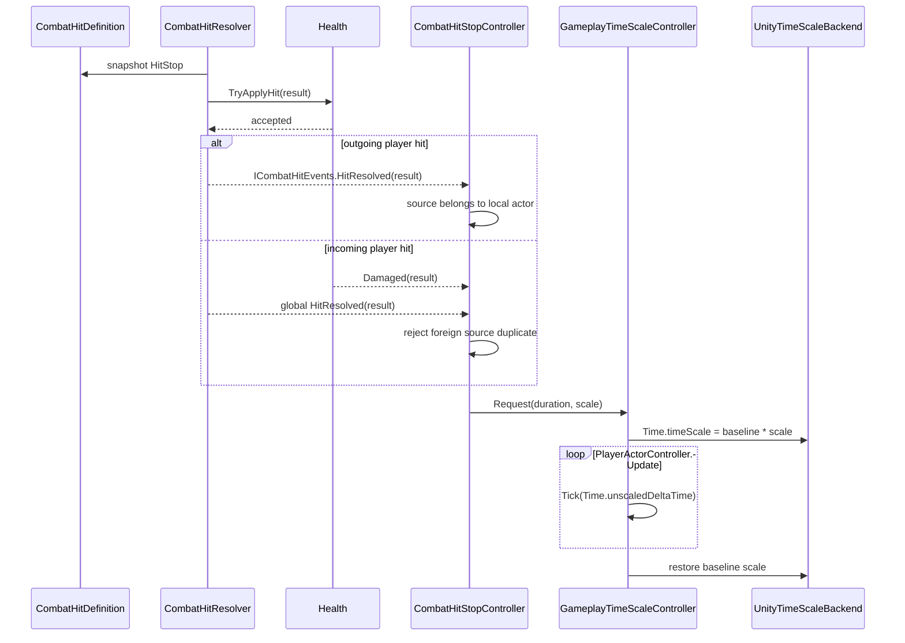

# Project S — Combat Hit Stop и Gameplay Time

## Ответственность

Система создаёт короткую остановку или замедление gameplay после подтверждённого попадания. Настройка эффекта принадлежит конкретному `CombatHitDefinition`, а не оружию, Animator или target reaction. `CombatHitStopController` только адаптирует входящие и исходящие `CombatHitResult` к единому владельцу `Time.timeScale` — `GameplayTimeScaleController`.

Текущая граница решает следующие задачи:

- hit stop возникает только после принятого `Health` попадания;
- один и тот же путь работает для удара игрока и входящего урона игроку;
- global hit stream фильтруется по source игрока, поэтому входящий hit не создаёт второй request после `Health.Damaged`;
- duration измеряется unscaled time и завершается даже при `Time.timeScale == 0`;
- overlapping запросы сохраняют собственные duration/scale и корректно ослабевают по мере истечения;
- исходный scale гарантированно восстанавливается при завершении, disable, dispose или выгрузке gameplay scope;
- прямые записи в `Time.timeScale` из Combat, Animation, Camera и VFX не требуются.

Система пока не управляет audio pitch, camera impulse, VFX policy и UI pause. Это отдельные presentation consumers.

## Дерево классов и зависимости

## Поток попадания

`Weapon` не знает о hit stop. Он сообщает physics-кандидата; только принятый resolver/Health результат может создать freeze.

## Агрегация запросов

`GameplayTimeScaleController` хранит до 32 независимых активных request в заранее выделенных slots:

- каждый request уменьшает собственный remaining duration по unscaled clock;
- effective scale в текущем кадре равен минимуму scale ещё живых request;
- `RemainingUnscaledTime` показывает максимальное оставшееся время среди них;
- `0` означает полный freeze, `0.5` — половинную скорость, `1` — отсутствие замедления;
- когда сильный короткий freeze истёк, более длинный слабый slow продолжает работу со своим scale;
- после последнего request восстанавливается scale, захваченный при `Enable`.

Массив создаётся вместе с controller, но `Request` и `Tick` не создают коллекций. Если одновременно живы более 32 эффектов, controller один раз сообщает saturation и консервативно объединяет новый request с самым коротким: берёт больший duration и меньший scale. Обычный combat flow до этой ветки не доходит. Если появятся cutscene/menu/ability time domains с разными приоритетами, они должны расширить единого owner, а не писать в `Time.timeScale` параллельно.

## Time policy

| Система | Clock во время hit stop | Поведение |
|---|---|---|
| Combat action executor | `Time.deltaTime` | timeline и hit/cancel windows заморожены |
| Character physics | `FixedUpdate` / scaled time | simulation заморожена при scale `0` |
| Обычный Animator | scaled Unity time | текущая поза заморожена |
| Character reaction duration | scaled delta | hit-stun не истекает во время freeze |
| Combat input buffer | `Time.unscaledTime` | продолжает принимать input и истекает в реальном времени |
| Camera input/tracking | unscaled delta | камера остаётся отзывчивой |
| Camera presentation smoothing | scaled delta | gameplay-dependent smoothing заморожен |
| UI | Unity UI / unscaled presentation | остаётся доступным; отдельная pause policy пока отсутствует |

Эта политика не является побочным эффектом случайного выбора clock: `ThirdPersonController` передаёт в `PlayerActorController` одновременно scaled и unscaled delta time.

## Authoring и defaults

`CombatActionAuthoring` хранит `Hit Stop Duration` и `Hit Stop Time Scale` рядом с damage/stagger/knockback. Duration `0` отключает эффект. Prototype action по умолчанию использует `0.06s` и scale `0`, поэтому текущая сцена не требует нового asset или Inspector wiring.

Существующие serialized action assets, в которых новых полей ещё нет, безопасно получают disabled/default значение до явной настройки. Сцены, prefabs и Animator Controller системой не изменяются.

## Lifecycle и границы

- `GameplayTimeScaleController.Enable` захватывает baseline scale; `Disable` и `Dispose` всегда его восстанавливают.
- `GameplayTimeScaleRequest` отклоняет неположительные и не finite duration,
  а также scale вне `0...1` или `NaN/Infinity`. `Tick` аналогично отклоняет
  не finite delta, поэтому повреждённое числовое значение не может рассинхронизировать
  fixed-capacity slots и `_activeRequestCount`.
- `CombatHitStopController.Enable/Disable` симметрично управляет двумя target-specific subscriptions.
- `ICombatHitEvents` является global resolver stream, поэтому его callback принимает только result, чей `Source` равен local actor root либо является его дочерним объектом. Входящий hit приходит через local `Health.Damaged` ровно один раз.
- VContainer registrations находятся только в `PlayerHitStopComposition`; runtime-код не вызывает `Resolve`.
- `PlayerActorController` запускает time owner до gameplay consumers и отключает его последним.
- `UnityTimeScaleBackend` — единственная реализация, которая обращается к `UnityEngine.Time.timeScale`.
- Код остаётся в `_App/Core`: общая time-scale граница пока имеет только один реальный gameplay consumer. После появления cutscene/ability/global pause consumers можно отдельно оценить извлечение стабильного ядра в `_App/Modules`.
