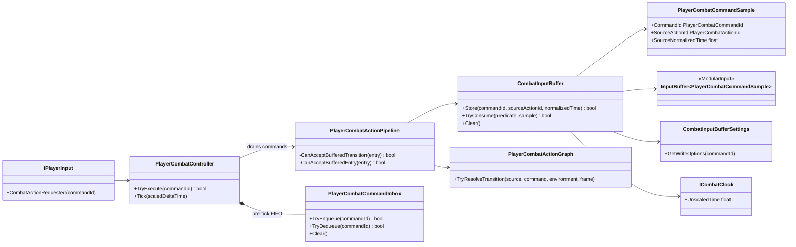

# Project S — Combat Input Buffer

## Граница

`ModularInput.InputBuffer<TAction>` — нейтральная очередь semantic actions. `_App.CombatInputBuffer` адаптирует её к `PlayerCombatCommandSample`, unscaled combat clock и authoring-настройкам Project S.

Raw keyboard, gamepad и будущий mobile UI не попадают в buffer: каждый input source сначала преобразуется в одинаковую команду через `IPlayerInput`.

## Ownership и consumption

Input callback сначала попадает в bounded `PlayerCombatCommandInbox` и не меняет
combat state. В gameplay tick executor продвигается на переданный
scaled delta time, затем controller передаёт pending commands в pipeline и только после
этого наблюдает новый `CombatActionFrame`. Если action уже выполняется,
`sourceNormalizedTime` берётся непосредственно из `CombatActionExecutor.CurrentFrame`.
Поэтому нажатие на границе окна оценивается относительно одного явно
продвинутого frame, а не относительно последнего callback или продолжения async
метода.

Buffer хранит команду, action-источник, normalized time получения, timestamp,
expiration, priority и duplicate policy. Он не решает, какая action следует за
текущей. При каждом `CombatActionFrame` pipeline передаёт predicate, а graph
проверяет одновременно:

- получена ли команда во время того же source action;
- существует ли transition из текущей action по этой команде;
- открыт ли требуемый `ChainWindow` или `CancelWindow`;
- попадает ли время фактического нажатия в optional `InputWindow`;
- подходит ли target action текущему Grounded/Airborne environment;
- доступна ли presentation и завершён ли cooldown.

Только прошедшая все проверки команда атомарно выбирается как successor.
Принятый graph edge является transaction boundary: после выбора pipeline удаляет
остальные samples завершившегося source action. Один action не может заранее
запрограммировать несколько будущих узлов, а лишний mash-input не просачивается
через следующий combo step и не перезапускает цепочку с entry. Expiration
использует unscaled time, поэтому ввод сохраняет предсказуемый lifetime во время
hit stop. Cooldown actions использует scaled gameplay time.

Если transition был принят на catch-up hitbox pulse, его применение откладывается
на один frame ради `LateUpdate` sweep. Команды, пришедшие в этот короткий
интервал, всё ещё имеют старый `SourceActionId` и очищаются при commit edge.
Внешний подтверждённый `Guard/Dodge/Jump` не является graph transition и имеет
приоритет над catch-up hit: отменённая игроком атака не выдаёт позднее попадание.

На completion boundary команда, которая не стала transition, но всё ещё жива,
повторно проверяется через entry rules графа для актуального Grounded/Airborne
environment. Это сохраняет поздний recovery input для следующей допустимой
цепочки. Неподдерживаемая presentation, активный cooldown и несовместимый
environment по-прежнему не позволяют потребить команду.

## Конфигурация

`CombatInputBufferAuthoring` задаёт capacity, overflow, selection, lifetime, priority и duplicate rules. Override адресуется строковым semantic command id (`attack.light`, `attack.heavy`, `skill.special`). Добавление новой команды не требует изменения generic `InputBuffer<TAction>`.

Здесь же лежит `ChargeHoldSeconds` — порог, после которого удержание тяжёлой атаки превращается в `attack.heavy.charged`. Это настройка ввода, а не свойство конкретного действия, поэтому она одна на loadout, а не на каждый `CombatActionDefinition`. Порог применяет `CombatChargeTracker`, описанный в `Input.Player.md`.

Настройки являются обязательной частью назначенного `PlayerCombatActionProfile`.
Runtime не подменяет отсутствующий authoring скрытым набором prototype defaults:
неполный профиль отклоняется при сборке gameplay scope/валидации asset.

Текущий slasher profile использует capacity `4`, `DropLowestPriority` и
`HighestPriorityThenOldest`. Default light input имеет priority `0` и допускает
несколько последовательных записей-кандидатов в пределах текущего action, но
после принятия одного successor остальные кандидаты этого source очищаются.
`attack.heavy` имеет priority
`10`, `skill.special` — `20`; обе named-команды используют `RefreshMatching`,
поэтому повторное нажатие продлевает одну pending command, но не программирует
несколько будущих heavy/special actions. Приоритет влияет только на выбор среди
одновременно допустимых buffered commands и не обходит graph transition,
environment, presentation или cooldown gates.

`RefreshMatching` обновляет не только lifetime/priority, но и sample последнего
повторного нажатия. Поэтому timing-gate всегда читает актуальный input context,
а не normalized time первого нажатия. Если edge не был принят, на completion
одна ещё живая команда может пройти отдельное entry rule как независимый ввод;
после такого handoff остальные samples завершённого source также очищаются.

У первых двух ground light actions начало `CancelWindow` выровнено с началом
`ChainWindow`. Благодаря этому light и named commands становятся кандидатами в
одном frame, и priority policy действительно разрешает их конфликт, а не
проигрывает более позднему открытию cancel window.

Ориентиры для playtest, не жёсткие пресеты:

| Форма боя | Capacity | Selection | Типичный lifetime |
|---|---:|---|---:|
| Hack and Slash | 3–6 | OldestFirst | 0.25–0.40 s |
| Souls-like | 1–2 | NewestFirst | 0.10–0.25 s |
| Action RPG | 2–4 | HighestPriorityThenOldest | 0.15–0.35 s |

Обе очереди очищаются при disable и interruption. Их различия и pre-tick
ownership подробно описаны в `Docs/Architecture/Combat.CommandInbox.md`.
Gameplay input buffer также
очищается при завершении всего action pipeline; внутри pipeline он сохраняется
между завершившимся action и новым action,
принятым через transition либо completion entry handoff. Dodge остаётся отдельным
locomotion event, но его допустимость берётся из `AllowDodge && CancelWindow`
текущего combat action. Прыжок использует симметричную policy
`AllowJump && CancelWindow`: наземный прыжок прерывает combat после принятия
jump startup (`GroundJumpIntentAccepted`), а `JumpAccepted` подтверждает
фактический motor jump. Пока startup активен, новая action не входит немедленно:
её Ready-entry сохраняется и после takeoff переоценивается в `Airborne`
environment. `JumpAccepted` не очищает такой buffer, если combat уже `Ready`, но
прерывает реально активную action. Перенос dodge/item/jump в единый action graph
не требуется, пока им не нужны собственные ветвящиеся transitions и buffering
semantics.
Guard является удерживаемым semantic input, а не элементом combat buffer. Во
время action он допускается по независимой policy
`AllowGuard && CancelWindow`; до открытия окна удержание сохраняется у defense
owner и не обрывает startup либо hitbox.
