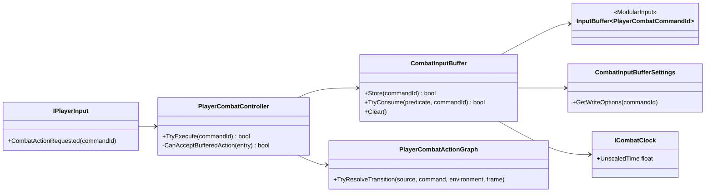

# Project S — Combat Input Buffer

## Граница

`ModularInput.InputBuffer<TAction>` — нейтральная очередь semantic actions. `_App.CombatInputBuffer` адаптирует её к `PlayerCombatCommandId`, unscaled combat clock и authoring-настройкам Project S.

Raw keyboard, gamepad и будущий mobile UI не попадают в buffer: каждый input source сначала преобразуется в одинаковую команду через `IPlayerInput`.

## Ownership и consumption

Buffer хранит команду, timestamp, expiration, priority и duplicate policy. Он не решает, какая action следует за текущей. При каждом `CombatActionFrame` controller передаёт predicate, а graph проверяет одновременно:

- существует ли transition из текущей action по этой команде;
- открыт ли требуемый `ChainWindow` или `CancelWindow`;
- подходит ли target action текущему Grounded/Airborne environment;
- доступна ли presentation и завершён ли cooldown.

Только прошедшая все проверки команда атомарно удаляется из очереди. Expiration использует unscaled time, поэтому ввод сохраняет предсказуемый lifetime во время hit stop. Cooldown actions использует scaled gameplay time.

## Конфигурация

`CombatInputBufferAuthoring` задаёт capacity, overflow, selection, lifetime, priority и duplicate rules. Override адресуется строковым semantic command id (`attack.light`, `skill.special`). Добавление новой команды не требует изменения generic `InputBuffer<TAction>`.

Ориентиры для playtest, не жёсткие пресеты:

| Форма боя | Capacity | Selection | Типичный lifetime |
|---|---:|---|---:|
| Hack and Slash | 3–6 | OldestFirst | 0.25–0.40 s |
| Souls-like | 1–2 | NewestFirst | 0.10–0.25 s |
| Action RPG | 2–4 | HighestPriorityThenOldest | 0.15–0.35 s |

Очередь очищается при disable, interruption и завершении action pipeline. Dodge пока остаётся отдельным locomotion event и прерывает combat; перенос dodge/item/jump в единый action graph выполняется только когда для них появятся реальные общие cancel rules.
