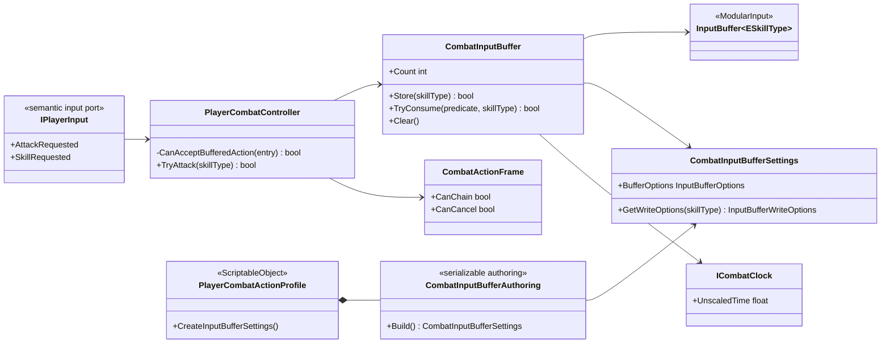

# Project S — Combat Input Buffer

## Граница

Project S использует два слоя:

1. `ModularInput.InputBuffer<TAction>` хранит нейтральные semantic actions.
2. `_App.CombatInputBuffer` адаптирует очередь к `ESkillType`, unscaled combat
   clock и authoring-настройкам `PlayerCombatActionProfile`.

Raw keyboard/gamepad/touch input до этой границы не доходит. Любая платформа
сначала переводит ввод в `IPlayerInput`, поэтому смена устройства не меняет
combat buffer.

## Потребление и ownership

`PlayerCombatController` остаётся владельцем combat rules. Он записывает ввод
во время активной combo/skill action и передаёт buffer predicate,
соответствующий текущему action frame:

- default attack допустим только в `ChainWindow` и пока существует следующий
  combo step;
- skill допустим только в `CancelWindow`, после проверки animation availability
  и cooldown;
- после skill default action также требует `CancelWindow`; это позволяет
  настраивать переход обратно в combo без особого типа buffer;
- очередь атомарно выбирает и удаляет только допустимую команду;
- expiration считается по unscaled time, поэтому короткий hit stop не уничтожает
  уже зарегистрированное нажатие;
- disable, interruption и завершение pipeline очищают очередь.

Buffer не решает, какая атака следует за текущей, не открывает cancel window и
не меняет state. Эти решения принадлежат будущему combo graph/combat state
machine и `CombatActionDefinition`.

## Настройка под разные формы боя

Ниже не пресеты и не жёсткие жанровые классы, а стартовые диапазоны для
authoring. Финальные значения определяются playtest и конкретным moveset.

| Форма | Capacity | Selection | Overflow | Повторы | Типичный lifetime |
|---|---:|---|---|---|---:|
| Hack and Slash | 3–6 | `OldestFirst` | `DropOldest` | `Allow` для combo | 0.25–0.40 s |
| Souls-like | 1–2 | `NewestFirst` | `DropOldest` | `ReplaceMatching` | 0.10–0.25 s |
| Action RPG | 2–4 | `HighestPriorityThenOldest` | `DropLowestPriority` | зависит от action | 0.15–0.35 s |

Примеры смысла конфигурации:

- слэшер сохраняет ритмичную последовательность нескольких атак;
- souls-like ограничивает «долг» ввода, чтобы персонаж не исполнял длинную
  очередь после восстановления контроля;
- action RPG может дать defensive/interrupt action больший priority, не
  зашивая это решение в общий модуль.

Priority не является универсальным правилом «dodge всегда важнее attack».
Разрешённость по cancel window проверяется раньше, поэтому запрещённое действие
никогда не обходит правила текущего состояния только из-за высокого priority.

## Расширение

Новый semantic action добавляется в project-specific input adapter и получает
authoring override. Общий `InputBuffer<TAction>` менять не нужно. Если dodge,
jump или item use должны буферизоваться единым combat graph, Project S должен
перейти с временного `ESkillType` на отдельный `PlayerCombatActionId`; это будет
изменение game-specific модели, а не инфраструктуры очереди.
