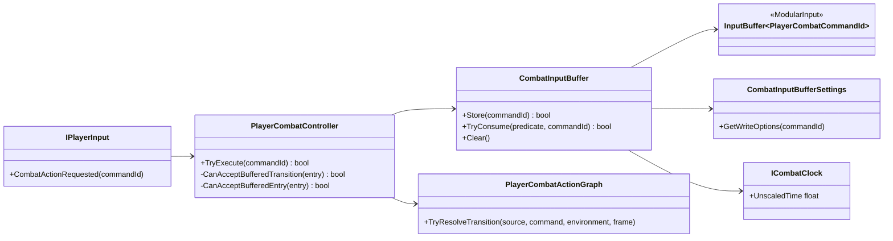

# Project S — Combat Input Buffer

## Граница

`ModularInput.InputBuffer<TAction>` — нейтральная очередь semantic actions. `_App.CombatInputBuffer` адаптирует её к `PlayerCombatCommandId`, unscaled combat clock и authoring-настройкам Project S.

Raw keyboard, gamepad и будущий mobile UI не попадают в buffer: каждый input source сначала преобразуется в одинаковую команду через `IPlayerInput`.

## Ownership и consumption

Buffer хранит команду, timestamp, expiration, priority и duplicate policy. Он не решает, какая action следует за текущей. При каждом `CombatActionFrame` controller передаёт predicate, а graph проверяет одновременно:

- существует ли transition из текущей action по этой команде;
- открыт ли требуемый `ChainWindow` или `CancelWindow`;
- подходит ли target action текущему Grounded/Airborne environment;
- доступна ли presentation и завершён ли cooldown.

Только прошедшая все проверки команда атомарно удаляется из очереди. Expiration использует unscaled time, поэтому ввод сохраняет предсказуемый lifetime во время hit stop. Cooldown actions использует scaled gameplay time.

На completion boundary команда, которая не стала transition, но всё ещё жива,
повторно проверяется через entry rules графа для актуального Grounded/Airborne
environment. Это сохраняет поздний recovery input для следующей допустимой
цепочки. Неподдерживаемая presentation, активный cooldown и несовместимый
environment по-прежнему не позволяют потребить команду.

## Конфигурация

`CombatInputBufferAuthoring` задаёт capacity, overflow, selection, lifetime, priority и duplicate rules. Override адресуется строковым semantic command id (`attack.light`, `attack.heavy`, `skill.special`). Добавление новой команды не требует изменения generic `InputBuffer<TAction>`.

Текущий slasher profile использует capacity `4`, `DropLowestPriority` и
`HighestPriorityThenOldest`. Default light input имеет priority `0` и допускает
несколько последовательных записей для combo. `attack.heavy` имеет priority
`10`, `skill.special` — `20`; обе named-команды используют `RefreshMatching`,
поэтому повторное нажатие продлевает одну pending command, но не программирует
несколько будущих heavy/special actions. Приоритет влияет только на выбор среди
одновременно допустимых buffered commands и не обходит graph transition,
environment, presentation или cooldown gates.

У первых двух ground light actions начало `CancelWindow` выровнено с началом
`ChainWindow`. Благодаря этому light и named commands становятся кандидатами в
одном frame, и priority policy действительно разрешает их конфликт, а не
проигрывает более позднему открытию cancel window.

Ориентиры для playtest, не жёсткие пресеты:

| Форма боя | Capacity | Selection | Типичный lifetime |
|---|---:|---|---:|
| Hack and Slash | 3–6 | OldestFirst | 0.25–0.40 s |
| Souls-like | 1–2 | NewestFirst | 0.10–0.25 s |
| Action RPG | 2–4 | HighestPriorityThenOldest | 0.15–0.35 s |

Очередь очищается при disable, interruption и завершении всего action pipeline.
Внутри pipeline она сохраняется между завершившимся action и новым action,
принятым через transition либо completion entry handoff. Dodge пока остаётся
отдельным locomotion event и прерывает combat; перенос dodge/item/jump в единый
action graph выполняется только когда для них появятся реальные общие cancel rules.
