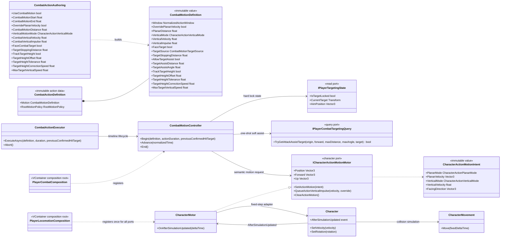
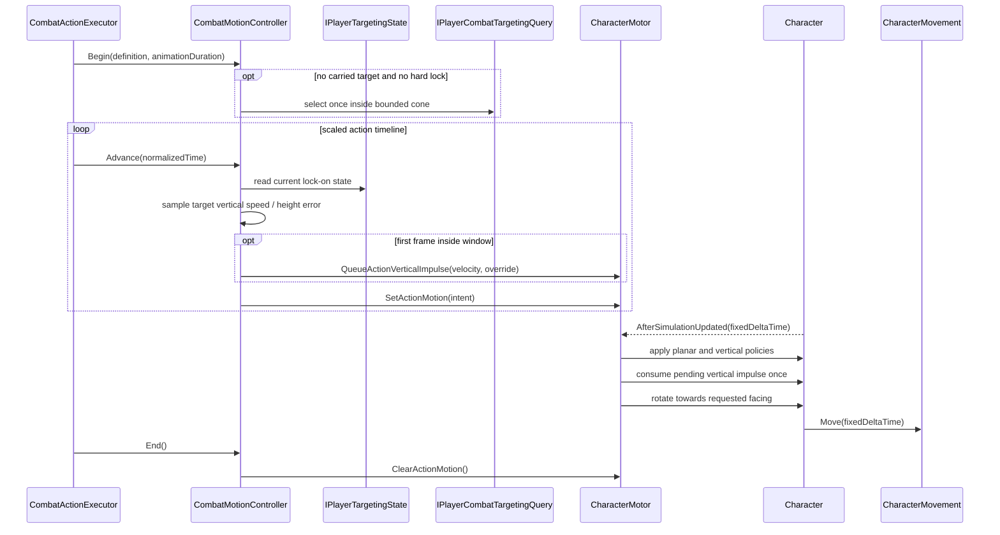

# Project S — Combat Motion

## Ответственность

Combat Motion управляет перемещением владельца во время конкретного combat action. Он решает только три задачи:

- независимо управляет планарной скоростью, вертикальной скоростью и одноразовым вертикальным импульсом в нормализованном окне action timeline;
- при включённой опции направляет движение и поворот к текущей lock-on цели;
- для явно настроенного chase-action согласует вертикальную скорость с движущейся целью и ограниченно исправляет разницу высот;
- передаёт результат в character motor, который применяет его внутри fixed-step до collision-resolved `CharacterMovement.Move`.

Обычный input locomotion продолжает формировать `PlayerMovementIntent`. В активном motion window combat action может заменить планарную скорость либо сохранить её, а также сохранить, заменить или ограничить снизу вертикальную скорость. Gravity продолжает рассчитываться `Character`, после чего action policy применяется в одном fixed-step adapter. Grounding, slopes и collision response остаются собственностью `Character`/`CharacterMovement`.

## Дерево классов и зависимости

`ICharacterActionMotionMotor` — нейтральная сменяемая граница Character, которую может использовать combat или другой краткоживущий action. Combat не знает о `Rigidbody`, `CharacterMovement`, friction, ground probing и Unity lifecycle. `CharacterMotor` реализует эту границу рядом с остальными адаптерами движения, но остаётся единственным scoped instance благодаря одной VContainer registration.

## Поток выполнения

Timeline использует scaled `ICombatClock`: во время hit stop окно и скорость атаки не продолжают жить в реальном времени. Physics применяет сохранённый intent только на fixed-step; при полном freeze fixed simulation не выполняется.

## Authoring и правила

- `Override Planar Velocity` явно выбирает владельца горизонтальной скорости. Когда опция выключена, сохраняется результат обычной locomotion; когда включена, `Combat Motion Distance` преобразуется в скорость как `distance / motion window duration`.
- `Vertical Motion Mode = PreserveVelocity` оставляет gravity/jump velocity без изменений.
- `OverrideVelocity` задаёт точную `Combat Vertical Velocity` на каждом fixed-step окна. Значение `0` полностью удерживает высоту, положительное поднимает персонажа, отрицательное задаёт контролируемое снижение.
- `MinimumVelocity` вычисляет `max(current, configured)`: значение `0` сохраняет существующий подъём, но не позволяет начать падение; отрицательное значение, например `-2`, создаёт ограниченное медленное падение.
- `Combat Vertical Impulse` — знаковая одноразовая скорость на первом fixed-step окна. Положительное значение запускает персонажа вверх, отрицательное поддерживает slam вниз. `Override Vertical Velocity On Impulse` выбирает замену текущей вертикальной скорости либо сложение с ней.
- Положительная итоговая vertical velocity на земле использует существующий character jump boundary: motor снимает ground constraint и переводит movement mode в `Falling`, поэтому подъём не теряется при ground projection.
- `CombatMotionTargetSource.LockOnTarget` использует подтверждённую lock-on цель.
  `PreviousConfirmedHit` принимает actor root из outcome предыдущего execution и
  используется air chase, не меняя состояние targeting. Если выбранная ссылка
  отсутствует или уничтожена, движение безопасно продолжает текущий forward.
- `PreviousConfirmedHitOrLockOnTarget` сначала использует цель, перенесённую из
  предыдущего execution, а при её отсутствии — текущий lock-on. Launcher target
  сохраняется через безударный air chase и остаётся motion-context воздушной
  combo; отдельным глобальным target state это не становится.
- `Target Stopping Distance` останавливает поступательное движение рядом с выбранной motion-целью, но позволяет продолжить разворот к ней.
- `Allow Target Assist` разрешает одноразовый soft selection при старте action, только если нет carried target и hard lock. `Target Assist Distance/Angle` задают ограниченный сектор. Выбранная ссылка живёт только до завершения action, не меняет camera lock и не запускает physics query на каждом кадре.
- `Track Target Height` включается только для action, которому действительно
  нужен vertical chase. После первого sample controller оценивает вертикальную
  скорость target и добавляет пропорциональную коррекцию height error. Итоговая
  скорость ограничивается `Max Target Vertical Speed`; tolerance подавляет
  мелкую дрожь, а signed offset позволяет держать игрока чуть ниже цели.
- Окно motion обязано завершаться не позже `Completion Time`.
- Translational root motion (`Translation`, `Full`) нельзя объединять с planar override, vertical policy или vertical impulse одного action.
- Rotational root motion (`Rotation`, `Full`) нельзя объединять с `Face Combat Target` одного action.
- Новые vertical-поля имеют безопасные defaults: `PreserveVelocity` и impulse `0`. Prototype combo сохраняет окно `0.0–0.3` и планарную дистанцию `0.75`; prototype skill — `1.0`; weapon transition не использует combat motion.
- Текущий player profile использует vertical impulse и bounded height tracking
  в `movement.air-chase`. Первые два воздушных combo actions сохраняют launcher
  target только для planar/facing assist и используют `OverrideVelocity(0 m/s)`
  в ограниченном окне `0.0–0.58`. Это фиксирует высоту во время active/chain
  части удара; следующий combo step обновляет stall, а при отсутствии продолжения
  gravity возвращается в recovery. Height tracking в этих шагах отключён, чтобы
  движение цели не создавало вертикальные рывки. `combo.air.2` намеренно меняет policy на
  `OverrideVelocity(-9 m/s)`: это контролируемый dive до столкновения, после
  которого существующая airborne-action landing boundary очищает motion.

## Lifecycle и отказоустойчивость

- `CombatActionExecutor` начинает и завершает motion в том же `try/finally`, где восстанавливает root motion и damage immunity.
- `Abort`, interruption, cancellation и disable игрока всегда вызывают `CombatMotionController.End`.
- Вертикальный impulse сначала ставится в очередь `CharacterMotor` и потребляется один раз только внутри fixed-step. Cancellation/disable до этого шага очищает очередь и не оставляет отложенный launch.
- `CharacterMotor.Dispose` очищает intent, pending impulse и снимает fixed-step subscription.
- Завершение action очищает carried target и target-height samples, поэтому
  следующая независимая атака не наследует старую цель или скорость.
- Пустая или потерянная hard/assist цель безопасно заменяется текущим forward персонажа. Уничтоженная либо ставшая недоступной assist-цель не удерживается.
- Scene, prefab, Animator Controller и animation clips для этой границы не изменяются.

## Почему это остаётся в Core

Алгоритм уже отделён портом `ICharacterActionMotionMotor`, но его data model пока напрямую использует `CombatActionDefinition`, `IPlayerTargetingState` и правила Project S. Реального второго consumer ещё нет, поэтому перенос в `_App/Modules` сейчас создал бы преждевременный package API. Кандидатом на модуль станет только стабильное ядро motion profile/window после применения к нескольким типам действий или персонажей без ссылок на Project S.
