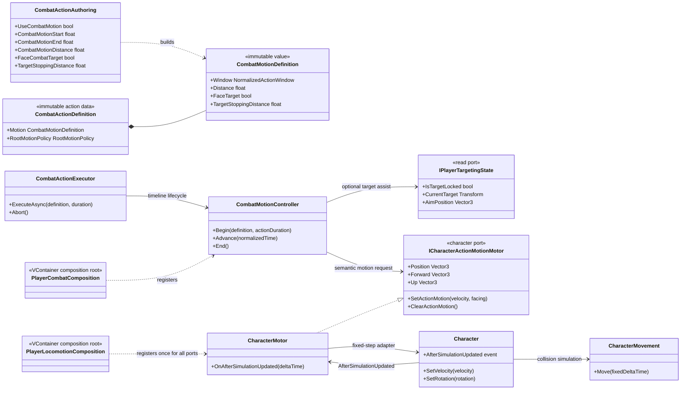
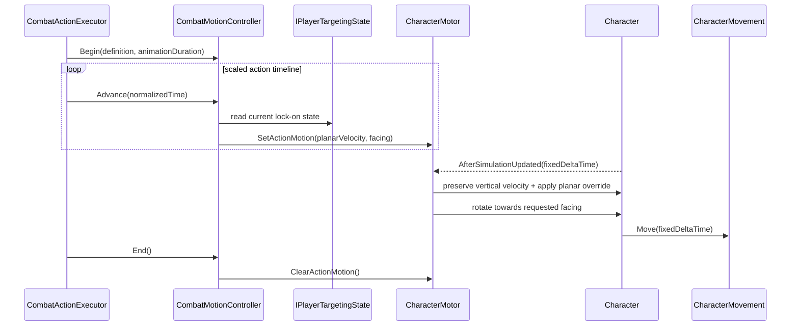

# Project S — Combat Motion

## Ответственность

Combat Motion управляет перемещением владельца во время конкретного combat action. Он решает только три задачи:

- преобразует нормализованное окно action timeline и заданную дистанцию в планарную скорость;
- при включённой опции направляет движение и поворот к текущей lock-on цели;
- передаёт результат в character motor, который применяет его внутри fixed-step до collision-resolved `CharacterMovement.Move`.

Обычный input locomotion продолжает формировать `PlayerMovementIntent`, но в активном motion window его итоговая планарная скорость заменяется combat motion. Вертикальная скорость, gravity, grounding, slopes и collision response остаются собственностью `Character`/`CharacterMovement`.

## Дерево классов и зависимости

`ICharacterActionMotionMotor` — нейтральная сменяемая граница Character, которую может использовать combat или другой краткоживущий action. Combat не знает о `Rigidbody`, `CharacterMovement`, friction, ground probing и Unity lifecycle. `CharacterMotor` реализует эту границу рядом с остальными адаптерами движения, но остаётся единственным scoped instance благодаря одной VContainer registration.

## Поток выполнения

Timeline использует scaled `ICombatClock`: во время hit stop окно и скорость атаки не продолжают жить в реальном времени. Physics применяет сохранённый intent только на fixed-step; при полном freeze fixed simulation не выполняется.

## Authoring и правила

- `Combat Motion Distance` — полная дистанция, которую action стремится пройти за `Combat Motion Start/End`. Скорость вычисляется как `distance / motion window duration`.
- `Face Combat Target` использует только подтверждённую lock-on цель. Без цели сохраняется движение вперёд по направлению персонажа.
- `Target Stopping Distance` останавливает поступательное движение рядом с lock-on целью, но позволяет продолжить разворот к ней.
- Окно motion обязано завершаться не позже `Completion Time`.
- Translational root motion (`Translation`, `Full`) нельзя объединять с code-driven translation одного action.
- Rotational root motion (`Rotation`, `Full`) нельзя объединять с `Face Combat Target` одного action.
- Отключённый motion не меняет текущие serialized actions. Prototype combo использует окно `0.0–0.3`, дистанцию `0.75`; prototype skill — `1.0`; weapon transition не использует combat motion.

## Lifecycle и отказоустойчивость

- `CombatActionExecutor` начинает и завершает motion в том же `try/finally`, где восстанавливает root motion и damage immunity.
- `Abort`, interruption, cancellation и disable игрока всегда вызывают `CombatMotionController.End`.
- `CharacterMotor.Dispose` очищает intent и снимает fixed-step subscription.
- Пустая или потерянная цель безопасно заменяется текущим forward персонажа.
- Scene, prefab, Animator Controller и animation clips для этой границы не изменяются.

## Почему это остаётся в Core

Алгоритм уже отделён портом `ICharacterActionMotionMotor`, но его data model пока напрямую использует `CombatActionDefinition`, `IPlayerTargetingState` и правила Project S. Реального второго consumer ещё нет, поэтому перенос в `_App/Modules` сейчас создал бы преждевременный package API. Кандидатом на модуль станет только стабильное ядро motion profile/window после применения к нескольким типам действий или персонажей без ссылок на Project S.
