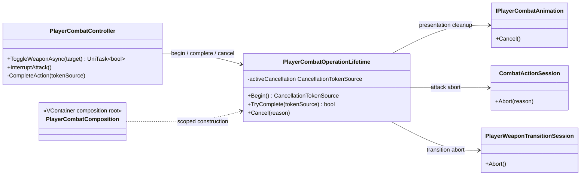

# Project S — Combat Operation Lifetime

## Ответственность

`PlayerCombatOperationLifetime` является единым owner активного
`CancellationTokenSource` для attack pipeline либо weapon transition. Он
гарантирует общий порядок cancellation: остановить animation action, отменить
async continuation, abort обе возможные sessions и освободить token source.

## Инварианты

- Одновременно существует не более одного активного operation token.
- `Begin` сначала отменяет предыдущую операцию с причиной `Cancelled`.
- Только owner текущего token source может выполнить completion cleanup;
  запоздавший `finally` старой UniTask получает `false` от `TryComplete`.
- `Cancel` вызывает обе session boundaries даже при отсутствии token source,
  чтобы частично начатая session не пережила disable/interruption.
- Вложенные `finally` гарантируют abort и dispose, даже если один callback
  cancellation/animation выбросил исключение.

Контроллер остаётся владельцем combat phase, input buffer, combo index и
возврата в `Ready`. Lifetime не выбирает actions и не регистрируется как
публичный service/interface: это конкретный scoped collaborator Player Combat.

