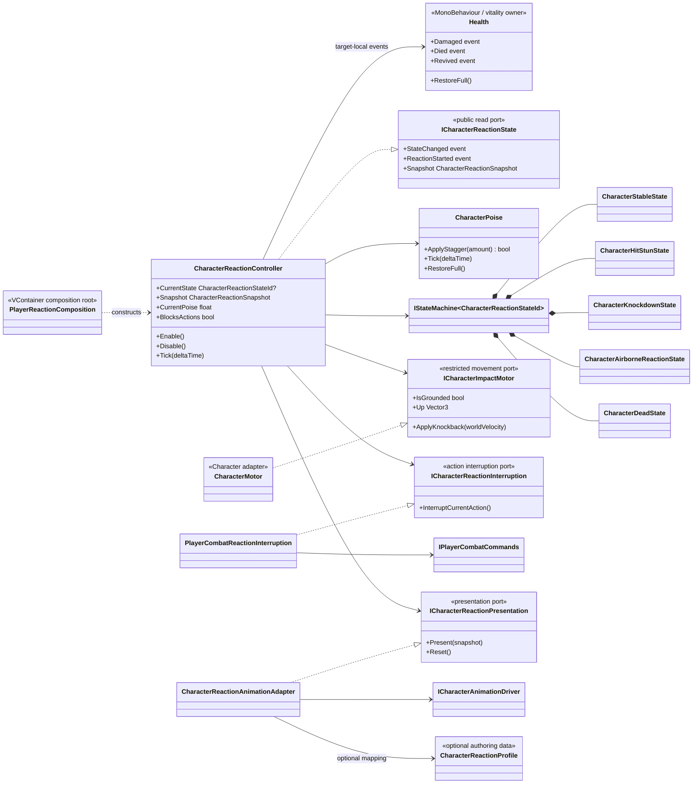
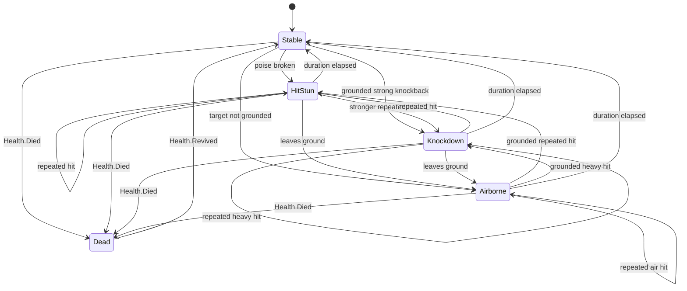
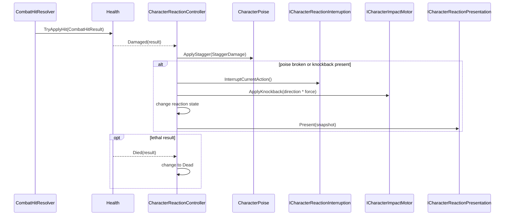

# Project S — Character Reaction и Poise

## Ответственность

`CharacterReactionController` владеет реакцией конкретного получателя урона. Он слушает только локальные события `Health`, расходует poise, выбирает состояние реакции, прерывает текущее действие и передаёт импульс motor через ограниченный порт. Исходящий `CombatHitResolver`, `Weapon`, Animator и `Character` не владеют reaction state.

Сейчас система поддерживает:

- накопление `StaggerDamage`, задержку и скорость восстановления poise;
- `Stable`, `HitStun`, `Knockdown`, `Airborne` и `Dead`;
- повторное попадание во время активной реакции;
- блокировку player movement intent и прерывание текущей атаки/смены оружия;
- направленный knockback через `ICharacterImpactMotor`;
- возврат из временной реакции и явное восстановление после `Health.RestoreFull()`;
- опциональное отображение состояний через `ICharacterAnimationDriver`.

Hit stop, invulnerability frames, get-up phase, ragdoll и финальные reaction clips не входят в этот блок.

## Дерево классов и зависимости

## State machine

Ненулевой knockback принудительно создаёт реакцию даже до полного расхода poise. На земле направление проецируется на плоскость персонажа; вертикальная составляющая текущей скорости сохраняется. Порог сильного импульса выбирает `Knockdown`. Если motor сообщает airborne, приоритет имеет `Airborne`.

## Поток подтверждённого попадания

`ICombatHitEvents` намеренно не используется для владения реакцией цели: это scoped broadcast исходящего resolver. Подписка непосредственно на `Health` гарантирует, что controller получает только события своего actor и пригоден для будущей отдельной composition противников.

## Authoring и presentation

`CharacterReactionProfile` опционален. При отсутствии asset используются безопасные prototype defaults: poise `10`, hit-stun `0.25s`, knockdown `0.8s`, airborne `0.45s`. Ни одного Animator state система в таком режиме не требует.

Когда финальные клипы появятся, profile связывает пару `ReactionId + State` с backend-neutral animation state. Пустой `ReactionId` является fallback для состояния. `CharacterReactionAnimationAdapter` только вызывает `ICharacterAnimationDriver`; он не завершает gameplay reaction по длине клипа и не меняет state machine. После возврата в `Stable` обычную позу снова отображает locomotion presentation.

## Lifecycle и границы

- `PlayerReactionComposition` создаёт settings, poise, state machine, ports и controller в gameplay scope. Gameplay-классы не вызывают `Resolve`.
- `Enable` подписывает `Health`, запускает state machine и синхронизируется с текущим alive/dead состоянием.
- `Disable` симметрично снимает подписки, останавливает machine, сбрасывает runtime state и presentation.
- `PlayerActorController` тикает reaction перед locomotion и при `BlocksActions` передаёт `PlayerMovementIntent.Locked`.
- `Health` остаётся единственным владельцем hit points; `CharacterPoise` — единственным владельцем poise; state machine — единственным владельцем reaction phase.
- Reaction не вызывает `Character` напрямую. Единственный путь физического воздействия — `ICharacterImpactMotor`, реализованный существующим `CharacterMotor`.
- Система остаётся в `_App/Core`: timings, состояния и связь с combat rules пока проверены только в Project S. Извлечение в `_App/Modules` преждевременно до появления второго реального consumer.
