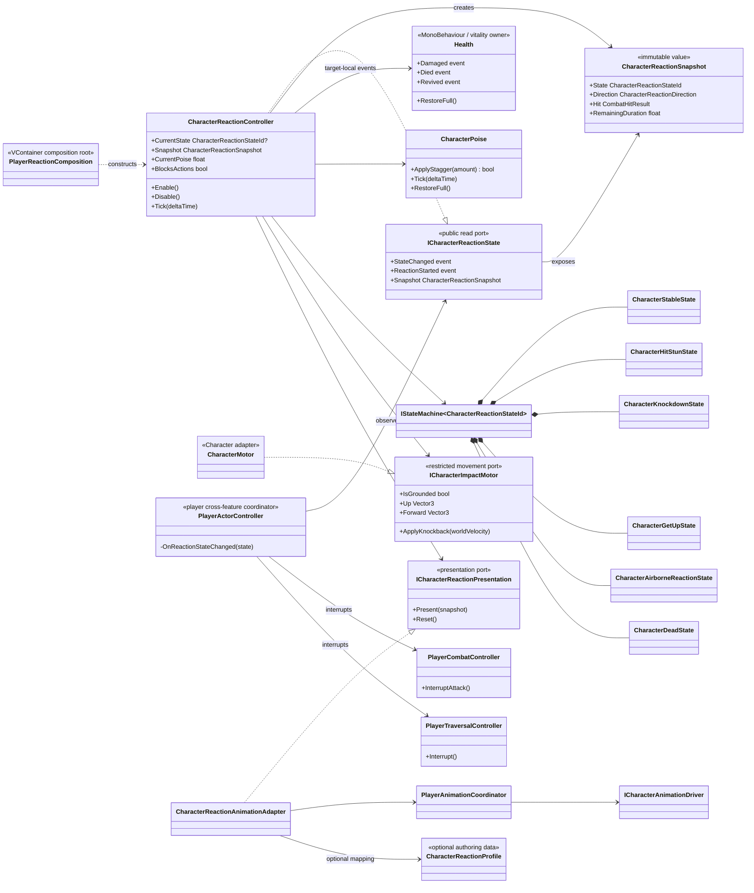
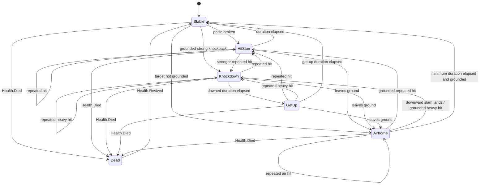

# Project S — Character Reaction и Poise

## Ответственность

`CharacterReactionController` владеет реакцией конкретного получателя урона. Он слушает только локальные события `Health`, расходует poise, выбирает состояние реакции и передаёт импульс motor через ограниченный порт. Он не знает о player-combat или traversal: межfeature-прерывание выполняет scoped `PlayerActorController` по подтверждённому `StateChanged`. Исходящий `CombatHitResolver`, `Weapon`, Animator и `Character` не владеют reaction state.

Сейчас система поддерживает:

- накопление `StaggerDamage`, задержку и скорость восстановления poise;
- `Stable`, `HitStun`, `Knockdown`, `GetUp`, `Airborne` и `Dead`;
- повторное попадание во время активной реакции;
- блокировку новых player actions и прерывание текущей атаки, смены оружия или traversal через player actor root;
- направленный knockback через `ICharacterImpactMotor`;
- стабильное направление источника удара (`Front`, `Back`, `Left`, `Right`) в reaction snapshot;
- возврат из временной реакции и явное восстановление после `Health.RestoreFull()`;
- опциональное отображение состояний через `PlayerAnimationCoordinator` и backend-neutral animation driver.

Hit stop не входит в reaction state machine и имеет отдельного time-scale owner, описанного в `Docs/Architecture/Combat.HitStop.md`. Invulnerability frames, ragdoll и финальные production reaction clips пока не входят в этот блок.

## Дерево классов и зависимости



## State machine



Ненулевой planar или vertical knockback принудительно создаёт реакцию даже до
полного расхода poise. Положительный `VerticalKnockback` запускает цель вверх;
отрицательный направляет её вниз вдоль локального `Up`. Уже воздушная цель
остаётся в `Airborne` до подтверждённого motor-приземления. Если последний
вертикальный impact был отрицательным, приземление переводит её в
`Knockdown → GetUp` без повторного применения knockback. Отрицательный impact
по уже стоящей на земле цели сразу выбирает `Knockdown`; сильный planar impulse
сохраняет прежнее правило.

## Поток подтверждённого попадания

```mermaid
sequenceDiagram
    participant Resolver as CombatHitResolver
    participant Health
    participant Reaction as CharacterReactionController
    participant Poise as CharacterPoise
    participant Actor as PlayerActorController
    participant Combat as PlayerCombatController
    participant Traversal as PlayerTraversalController
    participant Motor as ICharacterImpactMotor
    participant View as ICharacterReactionPresentation

    Resolver->>Health: TryApplyHit(CombatHitResult)
    Health-->>Reaction: Damaged(result)
    Reaction->>Poise: ApplyStagger(StaggerDamage)
    alt poise broken or knockback present
        Reaction->>Reaction: change reaction state
        Reaction-->>Actor: StateChanged(non-stable)
        Actor->>Combat: InterruptAttack()
        Actor->>Traversal: Interrupt()
        Reaction->>Motor: ApplyKnockback(planar + up * vertical)
        Reaction->>View: Present(snapshot)
    end
    opt lethal result
        Health-->>Reaction: Died(result)
        Reaction->>Reaction: change to Dead
    end
```

`ICombatHitEvents` намеренно не используется для владения реакцией цели: это scoped broadcast исходящего resolver. Подписка непосредственно на `Health` гарантирует, что controller получает только события своего actor и пригоден для будущей отдельной composition противников.

## Authoring и presentation

`CharacterReactionProfile` опционален. При отсутствии asset используются
безопасные prototype defaults: poise `10`, hit-stun `0.25s`, knockdown `0.8s`,
get-up `1.833s`, airborne `0.45s`. Ни одного Animator state gameplay-система
самостоятельно не выбирает.

Player prefab использует явный
`Assets/_Game/Settings/Combat/Player/PlayerCharacterReactionProfile.asset` с теми
же стартовыми gameplay timings, кроме увеличенного до `0.4s` hit-stun.
`XController` содержит девять обязательных presentation-слотов:
`Reaction/HitStun`, `Reaction/HitStun_Back`, `Reaction/HitStun_Left`,
`Reaction/HitStun_Right`, `Reaction/Knockdown`, `Reaction/Airborne`,
`Reaction/Dead_1`, `Reaction/Dead_2` и `Reaction/GetUp`. Сейчас они ссылаются
на Humanoid prototype motions. Исходные FBX не изменены и не содержат gameplay
events. Это временный визуальный набор; его клипы можно заменить без изменения
gameplay-контракта.

Внутри Animator у этих состояний нет параметрических входов и самостоятельных
gameplay-переходов. Подтверждённую реакцию запускает единственный animation
driver. После `Knockdown` gameplay state machine явно запускает `GetUp`, а после
его завершения отменяет presentation при возврате в `Stable`. Для смерти
`hit.heavy` выбирает `Dead_2`, остальные и неизвестные reaction id используют
fallback `Dead_1`; оба состояния удерживают последний кадр до подтверждённого
revive.

`CharacterReactionController` вычисляет направление один раз из подтверждённого
импульса и ориентации цели. Название описывает сторону источника относительно
цели: импульс назад означает `Front`, вправо — `Left`. Значение сохраняется в
`CharacterReactionSnapshot` и не меняется, если персонаж повернулся во время
реакции. Сейчас направление выбирает отдельный клип только для `HitStun`;
остальные reaction states используют общий fallback.

Комбинация `ReactionId + State + Direction` формирует backend-neutral animation
slot. Пустой `ReactionId` и `Direction.None` являются fallback.
`CharacterReactionAnimationAdapter` отправляет приоритетный request в
`PlayerAnimationCoordinator`; controller выбирает state через `ActionId = 4`,
но reaction clips всегда воспроизводятся на естественной скорости. Gameplay
duration остаётся authoritative и отменяет presentation при возврате в
`Stable`, не ускоряя исходный клип до 2-3x.

Самостоятельная action `attack.heavy` использует `ReactionId = hit.heavy`
и knockback `6.5`, поэтому на стоящей цели пересекает текущий threshold `6`
и подтверждает путь `Stable/HitStun -> Knockdown -> GetUp -> Stable`.
Три light-combo шага остаются `hit.light`. Повторное попадание во время `GetUp`
прерывает вставание и повторно выбирает реакцию по обычным правилам.

## Lifecycle и границы

- `PlayerReactionComposition` создаёт settings, poise, state machine, motor/presentation ports и controller в gameplay scope. Reaction composition не зависит от Player Combat или Traversal.
- `CharacterReactionStateMachineFactory` задаёт ту же topology для player scope и standalone actor; `CharacterReactionHost` использует её в тренировочном prefab без второго набора reaction rules.
- `CombatTrainingTarget` адаптирует физику через `RigidbodyCharacterImpactMotor`; это prefab-local composition, а не новый global service.
- `Enable` подписывает `Health`, запускает state machine и синхронизируется с текущим alive/dead состоянием.
- `Disable` симметрично снимает подписки, останавливает machine, сбрасывает runtime state и presentation.
- `PlayerActorController` подписывается до запуска reaction state machine. Любой non-stable state синхронно прерывает Combat и Traversal и блокирует locomotion intent; `Stable` восстанавливает актуальный combat movement intent.
- `PlayerCombatController` и `PlayerTraversalController` дополнительно читают `ICharacterReactionState.BlocksActions`, поэтому новый input не запускает действие между state transition и следующим frame tick.
- `Health` остаётся единственным владельцем hit points; `CharacterPoise` — единственным владельцем poise; state machine — единственным владельцем reaction phase.
- Reaction не вызывает `Character` напрямую. Единственный путь физического воздействия — `ICharacterImpactMotor`, реализованный существующим `CharacterMotor`.
- Система остаётся в `_App/Core`: timings, состояния и связь с combat rules пока проверены только в Project S. Извлечение в `_App/Modules` преждевременно до появления второго реального consumer.
