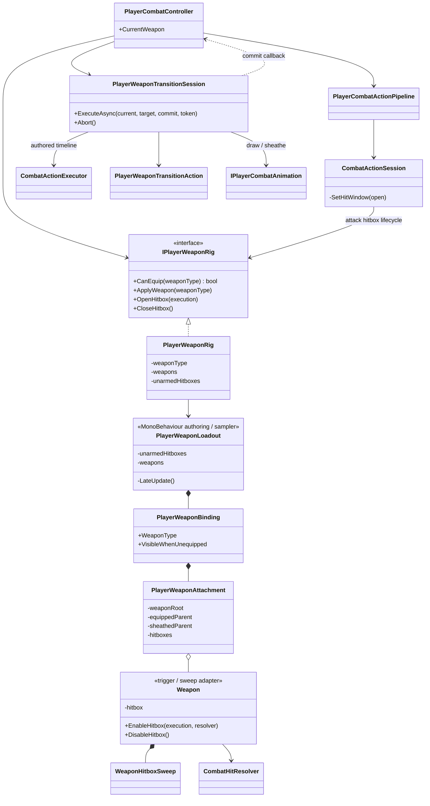

# Project S — player weapon loadout

## Граница ответственности

`PlayerWeaponLoadout` — Unity-authoring и late-frame physics adapter на prefab
игрока. Он хранит ссылки на оружейные объекты, точки крепления, локальные позы
и hitbox-компоненты. Пока открыт хотя бы один hitbox, component один раз
синхронизирует Physics transforms и запускает bounded sweep всех активных
attachments. Он не открывает hit window и не решает, какая атака допустима.

`PlayerWeaponRig` — runtime-владелец текущего визуального loadout. Он получает
подтверждённый тип оружия от `PlayerCombatController`, переставляет attachments
между hand/sheath sockets и включает только hitboxes выбранного оружия в
gameplay-окне атаки.

`PlayerWeaponTransitionSession` владеет только временным процессом смены оружия:
последовательностью sheathe/draw, animation loadout, timeline commit-point и
восстановлением после отмены. Подтверждённое `CurrentWeapon` остаётся у
`PlayerCombatController`, а scene attachments — у `PlayerWeaponRig`.

## Правила зависимостей и состояния

- Единственный owner hit window — `CombatActionSession`. Animator и
  `Weapon` не могут самостоятельно начать или продлить нанесение урона.
- Единственный owner подтверждённого `CurrentWeapon` — `PlayerCombatController`.
  `PlayerWeaponTransitionSession` сообщает commit через узкий callback и не
  дублирует persistent weapon state после завершения операции.
- `IPlayerWeaponRig.CanEquip` проверяется до открытия weapon-transition
  operation. `Unarmed` является допустимым sheathed-состоянием без обязательной
  attack hitbox, оружейный тип требует binding с hitboxes.
- При draw Animator заранее получает incoming loadout, необходимый для
  правильного animation override. Отмена до commit возвращает предыдущий
  loadout; отмена после sheathe сохраняет `Unarmed` как последний подтверждённый
  результат.
- Один action execution передаётся всем активным клинкам. Фильтр
  `CombatAttackExecution` всё равно разрешает поразить одну цель только один раз
  за атаку, даже если её пересекли оба меча.
- `PlayerWeaponLoadout` содержит scene/prefab references, но не runtime progress.
  Combat profile и Animator Override Controller остаются отдельными границами.
- Для нового оружия добавляется `PlayerWeaponBinding` с одним или несколькими
  attachments. Код `PlayerWeaponRig` не зависит от количества клинков, рук или
  конкретной модели.
- `None` скрывает все attachments. `Unarmed` использует отдельный набор hand
  hitboxes. Неэкипированный binding может оставаться видимым в sheath sockets.
- Отсутствующий binding или hitbox считается ошибкой authoring, а не поводом
  молча наносить урон кулаками.
- Player weapon queries используют только слой `Hitbox`. Sweep поддерживает
  capsule, sphere и box shapes, не создаёт коллекции в кадре и ограничен восемью
  промежуточными samples на один rendering frame.

## Editor validation

`Tools/Animation/Validate XController Contract` проверяет физический loadout
вместе с animation contract. До Play Mode выявляются отсутствующий
`PlayerWeaponLoadout`, неподдерживаемый starting weapon, дубли weapon bindings,
пустые attachments, отсутствующие hand/equipped/sheath references, пустые или
дублирующиеся hitboxes и animation override без соответствующего физического
оружия. Hitbox attachment обязан находиться внутри своего weapon root, чтобы
видимость оружия и его collision lifecycle не расходились.

`Unarmed` остаётся допустимым sheathed-состоянием runtime rig, но prefab игрока
должен иметь хотя бы один hand hitbox: текущий base combat graph позволяет
рукопашные атаки, и их нельзя authoring-ошибкой превратить в тихий промах без
урона.

## Текущий DualSwords prototype

Player prefab содержит два независимых attachment и два capsule trigger:
`DualSwordPrototype_Left` и `DualSwordPrototype_Right`. Геометрия клинков
временная: исходный Frank-пак содержит UE4 editor-only SkeletalMesh, который не
декодируется текущим export pipeline. Замена прототипных mesh children на
финальные модели не требует изменения gameplay-кода, сокетов или hitbox API.
