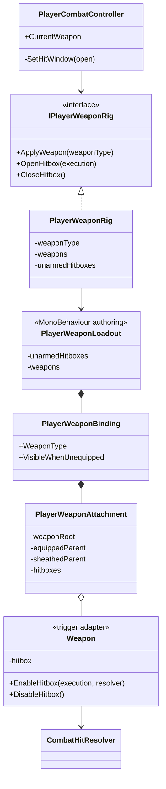

# Project S — player weapon loadout

## Граница ответственности

`PlayerWeaponLoadout` — Unity-authoring component на prefab игрока. Он хранит
ссылки на оружейные объекты, точки крепления, локальные позы и hitbox-компоненты.
Он не открывает hit window и не решает, какая атака допустима.

`PlayerWeaponRig` — runtime-владелец текущего визуального loadout. Он получает
подтверждённый тип оружия от `PlayerCombatController`, переставляет attachments
между hand/sheath sockets и включает только hitboxes выбранного оружия в
gameplay-окне атаки.

## Правила зависимостей и состояния

- Единственный owner hit window — `PlayerCombatController`. Animator и
  `Weapon` не могут самостоятельно начать или продлить нанесение урона.
- Один action execution передаётся всем активным клинкам. Фильтр
  `CombatAttackExecution` всё равно разрешает поразить одну цель только один раз
  за атаку, даже если её пересекли оба меча.
- `PlayerWeaponLoadout` содержит scene/prefab references, но не runtime progress.
  Combat profile и Animator Override Controller остаются отдельными границами.
- Для нового оружия добавляется `PlayerWeaponBinding` с одним или несколькими
  attachments. Код `PlayerWeaponRig` не зависит от количества клинков, рук или
  конкретной модели.
- `None` скрывает все attachments. `Unarmed` использует отдельный набор hand
  hitboxes. Неэкипированный binding может оставаться видимым в sheath sockets.
- Отсутствующий binding или hitbox считается ошибкой authoring, а не поводом
  молча наносить урон кулаками.

## Текущий DualSwords prototype

Player prefab содержит два независимых attachment и два capsule trigger:
`DualSwordPrototype_Left` и `DualSwordPrototype_Right`. Геометрия клинков
временная: исходный Frank-пак содержит UE4 editor-only SkeletalMesh, который не
декодируется текущим export pipeline. Замена прототипных mesh children на
финальные модели не требует изменения gameplay-кода, сокетов или hitbox API.
