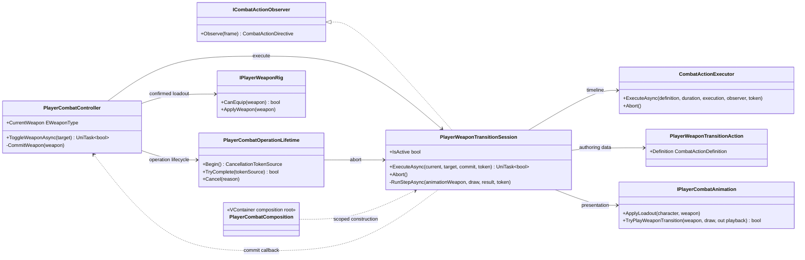
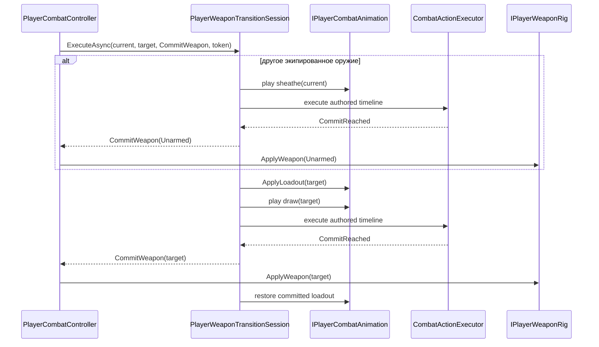

# Project S — weapon transition session

## Назначение

`PlayerWeaponTransitionSession` выполняет один управляемый процесс смены оружия. Она
скрывает от `PlayerCombatController` детали последовательности sheathe/draw,
наблюдение за timeline commit-point и откат presentation при отмене.

Сессия не выбирает целевое оружие, не владеет `CurrentWeapon`, не меняет combat
phase и не знает о scene attachments. Эти ответственности остаются у
`PlayerCombatController`, combat state machine и `PlayerWeaponRig`.

## Дерево классов и зависимости

Направление зависимостей остаётся внутри `ProjectS.Core.Runtime`. Сессия — часть
конкретного player combat feature и пока не является стабильным независимым
модулем для `_App/Modules`.

## Последовательность

Повторный выбор уже экипированного оружия означает sheathe в `Unarmed`.
`Unarmed → Unarmed` является успешной no-op операцией и не открывает
`WeaponSwitch` phase.

До создания operation controller проверяет `IPlayerWeaponRig.CanEquip`.
`Unarmed` всегда допустим как sheathed-состояние, а weapon type требует
реальный binding с hitboxes. Неподдерживаемый enum отклоняется в `Ready` и не
может попасть в gameplay state под видом base-animation fallback.

## Инварианты lifecycle

- Одновременно выполняется не более одной weapon transition и одной timeline в
  общем scoped `CombatActionExecutor`.
- Каждый шаг имеет собственный commit flag. Callback применяется не более
  одного раза, даже если frame наблюдается повторно.
- При sheathe commit подтверждённым состоянием становится `Unarmed`. Поэтому
  отменённый следующий draw не возвращает оружие в руку самопроизвольно.
- Incoming animation loadout применяется перед draw только как presentation
  prerequisite. До commit он не меняет `CurrentWeapon` и `PlayerWeaponRig`.
- `Abort` завершает executor через его штатную cancellation boundary. `finally`
  очищает transient references и восстанавливает loadout последнего
  подтверждённого оружия при completion, failure, cancellation и disable.
- `PlayerCombatOperationLifetime` владеет общим lifecycle token и единым abort
  path атаки/смены оружия. `PlayerCombatController` по-прежнему владеет combat
  phase, публичным `WeaponChanged` и окончательным возвратом в `Ready`.

## Composition

`PlayerCombatComposition` создаёт `PlayerWeaponTransitionAction` из текущего
combat profile (либо prototype defaults) и регистрирует
`PlayerWeaponTransitionSession` как scoped plain C# dependency. Сессия не
вызывает container и не получает Unity scene references напрямую.
`PlayerCombatOperationLifetime` регистрируется в том же scope и зависит только
от animation port и двух runtime sessions.
