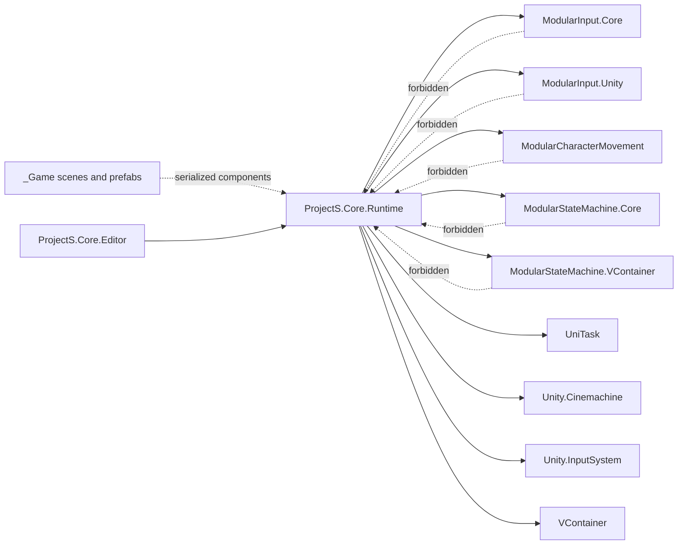

# Project S Core — границы assemblies

`Assets/_App/Core` содержит только код конкретной игры и разделён на две assembly: runtime и editor tooling. Граница нужна не ради количества проектов в IDE, а для проверки допустимого направления зависимостей самим Unity compiler.

## Физическая структура

```text
Assets/_App/Core/
├── Runtime/                         # ProjectS.Core.Runtime
│   ├── Character/                    # simulation, locomotion, traversal, movement policies
│   ├── Combat/
│   ├── Common/
│   ├── Composition/
│   ├── Enemies/
│   ├── Enums/
│   ├── Environment/
│   ├── IK/
│   ├── Input/
│   ├── Settings/CharacterFeatures/   # immutable feature authoring data
│   ├── TargetLock/
│   ├── Time/
│   └── UI/
├── Editor/                          # ProjectS.Core.Editor
└── Tests/
    ├── EditMode/                    # ProjectS.Core.Tests
    └── PlayMode/                    # ProjectS.Core.PlayModeTests
```

`ProjectS.Core.Runtime` остаётся одной feature-oriented assembly. Дробить её на assembly для каждой папки запрещено, пока конкретная feature не получила стабильный публичный контракт и независимый lifecycle.

## Направление зависимостей



`_App/Modules` не ссылается на `ProjectS.Core.Runtime`. Сторонние `_Modules` рассматриваются как внешние зависимости; адаптеры Project S к ним должны находиться в Core.

`ProjectS.Core.Tests` и `ProjectS.Core.PlayModeTests` — тестовые assembly с `UNITY_INCLUDE_TESTS` в define constraints, поэтому в player build они не попадают. Runtime открывает ей internals через `InternalsVisibleTo` в `Runtime/AssemblyInfo.cs`: это единственное исключение, и оно нужно, чтобы покрывать внутреннюю боевую и анимационную логику без расширения публичного API. PlayMode-сборка обходится публичным API `ModularCharacterMovement`. Ни Runtime, ни Editor на тесты не ссылаются. Что покрыто — в `Docs/Architecture/Core.Tests.md`.

Editor assembly может зависеть от Runtime, но Runtime не зависит от `ProjectS.Core.Editor`. Исключение — узкий код под `#if UNITY_EDITOR` внутри того же partial runtime-типа, когда перенос в другую assembly технически разорвал бы partial class. В Core такого кода сейчас нет; единственный пример живёт в модуле `ModularCharacterMovement` (`CharacterMovement.Editor.cs`).

## Текущие зависимости Runtime

- `ModularInput.Core` и `ModularInput.Unity` — семантический input и Unity Input System adapter;
- `ModularCharacterMovement` — решатель коллизий капсулы, grounding и движущиеся платформы;
- `ModularStateMachine.Core` и `ModularStateMachine.VContainer` — locomotion state machine и DI-регистрация;
- `VContainer` — composition root и injection;
- `UniTask` — существующие асинхронные gameplay-операции;
- `Unity.Cinemachine` — текущая camera/target-lock интеграция;
- `Unity.InputSystem` — создание Unity input source в composition root.

Новые assembly references добавляются только при фактическом использовании. `overrideReferences` отключён, поэтому Unity engine modules и совместимые precompiled plugins остаются доступны штатно.

## Зафиксированный технический долг

- `Common` содержит уже используемые малые helpers, ранее лежавшие в общей папке `Utils`. Новые универсальные helpers без доказанного общего владельца сюда не добавляются.
- `Enemy` и старый `TargetLock` продолжают компилироваться для сохранения проекта, но не входят в текущий приоритет single-player locomotion.
- Наличие одной Core assembly не означает, что все классы являются публичным API. Внутренние типы следует делать `internal` по мере локального рефакторинга и проверки всех consumers.

## Инварианты

- Runtime не содержит editor-only инструментов и не ссылается на `ProjectS.Core.Editor`.
- Editor tooling не попадает в player build.
- `_App/Modules` не получает references на Core.
- Перемещение скриптов выполняется с сохранением `.meta` GUID, поэтому scene/prefab references не меняются.
- После изменения references Unity должна завершить компиляцию без новых ошибок.
