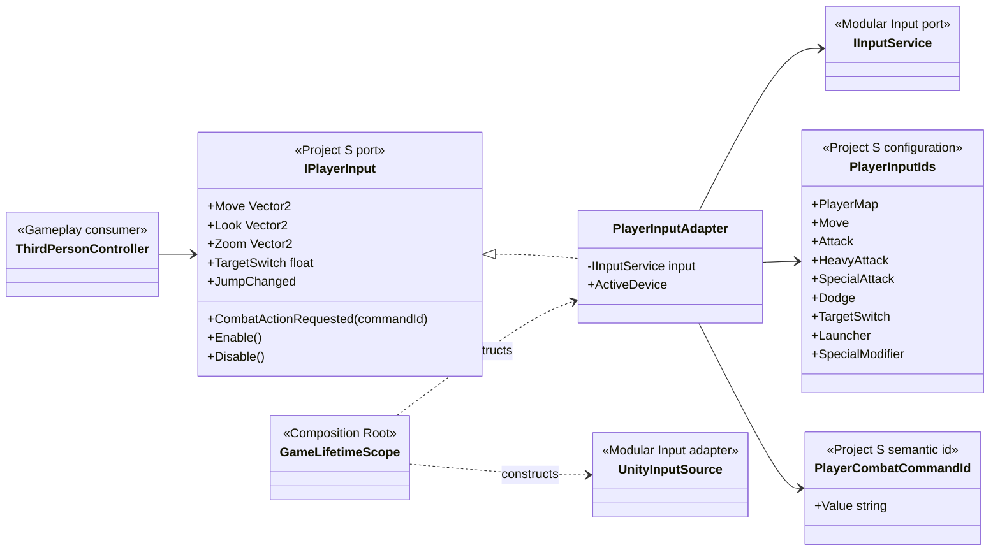
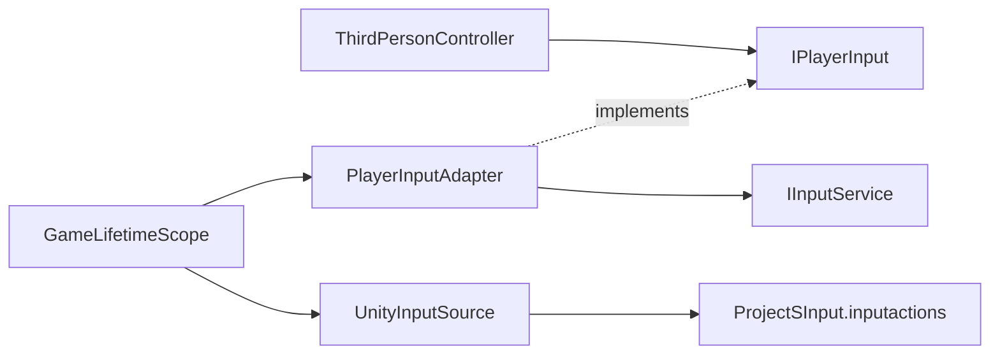

# Project S — Player Input adapter

## Ответственность

Project S не получает raw controls. `PlayerInputAdapter` переводит стабильные GUID действий из generic Input-модуля в команды уровня игры. Боевые bindings становятся единым `CombatActionRequested(PlayerCombatCommandId)`, а locomotion/UI сигналы сохраняют собственные typed events. Это anti-corruption layer между переиспользуемой инфраструктурой и gameplay.

## Дерево классов

## Направление зависимостей

- Gameplay зависит только от `IPlayerInput` и не знает о devices, bindings или Unity callback context.
- Одноразовые jump/dodge callbacks только фиксируют pending semantic signal.
  `PlayerLocomotionController` потребляет их в своём `Tick` после того, как
  `PlayerActorController` передал актуальный combat/reaction movement intent.
  Поэтому допустимость cancel не зависит от порядка Input System callbacks и
  gameplay Update в конкретном кадре.
- Combat callbacks также не запускают action немедленно. Controller помещает
  semantic command в заранее выделенную очередь ёмкостью `8`, а единственный
  combat tick потребляет её после продвижения action timeline. Очередь ограничена,
  очищается при disable/interruption и не переносит команды между lifecycle
  generations.
- Keyboard/mouse, gamepad и будущий mobile adapter публикуют одинаковый `PlayerCombatCommandId`; input не зависит от animation ids и конкретной реализации moveset.
- `PlayerInputIds` — project configuration. GUID остаются стабильными после rename action/map.
- `GameLifetimeScope` — единственное место, где встречаются VContainer, Unity source и project asset.
- UI prompts могут подписаться на `ActiveDeviceChanged`, не выполняя device polling.
- `TargetSwitch` передаёт семантическую ось: `scroll/y` для mouse,
  `rightStick/x` для gamepad и `stick/x` для joystick. Колесо меняет цель только
  при активном lock-on; в free-look оно продолжает управлять zoom камеры.
- Light attack использует `ЛКМ / X`, heavy attack — `ПКМ / RT`.
  Удержание `Shift` превращает как `ЛКМ`, так и `ПКМ` в `skill.special`; direct
  gamepad binding special остаётся на `D-pad Down`. Adapter разрешает modifier
  до публикации команды, поэтому обычная и special-атака не запускаются вместе.
- Launcher использует `F / LB` и публикует `attack.launcher`.
- Guard/parry использует `Q / LT`, dodge — `Left Alt / RB`.
- Prototype debug controls изолированы от gameplay bindings: inversion gravity
  использует `F10`, управление cursor lock — `F11`.

## От чего отказались

- сгенерированный `InputSystem.cs` удалён: добавление action больше не требует wrapper regeneration;
- `InputHandler` и изменяемые delegate-properties удалены;
- gameplay больше не создаёт input через `new` и не имеет fallback вне composition root;
- skill больше не определяется через `context.control.name`;
- `PlayerInput` MonoBehaviour не дублирует lifecycle action asset.
- неиспользуемые prototype controllers с прямым `UnityEngine.Input` удалены; editor `TestSystem` больше не выполняет device polling.
