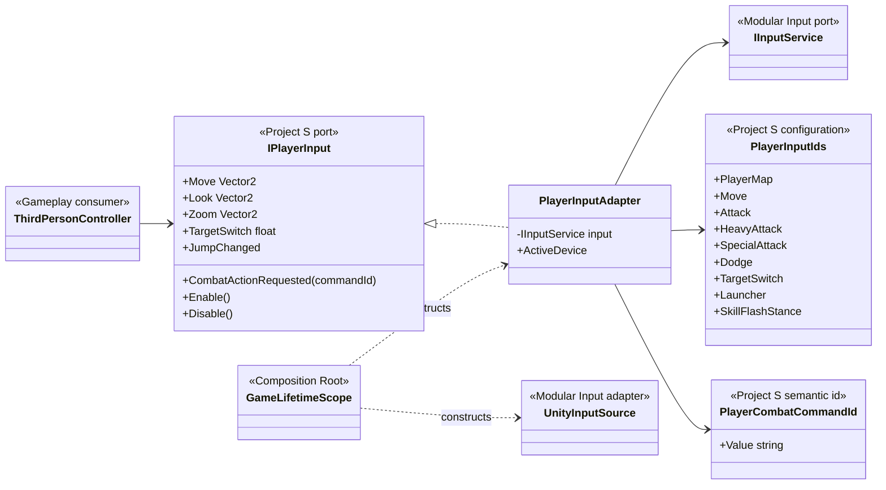
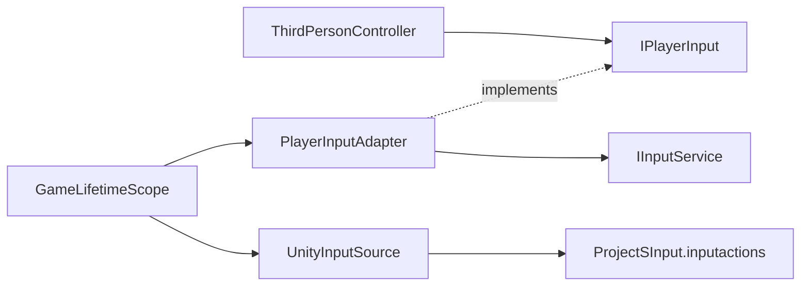

# Project S — Player Input adapter

## Ответственность

Project S не получает raw controls. `PlayerInputAdapter` переводит стабильные GUID действий из generic Input-модуля в команды уровня игры. Боевые bindings становятся единым `CombatActionRequested(PlayerCombatCommandId)`, а locomotion/UI сигналы сохраняют собственные typed events. Это anti-corruption layer между переиспользуемой инфраструктурой и gameplay.

## Дерево классов

## Направление зависимостей

- Gameplay зависит только от `IPlayerInput` и не знает о devices, bindings или Unity callback context.
- Keyboard/mouse, gamepad и будущий mobile adapter публикуют одинаковый `PlayerCombatCommandId`; input не зависит от animation ids и конкретной реализации moveset.
- `PlayerInputIds` — project configuration. GUID остаются стабильными после rename action/map.
- `GameLifetimeScope` — единственное место, где встречаются VContainer, Unity source и project asset.
- UI prompts могут подписаться на `ActiveDeviceChanged`, не выполняя device polling.
- `TargetSwitch` передаёт нормализованную семантическую ось: `Z/C` для keyboard, `rightStick/x` для gamepad и `stick/x` для joystick. Gameplay не знает, какое устройство создало направление.
- Light attack использует `ЛКМ / X`, heavy attack — `ПКМ / RT`, а
  `skill.special` — `3 / D-pad Down`. Adapter переводит все три действия в
  разные `PlayerCombatCommandId`; gameplay не сравнивает control path.
- Launcher использует существующий binding `1 / LB` и публикует
  `attack.launcher`. В `.inputactions` его authoring name пока остаётся legacy
  `SkillBoneCrash`, но gameplay опирается на стабильный GUID и не знает это имя.

## От чего отказались

- сгенерированный `InputSystem.cs` удалён: добавление action больше не требует wrapper regeneration;
- `InputHandler` и изменяемые delegate-properties удалены;
- gameplay больше не создаёт input через `new` и не имеет fallback вне composition root;
- skill больше не определяется через `context.control.name`;
- `PlayerInput` MonoBehaviour не дублирует lifecycle action asset.
- неиспользуемые prototype controllers с прямым `UnityEngine.Input` удалены; editor `TestSystem` больше не выполняет device polling.
