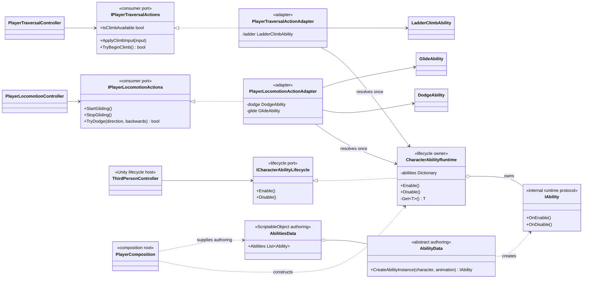
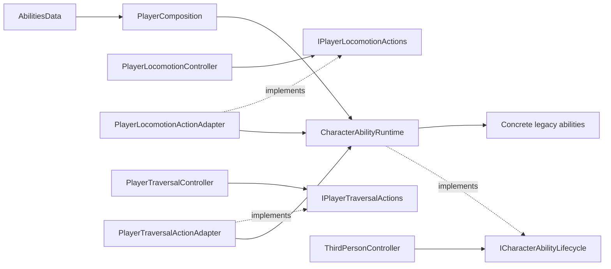

# Project S — Character Abilities Runtime

## Ответственность

`CharacterAbilityRuntime` создаёт активные ability-экземпляры из существующего `AbilitiesData`, владеет их lifecycle и скрывает внутренний реестр от gameplay-контроллеров. Это внутренняя переходная граница Project S, а не универсальная ability system и не кандидат на `_Modules` в текущем виде.

Gameplay-код больше не запрашивает ability по типу. Каждый feature получает минимальный контракт своей задачи:

- `IPlayerLocomotionActions` — glide и dodge;
- `IPlayerTraversalActions` — запуск climb и передача climb input;
- `ICharacterAbilityLifecycle` — симметричные `Enable / Disable` для Unity lifecycle host.

Существующие `AbilityData` и concrete abilities сохранены, поэтому serialized настройки и ссылки в `_Game` не мигрируют. Реестр доступен только внутренним adapter-классам и composition root.

## Дерево классов

## Направление зависимостей

Контроллеры зависят внутрь от consumer-specific портов. Зависимость от concrete ability направлена только из adapter-классов, расположенных рядом с соответствующим feature. Поэтому замена dodge, glide или climb не меняет controller API и не превращает общий реестр в service locator.

## Lifecycle и ограничения

`CharacterAbilityRuntime.Enable` и `Disable` идемпотентны. Один scoped runtime создаётся composition root для одного Player; `ThirdPersonController` включает его до feature controllers и выключает после них. При уничтожении VContainer scope `Dispose` повторно гарантирует `Disable`.

Это не завершённая модульная ability model. Concrete abilities всё ещё зависят от `Character`, `AnimationController`, Unity time и scene-компонентов. Их следует мигрировать по одному gameplay-сценарию, когда появятся стабильные command/state contracts. Перенос текущего runtime в `_App/Modules` лишь скроет Project S зависимости за неверной физической границей.
