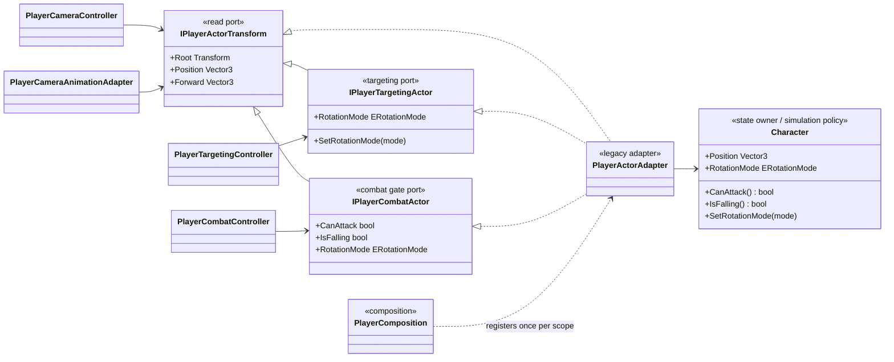
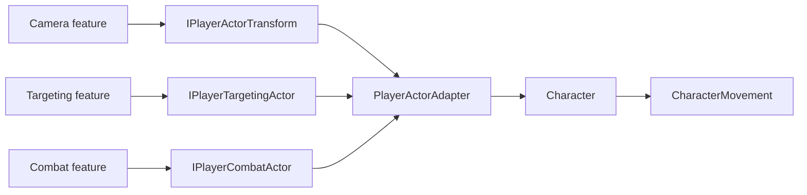

# Project S — Player Actor Boundary

## Назначение

`Character` пока объединяет физическую simulation policy, rotation policy, traversal-состояние и ряд legacy-проверок. Передавать этот concrete-класс во все новые feature controllers опасно: Camera, Targeting и Combat получают значительно больше возможностей, чем им требуется, и становятся зависимыми от дальнейшего рефакторинга `Character`.

`PlayerActorAdapter` образует anti-corruption boundary вокруг этой legacy-модели. Он не создаёт второе состояние игрока и ничего не кэширует: каждый запрос делегируется единственному owner — `Character`. Consumers получают только узкий порт под собственную ответственность.

## Дерево классов

## Направление зависимостей

- Camera может прочитать направление и transform, но не может менять rotation policy или вызывать combat gates.
- Targeting может временно менять только rotation policy, сохраняя и восстанавливая предыдущее значение.
- Combat видит только разрешение атаки, falling state и rotation mode; он не получает motor API.
- `PlayerActorAdapter` регистрируется один раз на gameplay scope и публикуется под тремя портами. Service locator и runtime search не используются.

## Граница абстракции

Это не универсальная модель персонажа и не обещание общего API для player, enemy и NPC. Порты существуют потому, что уже есть несколько реальных consumers и legacy-класс меняется независимо от них. Новые свойства добавляются только в тот consumer-specific контракт, которому они действительно нужны.

Когда обязанности `Character` будут окончательно разделены между motor, traversal и actor state, adapter можно будет перенаправить на новые owners либо удалить. Camera, Targeting и Combat при этом не должны измениться.

## Composition

`GameLifetimeScope` остаётся единственным scene composition root, но делегирует регистрацию игрока в `PlayerComposition`. Внутри Composition-региона feature-блоки `PlayerCameraComposition`, `PlayerTargetingComposition`, `PlayerCombatComposition` и `PlayerLocomotionComposition` владеют только wiring своих зависимостей. Они не являются runtime services и не доступны gameplay-коду.

Новые asmdef не добавлены: граница уже выражена контрактами и направлением ссылок, а features пока недостаточно стабильны для независимого versioning или package extraction.
