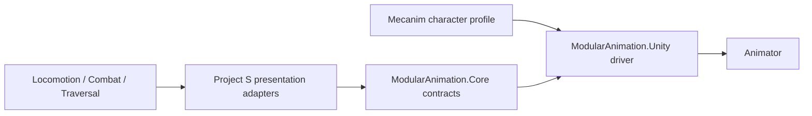

# Project S — Player Animation Presentation

## Назначение

Player animation отображает подтверждённый gameplay state и не является владельцем locomotion, combat timings, damage или traversal. Project-specific adapters переводят данные Player в backend-neutral контракты `ModularAnimation`; Unity Animator остаётся одной из сменяемых реализаций driver.

## Дерево классов

```mermaid
classDiagram
    direction LR

    class PlayerLocomotionController {
        +Snapshot PlayerLocomotionSnapshot
    }
    class PlayerLocomotionSnapshot {
        <<immutable presentation input>>
        +IsValid bool
        +State PlayerLocomotionStateId
        +SpeedMode PlayerSpeedMode
        +Mode PlayerLocomotionMode
        +ForwardSpeed float
        +LateralSpeed float
        +VerticalSpeed float
        +NormalizedSpeed float
        +IsGrounded bool
    }
    class IPlayerLocomotionPresentation {
        <<Project S port>>
        +Present(snapshot, deltaTime)
        +Reset()
    }
    class PlayerLocomotionAnimationAdapter {
        <<state transition adapter>>
    }
    class PlayerCharacterAnimationPresenter {
        <<locomotion mapper>>
        +Present(snapshot, deltaTime)
    }
    class CharacterLocomotionFrame {
        <<backend-neutral frame>>
    }
    class ICharacterAnimationDriver {
        <<module port>>
        +ApplyLocomotion(frame, deltaTime)
        +CrossFade(state, layer, transition, duration)
        +SetPlaybackSpeed(speed)
    }
    class MecanimCharacterAnimationDriver {
        <<Unity backend>>
    }
    class MecanimCharacterAnimationProfile {
        <<authoring profile>>
        +CreateBindings()
    }
    class MecanimCharacterAnimationBindings
    class Animator
    class PlayerCombatAnimationAdapter
    class PlayerTraversalActions

    PlayerLocomotionController --> PlayerLocomotionSnapshot : creates once per frame
    PlayerLocomotionController --> IPlayerLocomotionPresentation
    IPlayerLocomotionPresentation <|.. PlayerLocomotionAnimationAdapter
    PlayerLocomotionAnimationAdapter --> PlayerCharacterAnimationPresenter
    PlayerLocomotionAnimationAdapter --> ICharacterAnimationDriver : dodge transition
    PlayerCharacterAnimationPresenter --> CharacterLocomotionFrame : maps
    PlayerCharacterAnimationPresenter --> ICharacterAnimationDriver
    ICharacterAnimationDriver <|.. MecanimCharacterAnimationDriver
    MecanimCharacterAnimationProfile --> MecanimCharacterAnimationBindings : creates
    MecanimCharacterAnimationDriver --> MecanimCharacterAnimationBindings
    MecanimCharacterAnimationDriver --> Animator
    PlayerCombatAnimationAdapter --> ICharacterAnimationDriver
    PlayerTraversalActions --> ICharacterAnimationDriver
```

## Направление зависимостей

- `_App/Core` знает о семантике Player и зависит от `ModularAnimation`.
- `ModularAnimation.Core` не зависит от Unity, Project S и `_Game` assets.
- `ModularAnimation.Unity` зависит только от Core-контрактов и Unity animation API.
- Profile содержит только имена Animator parameters. Project-specific state ids и выбор clips остаются в `_App/Core` и `_Game`.

## Runtime ownership

- `PlayerLocomotionController` — единственный owner locomotion snapshot.
- `PlayerLocomotionAnimationAdapter` обнаруживает смену подтверждённого state и отправляет presentation transition.
- `PlayerCharacterAnimationPresenter` является stateless mapper snapshot → `CharacterLocomotionFrame`.
- `MecanimCharacterAnimationDriver` кэширует parameter hashes и clip durations, но не принимает gameplay-решения.
- Combat и Traversal используют тот же driver через отдельные adapters и не меняют locomotion state.

## Вариативность моделей

Humanoid и Generic персонажи используют одинаковый `ICharacterAnimationDriver`. Различия Animator Controller и parameter naming задаются отдельным `MecanimCharacterAnimationProfile`; retargeting, avatar и совместимость clips остаются authoring-ответственностью конкретного character prefab. Новый Playables/backend реализует тот же driver contract и выбирается только в Composition Root.

