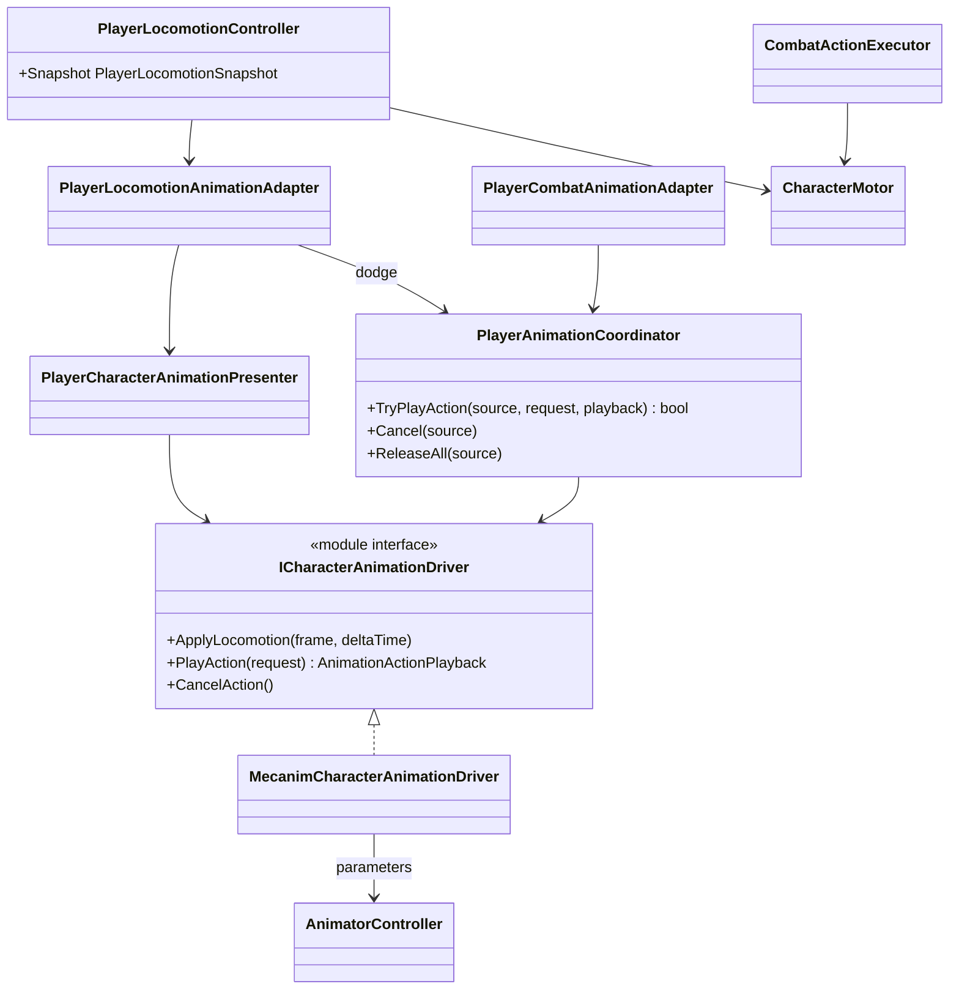

# Project S — Player Animation Presentation

## Boundary

Player animation displays confirmed gameplay state. Locomotion, dodge
eligibility, combat timing, hit windows and damage remain in gameplay code.
The Animator Controller owns only motions, blend trees and visual transitions.

## Ownership

- `PlayerLocomotionController` owns `Idle / Run / Jump / Fall / Dodge` gameplay
  state and publishes an immutable snapshot.
- `PlayerCharacterAnimationPresenter` maps that snapshot to a backend-neutral
  locomotion frame.
- `PlayerAnimationCoordinator` arbitrates finite action priority:
  `Death > Reaction > Traversal > Combat > Locomotion`.
- `MecanimCharacterAnimationDriver` is the only runtime writer of the Animator
  parameters. It caches hashes, validates the controller contract and never
  selects a clip.
- `Player_KurtzPel.controller` contains the actual states and fixed-duration
  transitions. It can be replaced by a controller with the same parameter and
  semantic action contract.
- `CombatActionDefinition.DurationSeconds` owns gameplay action duration. No
  combat rule reads an animation clip length or Animator normalized time.
- Root motion is disabled. Dodge and attack translation go through
  `CharacterMotor` and the normal collision sweep.

## Current content

The Player uses the KurtzPel 86-bone Generic Avatar. The controller currently
contains grounded locomotion, jump/fall/landing, forward/backward dodge and one
grounded unarmed light attack. Swimming and ladder animation are deferred.

Grounded locomotion uses the coherent ENFJ set with a genuine walk cycle and
blends by measured planar speed (`0/3/5/10` for idle/walk/run/sprint). The
KurtzPel visual is rotated `-90` degrees around Y at the presentation boundary
to align its authored `+X` forward with gameplay `+Z`; the physics root is not
rotated.

Humanoid migration is content work: replace the Avatar and motions while
preserving the controller parameters and semantic action IDs. Gameplay code and
the motor remain unchanged.
