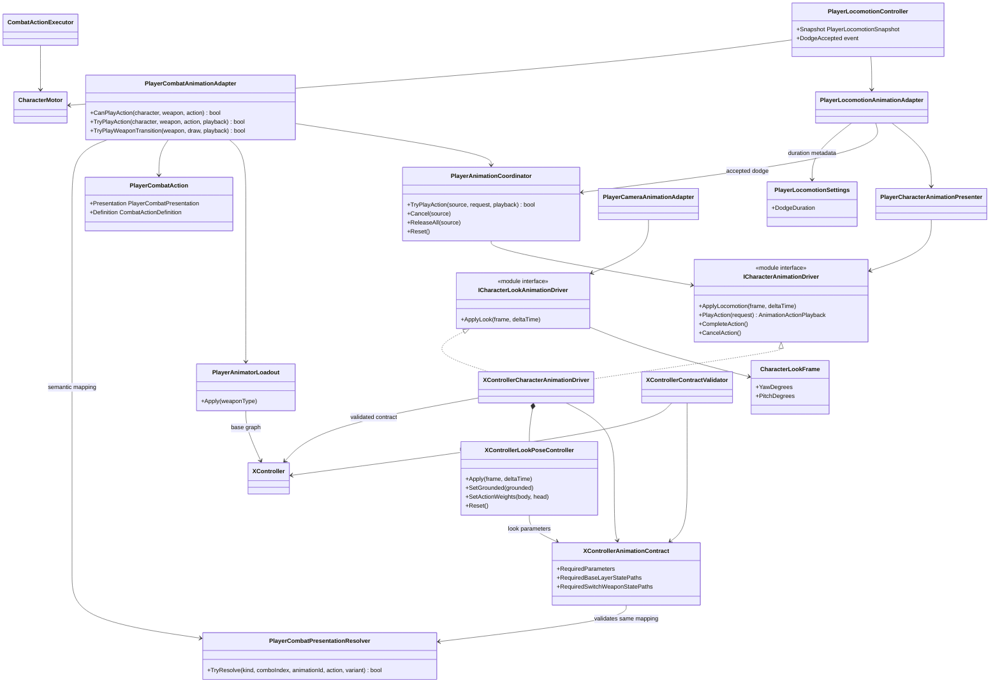

# Project S — Player animation presentation

## Boundary

Player animation displays confirmed gameplay state. Locomotion, dodge
eligibility, combat timing, hit windows, damage and translation remain in
gameplay code. The Animator Controller owns motion selection, Blend Trees and
visual crossfades.

## Ownership and update flow

- `PlayerLocomotionController` owns `Idle / Run / Jump / Fall / Dodge / AirDash / Landing` gameplay
  state and publishes an immutable snapshot.
- `PlayerCharacterAnimationPresenter` converts that snapshot to a rig-neutral
  locomotion frame.
- `PlayerAnimationCoordinator` arbitrates finite action priority:
  `Death > Reaction > Traversal > Defense > Combat > Locomotion`.
- Normal completion calls `CompleteAction` and only releases transient
  presentation ownership. Playback rate and look-layer suppression remain
  active until Animator has actually left the action state. Interruption calls
  `CancelAction`, releases both immediately and requests an explicit visual exit
  from the active Animator layer.
- Finite actions can live on different Animator layers. The driver explicitly
  neutralizes the previously owned layer before transferring presentation
  ownership: upper-body layers return to `Waiting`, while a replaced Base Layer
  action returns to `Move`. A stale guard or weapon pose therefore cannot remain
  over a higher-priority action, and an upper-body action entered after combat
  cannot leave the old full-body attack underneath it.
- Coordinator construction and actor disable both execute a full driver reset
  after feature owners stop. This clears stale look values, action ownership,
  per-source playback speed and Animator speed before a later re-enable; camera
  shutdown can no longer freeze the last target pose on the character.
- `XControllerCharacterAnimationDriver` is the only external parameter-writer
  boundary. The same scoped instance presents locomotion and finite actions and
  delegates only the four look channels to its owned
  `XControllerLookPoseController`.
- `PlayerCameraAnimationAdapter` supplies a rig-independent yaw/pitch request in
  character-local degrees. Its origin is the stable camera follow target, never
  the animated head bone that receives the resulting pose; this prevents a
  presentation feedback loop from producing oscillating look values. The
  `XControllerLookPoseController` owns pose calibration, body/head distribution,
  grounded/action weights, smoothing state and the four Animator writes. It has
  no lifecycle, target selection or gameplay authority outside its driver owner.
- Camera look presentation ticks from `PlayerActorController.Update` after
  targeting, before normal Animator evaluation. Cinemachine orientation remains
  in camera `LateTick`; separating them prevents the first frame of an attack or
  reaction from being evaluated with the previous BodyLook/HeadLook weights.
- `XController.controller` is the manually authored visual graph. No editor
  setup tool creates or rewrites its states, motions, Blend Trees or transitions.
- `PlayerCombatPresentationResolver` is the single mapping from combat
  presentation (`ComboStep`, `AirComboStep`, named ids) to semantic animation
  action and variant. Runtime playback and editor validation consume the same
  result. `XControllerAnimationContract` then owns the single action/variant to
  Animator state mapping consumed by both the driver and validator, so adding a
  slot cannot silently update only one side.
- `CombatActionDefinition.DurationSeconds` owns gameplay action duration. No
  combat rule reads clip length or Animator normalized time.
- Expected durations handed to the driver are authored, not baked into code.
  Reaction lengths come from `CharacterReactionProfile`, the guard pose length
  from `PlayerDefenseProfile.GuardClipSeconds`, and the weapon transition reuses
  the authored `DurationSeconds` of its own combat action, so gameplay and
  presentation cannot drift apart. The only remaining constant is the death
  length, which has no authored counterpart because both death paths clear the
  remaining duration before presenting.
- `PlayerAnimatorActions` resolves a slot through a table built once at static
  initialization from the same predicates it used to evaluate per call. Lookup is
  allocation-free; an unmapped slot still returns `false` and the caller decides
  how to degrade.
- Root motion is disabled for every clip in the working set, attacks included.
  Dodge and attack movement go through `CharacterMotor`, including normal
  collision sweeps and grounding.
- Action travel is authored in `CombatMotionDefinition` and owns its own numbers.
  The source clip's root curve is reference material, not the target: reach is a
  balance value tuned against how the move should play, so a deliberate gap
  between the two is expected rather than drift to be corrected. Baked root
  motion is rejected for three reasons: it cannot honour target assist, it would
  give the same logical attack a different reach per weapon because override
  clips carry different baked displacement, and it couples reach to the playback
  rate the driver already stretches between 0.5x and 2.0x.
- Clips that ship both a travelling and an in-place variant are wired through the
  in-place one. A discarded root curve still animates a lunge the character never
  makes, which reads as a snap back to origin.
- Dodge presentation receives its expected duration from the same immutable
  `PlayerLocomotionSettings` snapshot as gameplay composition. The validator
  checks every active weapon override's forward/back evade clips against that
  duration with a 50 ms tolerance; clip length never becomes simulation state.

## Transition model

Transitions out of finite states remain content-authored in Animator. The
restored XController has no semantic action parameters or entry transitions,
so the Project S adapter maps an accepted semantic request to a known state and
enters it with `CrossFadeInFixedTime`. Gameplay still owns acceptance, timing
and cancellation; it never selects a clip. `CancelAction` returns base-layer
dodge/attack/reaction actions to `Move` and upper-body defense/weapon actions to
their own `Waiting` state.
`CompleteAction` does not force a transition and lets the controller finish its
authored exit.

Cross-layer replacement is the exception to that non-disruptive rule: a
higher-priority base-layer action cannot replace an upper-body state through a
base-layer crossfade. The inverse is also true when Guard replaces a full-body
combat action. The driver detects both boundaries and neutralizes the tracked
source layer; `Reset` performs the same cleanup for disable and re-enable
lifecycle safety.

Combat exits use normalized transition duration. For every semantic action
slot, `exitTime + transitionDuration` equals the gameplay
`CombatActionDefinition.CompletionTime`. This keeps the visual completion
boundary stable when an `AnimatorOverrideController` substitutes a clip of a
different absolute length. The transition remains authored in the existing
state; no runtime code creates nodes or derives gameplay timing from Animator.

The current action contract is:

| Action | Id | Variant | State |
| --- | ---: | ---: | --- |
| Dodge | 1 | 0 | `Locomotion/Roll/RollFront` |
| Dodge | 1 | 1 | `Locomotion/Roll/RollBack` |
| Air dash | 14 | 0 | `Locomotion/Jump/AirDash/AirDashFront` |
| Air dash | 14 | 1 | `Locomotion/Jump/AirDash/AirDashBack` |
| Light attack | 2 | 0...3 | `Attack/BaseAttack1...4` |
| Air light attack | 5 | 0...2 | `Attack/AirAttack1...3` |
| Grounded named special | 6 | 0 | `Attack/Skill` |
| Grounded heavy attack | 7 | 0 | `Attack/BaseAttack4` |
| Launcher | 8 | 0 | `Attack/Launcher` |
| Air chase | 9 | 0 | `Locomotion/Jump/Jump/JumpRunning` |
| Guard enter/hold | 10 | 0/1 | `Defense Layer/Guard` |
| Sheathe current weapon | 3 | 0 | `SwitchWeapon Layer/Sheathe` |
| Draw target weapon | 3 | 1 | `SwitchWeapon Layer/Draw` |
| Hit reaction (front/fallback) | 4 | 0 | `Reaction/HitStun` |
| Reaction | 4 | 1 | `Reaction/Knockdown` |
| Reaction | 4 | 2 | `Reaction/Airborne` |
| Death (default/light) | 4 | 3 | `Reaction/Dead_1` |
| Get up | 4 | 4 | `Reaction/GetUp` |
| Death (heavy) | 4 | 5 | `Reaction/Dead_2` |
| Hit reaction (source behind) | 4 | 6 | `Reaction/HitStun_Back` |
| Hit reaction (source left) | 4 | 7 | `Reaction/HitStun_Left` |
| Hit reaction (source right) | 4 | 8 | `Reaction/HitStun_Right` |

The controller consumes its historical `MovementType`, `MovementDirection`,
`FallingDuration`, `OnGround` and `SpeedMultiplier` parameters. `BodyLookX/Y`
and `HeadLookX/Y` drive the additive `BodyLook` and `HeadLook` layers from the
camera/targeting presentation path. Jump anticipation remains gameplay-owned
regardless of the current animation graph.

## Locomotion selection

The locomotion tree blends on `MovementType`, the gait index, with thresholds
`0` idle, `1` walk, `2` run and `3` sprint. Each gait owns a nested
`MovementDirection` tree that picks the backward or forward clip at `-0.5` and
`0.5`. The `Move` state carries no speed parameter: every clip plays at its
authored rate.

Gait selection and clip cadence are deliberately separate concerns here, and
only selection is solved. Because the gait index — not the motor speed — chooses
the tier, the clip the player sees always matches the movement mode they asked
for. The cost is that the clips were authored slower than the motor moves, so
the feet under-run the ground: walk travels `3.0` m/s against a `1.823` m/s
cycle, run `5.0` against `2.963`, and sprint `10.0` against the same `2.963`
because `Loco_Sprint_F/B` are copies of the run clips.

While a dodge or an air dash owns the velocity, the locomotion frame carries the
requested gait speed instead of the measured planar speed. The action moves the
character far faster than any gait, so feeding the measured speed parked
`MovementType` at run for the whole roll: a standing dodge then exited through a
run pose and needed half a second to decay back to idle, which read as a roll
authored for a running exit. The same value also chooses the dodge cross-fade
length, so a standing dodge now gets the short fade instead of always taking the
moving one. Holding a direction keeps the requested speed at the gait, so a roll
out of a run still exits into the run clip.

Scaling playback to close that gap was tried and reverted. Driving the blend by
metres per second instead of gait index made the walk clip unreachable, since
the gameplay walk speed of `3.0` m/s sits above the run clip's authored `2.963`,
and stretching the run clip to sprint speed needed a rate the eye reads as
comical. Any future attempt needs faster source cycles first; retiming the
existing ones is not enough.

The body receives a smaller share of the requested angle and follows it more
slowly; the head receives the remaining angle and reacts faster. Losing a
target smoothly returns both channels to neutral. Airborne locomotion removes
body twist and retains only a reduced head response. Dodge and reaction poses
fully suppress look, while attacks and weapon transitions retain reduced
tracking so additive layers do not deform authored action silhouettes.

Suppression is applied through damped Animator layer weights, not by scaling the
`BodyLookX/Y` and `HeadLookX/Y` values. The look target therefore remains
continuous when presentation ownership changes and the body/head angle split
cannot jump on attack or reaction entry. `BodyLook.mask` enables only the
Humanoid Body channel; `HeadLook.mask` enables only Head. Root, limbs and IK are
excluded from both additive layers.

Guard is an upper-body override rather than a locomotion state. `Defense Layer`
uses `DefenseUpperBody.mask`: Body, Head, both Arms and Fingers are enabled,
while Root, Legs and IK are disabled. The Base Layer therefore remains the sole
owner of idle/walk/run/sprint and continues evaluating the locomotion Blend Tree
while the non-looping Guard clip enters and holds its final pose. Block and Parry
remain full-body reaction slots until their moving variants are migrated
deliberately.

Both look layers use `SimpleDirectional2D` Blend Trees. Their horizontal and
vertical parameters are evaluated together and each tree contains exactly one
neutral motion at `(0, 0)`. A `Simple1D` tree is invalid here: it ignores the
vertical channel and selects a directional clip at zero, which twists the
neutral pose and creates discontinuous jumps while the input crosses its
thresholds. `XControllerContractValidator` checks the tree type, both parameter
names and the single neutral child so this controller regression is reported
before Play Mode.

`CombatActionDefinition.DurationSeconds` remains the gameplay timeline for hit,
chain, cancel and completion windows. For attack and dodge actions the
Project-S-specific driver resolves the active clip through the stable XController
slot and derives `clip.length / expectedDuration`. This content rate lets the
whole base or overridden clip finish inside the authoritative gameplay window;
Animator normalized time never becomes simulation state. Weapon overrides
should still be authored close to the semantic timing so runtime correction
remains small.

The validator requires one consistent Write Defaults policy across the entire
Base Layer. The preserved legacy controller currently uses `On`; new action
states must not silently use `Off`, because incomplete Humanoid curves can then
inherit transforms or muscle values from the previous state and make the result
transition-order dependent.

Content rate and time policy are separate factors. Hit stop multiplies the
current action rate and restores it afterwards; completion or cancellation
does not make Animator timing authoritative. Normal completion retains the
content factor while the authored exit still references the action state and
retains the matching BodyLook/HeadLook action weights over the same interval.
Both are cleared once Animator reaches the destination state; an explicit cancel
clears them before its forced crossfade. The base attack and dodge states
therefore keep authored state speed `1`, which is enforced by the editor contract
validator.

Reaction and death actions keep authored playback speed `1`. Gameplay reaction
state and duration remain authoritative and cancel presentation when their
window ends, but a short hit-stun does not compress the source clip to fit the
gameplay duration. This preserves the authored impact pose and avoids the
unnatural accelerated playback seen with prototype reaction clips.
Body/head look parameters are neutralized while a reaction or death action owns
the finite-action lane, preventing additive aiming poses from deforming the hit
motion. They resume after the reaction controller returns to `Stable`.

`Reaction` is a dedicated Base Layer sub-state machine. Its nine states have no
parameter-driven entry and no gameplay transitions: the driver enters the
accepted state directly. Reaction gameplay changes `Knockdown` to `GetUp`, then
explicitly cancels GetUp back to `Locomotion/Move`; short hit-stun and airborne
reactions cancel directly to Move. `Dead_1` is the fallback death and
`Dead_2` is selected for `hit.heavy`; both hold their final frame until the
health owner confirms revival. This keeps damage, recovery and death authority
outside Mecanim while retaining visible, replaceable Animator slots.

Hit-stun direction is captured by gameplay when the hit is confirmed and means
the source side relative to the target (`Front`, `Back`, `Left`, `Right`). The
snapshot remains stable if the actor rotates during playback. Front and missing
direction use the original `HitStun`; the other sides use variants `6...8`.
Current motions are prototype content slots and may be replaced independently
without changing reaction state ownership or the animation-driver contract.

## Weapon override contract

Every equipped weapon uses an `AnimatorOverrideController` whose base controller
is `XController`. Layers, parameters, state machines and state names therefore
remain identical; only animation clips are replaced. `Unarmed` alone uses the
base controller; a missing armed override is an invalid loadout.

`PlayerAnimatorLoadout` owns runtime controller selection. It validates all
configured overrides during scene composition and rejects a missing controller,
duplicate weapon binding, or an override built on another base graph. `Unarmed`
uses `XController` directly.
Changing between the base controller and a compatible override preserves all
Animator parameters, current normalized state time, layer weights and playback
speed. Controller reassignment therefore cannot reset moving locomotion to the
default idle pose.

Draw selects the incoming animation loadout before its transition starts, but
the gameplay weapon and rig change only at normalized commit time `0.50`.
Sheathe keeps the outgoing loadout until the clip finishes, changes gameplay
state at the same commit point, and returns to the base controller at completion.
Cancellation restores the loadout for the weapon that actually reached commit.

The common graph exposes only `SwitchWeapon Layer/Draw` and `Sheathe`. It has no
OneHanded/TwoHanded branches. `EWeaponType` selects the weapon's
`AnimatorOverrideController`, and that override supplies the concrete draw and
sheathe clips for the same two stable slots.

Weapon transitions run for `1.00 s`, matching the current draw/sheathe clips.
Their Animator states start returning to `Waiting` at normalized time `0.90`
through a `0.10 s` fixed-duration blend. The combat executor is advanced once
by `PlayerActorController`'s gameplay tick; async weapon/action workflows await
completion but never advance time themselves.

The source motions assigned to the dodge, ground combo, heavy, launcher, air
combo and special states are unique override slots. Do not reuse one source clip
for two semantically different states because a single override would then
replace both usages.

Animator state names and clip slot names are deliberately independent: states
keep the historical XController names, while clips follow
`Docs/Animation/AnimationNaming.md`. The mapping between them is declared once,
in `XControllerAnimationContract.TryGetClipSlot`:

| State | Clip slot |
| --- | --- |
| `Attack/BaseAttack1...4` | `Unarmed_Combo_1...4` |
| `Attack/AirAttack1...3` | `Unarmed_Air_1...3` |
| `Attack/Launcher` | `Unarmed_Launcher` |
| `Attack/Skill` | `Unarmed_Special` |
| `Locomotion/Jump/AirDash/AirDashFront` / `AirDashBack` | `Jump_AirDash_F` / `Jump_AirDash_B` |
| `Locomotion/Jump/Jump/JumpRunning` | `Jump_Rise_Run` |
| `Locomotion/Roll/RollFront` / `RollBack` | `Dodge_Roll_F` / `Dodge_Roll_B` |

That table is load-bearing, not documentation. `ResolveActionPlaybackRate`
resolves the currently active override through it to learn the real clip length
before stretching an action to its gameplay duration; without it the driver
would silently fall back to rate `1.0` and every action would drift from its
authored timing. The validator asserts each listed state actually carries its
declared slot clip.

Dodges are shared across weapons, so an override that replaces `Dodge_Roll_F` or
`Dodge_Roll_B` fails validation. The base clip is stretched to the gameplay
`DodgeSettings` duration at runtime, which is why the dodge states keep speed
`1.0` and the validator only checks that the implied rate stays inside
`[0.5, 2.0]`.

## Current content

The Player prefab references `XController.controller` as its base and starts
with `Unarmed`, which runs on that base controller directly. `DualHand` is bound
to `DualSwords.overrideController` and is reached by switching weapons.
Unsupported weapon types are rejected before entering gameplay state. Additional
weapon styles extend the serialized binding list without changing gameplay or
Animator state names after a compatible override asset exists.

The DualSwords three-step ground light combo, standalone grounded
`BaseAttack4` heavy, dedicated `Launcher`, three air attacks and grounded
`Skill` state are entered
by the Project S adapter with a `0.12 s` fixed-time crossfade. Their natural exits
remain authored in XController; an explicit gameplay cancellation uses a
`0.12 s` crossfade back to locomotion. A new combo step or named special interrupts
the current attack only after gameplay accepts its buffered command inside the
configured chain/cancel window.

The four ground-light slots are presentation capacity, not a global combo
length. `DualSwords` reaches variants `0...2`; `Unarmed` reaches `0...3` through
its own action graph. The Unarmed fourth step and its separately addressable
heavy action currently share `BaseAttack4`, while remaining different gameplay
actions.

`AirAttack1...3` use standalone Humanoid `.anim` derivatives created from the
Frank dual-sword zero-height source. The Frank catalog and all derived slots use
the shared Humanoid contract, while XController still avoids direct FBX
references. This keeps the source catalog replaceable, gives the
base controller stable universal slot names and lets a future weapon override
replace only these motions. Their exits (`0.76 / 0.76 / 0.82` plus a `0.20 s`
fixed blend) align with the authored gameplay completion times.

The current reaction states use Humanoid proxy motions from one coherent Knight
set: `LightHit`, the alternate `LightHit`, `Fall`, `Death` and `Revive`. These
clips are referenced without modifying their imported FBX files. They are
replaceable content slots, not final reaction directionality.

## Contract validation

`XControllerAnimationContract` is the shared source of required layer,
parameter and state names for runtime validation and editor tooling. The
read-only command `Tools/Animation/Validate XController Contract` checks the
controller (including the named `Attack/Skill` slot), compatible Humanoid motions,
finite-state exit ownership, base and
override-controller compatibility, and the Player/training-target prefabs. It
reports mismatches but never creates or rewrites Animator states, transitions,
Blend Trees, clips or prefab bindings.
It also fixes the locomotion blend contract to a continuous
`Idle(0) / Walk(1) / Run(2) / Sprint(3)` gait axis with backward/forward
subtrees at `-0.5 / 0.5`. Runtime damping therefore cannot be invalidated by an
accidental Blend Tree type or threshold change.
Controller defaults are part of the same neutral-pose contract:
`OnGround=true`, all movement/look channels at zero and `SpeedMultiplier=1`.
This keeps Editor preview and the first frame before composition consistent with
the runtime driver reset.
The validator also builds the active player combat profile and verifies that
each mapped combat state has timed exits with normalized blend duration and the
same completion boundary as gameplay. This catches a disabled launcher exit or
an override-incompatible fixed-time blend before Play Mode.
For every Player weapon override it additionally resolves the actual clip behind
each combat slot and compares its effective duration with the action profile
within 20 ms. Hit, chain and recovery windows therefore cannot drift silently
after a clip replacement.
For the `Unarmed` base controller it validates one clip per synchronized
attack/dodge state, authored state speed `1`, and a bounded automatic playback
rate of `0.5..2.0`. Armed loadouts must provide a compatible override instead of
falling back to unrelated base clips.
It additionally requires the Player prefab to reference that exact profile and
builds its full graph, input-buffer settings and weapon-transition definition
before comparing animation timings. A broken route or missing authoring block
therefore cannot pass because its individual animation slots happen to be valid.
Every authored combat action must also map to an explicit XController state, and
all timed exits from that state must agree with its gameplay completion boundary.
Unsupported presentation slots and ambiguous completion transitions are
validation errors rather than silent skips.

Именование и раскладка анимационных клипов описаны в `Docs/Animation/AnimationNaming.md`.
