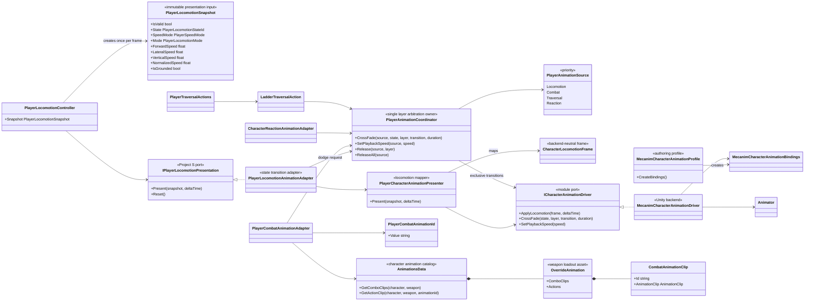
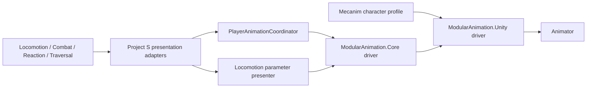

# Project S — Player Animation Presentation

## Назначение

Player animation отображает подтверждённый gameplay state и не является владельцем locomotion, combat timings, damage или traversal. Project-specific adapters переводят данные Player в backend-neutral контракты `ModularAnimation`; Unity Animator остаётся одной из сменяемых реализаций driver.

## Дерево классов



## Направление зависимостей



- `_App/Core` знает о семантике Player и зависит от `ModularAnimation`.
- `ModularAnimation.Core` не зависит от Unity, Project S и `_Game` assets.
- `ModularAnimation.Unity` зависит только от Core-контрактов и Unity animation API.
- Profile содержит только имена Animator parameters. Project-specific state ids и выбор clips остаются в `_App/Core` и `_Game`.

## Runtime ownership

- `PlayerLocomotionController` — единственный owner locomotion snapshot.
- `PlayerLocomotionAnimationAdapter` обнаруживает смену подтверждённого state и отправляет presentation transition.
- `PlayerCharacterAnimationPresenter` является stateless mapper snapshot → `CharacterLocomotionFrame`.
- `PlayerAnimationCoordinator` — единственный owner явных `CrossFade`, владельца animation layer и source-specific playback speed.
- `MecanimCharacterAnimationDriver` кэширует parameter hashes и clip durations, но не принимает gameplay-решения.
- Locomotion parameters обновляются независимо от layer arbitration, поэтому underlying blend tree получает актуальную скорость даже во время action animation.
- Combat, Reaction и Traversal отправляют coordinator только presentation requests и не меняют locomotion state.

## Arbitration animation states

Для одного layer одновременно существует только один effective owner. Приоритеты принадлежат Project S Core, а не универсальному animation module:

```text
Reaction > Traversal > Combat > Locomotion
```

- Более высокий source может прервать визуальный state более низкого.
- Более низкий request не изменяет Animator и получает `AnimationPlayback.Invalid`; gameplay action обязан трактовать это как непринятое presentation-действие.
- Последний валидный request каждого source/layer сохраняется. После `Release` coordinator восстанавливает самый приоритетный оставшийся request.
- Combat освобождает свои layers при completion, cancellation, interruption и disable.
- Reaction освобождает layer при возврате в `Stable` или reset lifecycle.
- Traversal освобождает layers при выходе из climbing mode и при disable.
- Locomotion освобождает явный dodge request при выходе из `Dodge`; обычные blend parameters продолжают обновляться каждый frame.
- `SpeedMultiplier` применяется только текущим владельцем Base Layer и сбрасывается либо восстанавливается вместе со сменой owner.

## Combat presentation lookup

Combat gameplay не знает о clip references. `PlayerCombatAction` содержит presentation: combo index либо `PlayerCombatAnimationId`. `PlayerCombatAnimationAdapter` разрешает её через `AnimationsData -> OverrideAnimation` текущего character/weapon loadout и только после этого вызывает driver.

`OverrideAnimation` хранит плоский список combo clips и named `CombatAnimationClip` entries. Enum навыков и generic `SkillBase` hierarchy удалены: строковый animation id позволяет новому action profile добавить presentation slot без изменения C# enum. Animation id не является gameplay action id и не задаёт transitions, cooldown или damage.

## Вариативность моделей

Humanoid и Generic персонажи используют одинаковый `ICharacterAnimationDriver`. Различия Animator Controller и parameter naming задаются отдельным `MecanimCharacterAnimationProfile`; retargeting, avatar и совместимость clips остаются authoring-ответственностью конкретного character prefab. Новый Playables/backend реализует тот же driver contract и выбирается только в Composition Root.

## Следующий state scope

Layer arbitration теперь имеет одного владельца. Следующий отдельный блок — согласование gameplay interruption rules: прежде всего реакция во время traversal, запрет новых действий при non-stable reaction и явное восстановление presentation после сложного interruption.

Эта работа не зависит от финальных animation clips и не переносит gameplay authority в Animator. Gameplay state machines по-прежнему подтверждают состояние, coordinator решает только конфликт presentation requests.
