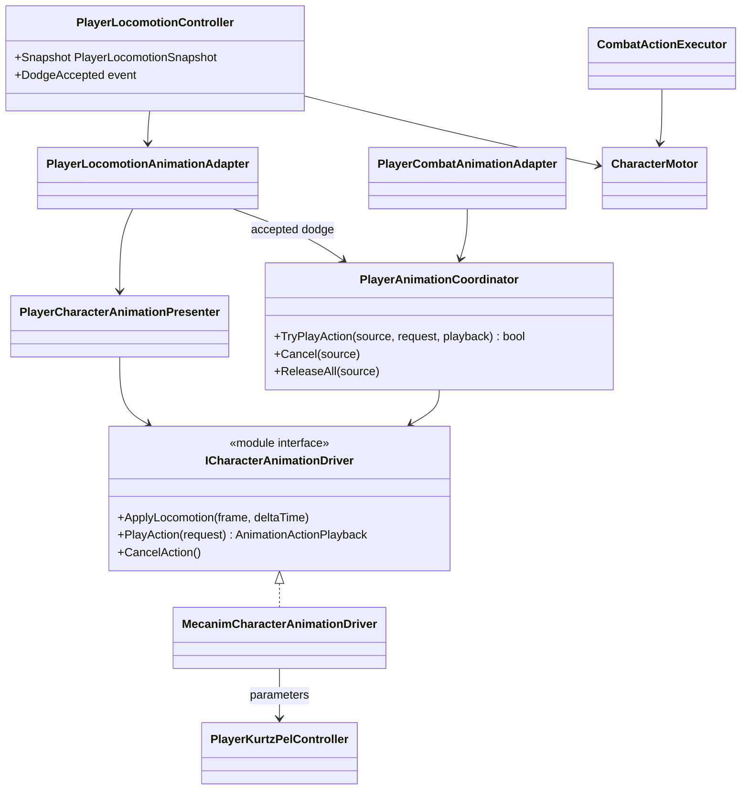
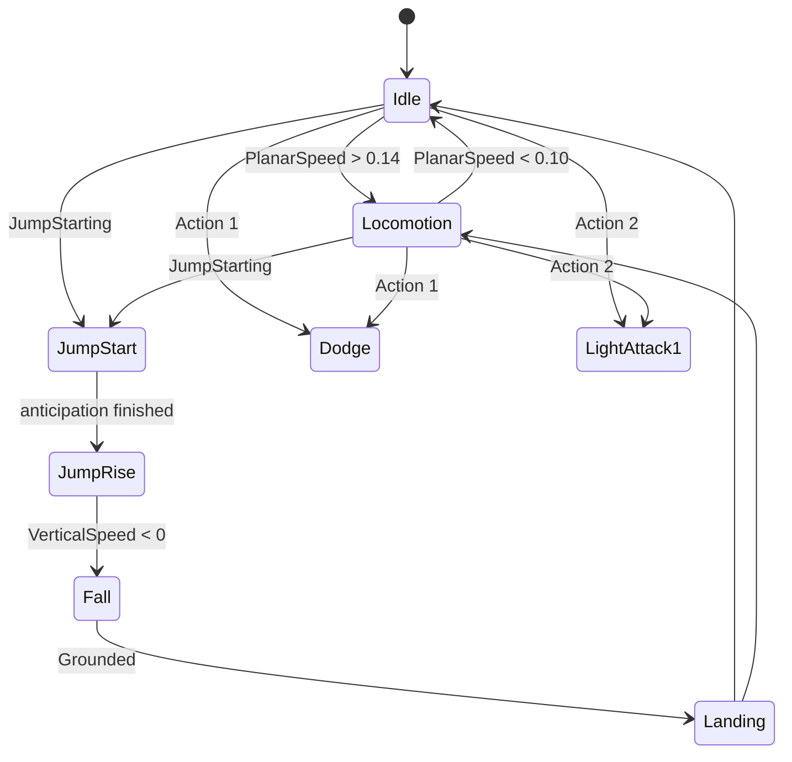

# Project S — Player animation presentation

## Boundary

Player animation displays confirmed gameplay state. Locomotion, dodge
eligibility, combat timing, hit windows, damage and translation remain in
gameplay code. The Animator Controller owns motion selection, Blend Trees and
visual crossfades.

## Ownership and update flow

- `PlayerLocomotionController` owns `Idle / Run / Jump / Fall / Dodge` gameplay
  state and publishes an immutable snapshot.
- `PlayerCharacterAnimationPresenter` converts that snapshot to a rig-neutral
  locomotion frame.
- `PlayerAnimationCoordinator` arbitrates finite action priority:
  `Death > Reaction > Traversal > Combat > Locomotion`.
- `MecanimCharacterAnimationDriver` is the only parameter writer. It validates
  the controller contract, caches parameter hashes and never selects a clip.
- `PlayerKurtzPel.controller` is the single-layer visual graph. It can be edited
  directly in Animator; the setup tool validates rather than overwrites an
  existing asset.
- `CombatActionDefinition.DurationSeconds` owns gameplay action duration. No
  combat rule reads clip length or Animator normalized time.
- Root motion is disabled. Dodge and attack movement go through
  `CharacterMotor`, including normal collision sweeps and grounding.

## Transition model

The controller avoids one large idle/walk/run/sprint Blend Tree. Idle is a
separate state; locomotion contains only the three cyclic moving clips.

The locomotion Blend Tree uses the measured physical thresholds
`Walk=3`, `Run=5`, `Sprint=10 m/s`. Walk is the reference contact phase;
measured offsets `Run=0.32` and `Sprint=0.47` align the selected cycles. Short
crossfades (`0.12 s` locomotion, `0.055 s` action entry) keep the controller
responsive while avoiding pose cuts.

Jump anticipation is gameplay-owned (`0.12 s`). The Animator shows Jump Start
during that interval, then uses vertical velocity and grounding for rise, fall
and landing. A missing/short clip cannot change jump physics.

## Current content and validation

The Player uses the KurtzPel Generic Avatar and selected ENFJ locomotion set,
forward/back dodge and the first Blazing Fist light attack. The visual child is
rotated `-90` degrees around Y to convert authored `+X` forward to gameplay
`+Z`; the physics root remains unrotated.

The runtime path was exercised in `PrototypeArena` through the real Input
System:

- keyboard move produced `Locomotion`, `PlanarSpeed=5` and motor displacement;
- jump entered the gameplay-owned `Jump Start` phase;
- light attack entered `Light Attack 1` through the combat command path;
- gamepad dodge entered `Dodge Forward` and moved through the motor.

Humanoid migration remains content-only. The production Avatar, clips and
controller motions can be replaced while preserving all gameplay contracts.
