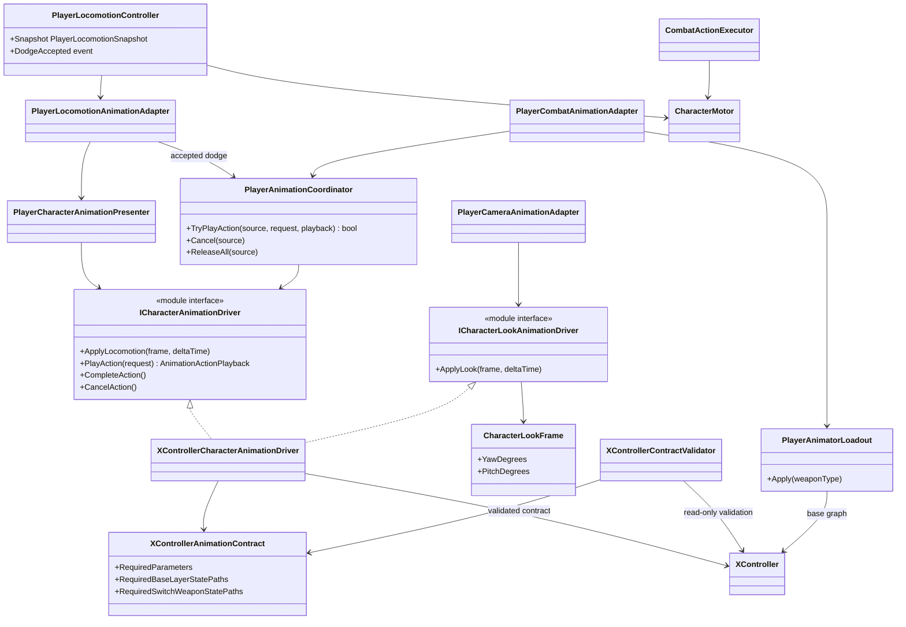

# Project S — Player animation presentation

## Boundary

Player animation displays confirmed gameplay state. Locomotion, dodge
eligibility, combat timing, hit windows, damage and translation remain in
gameplay code. The Animator Controller owns motion selection, Blend Trees and
visual crossfades.

## Ownership and update flow

- `PlayerLocomotionController` owns `Idle / Run / Jump / Fall / Dodge` gameplay
  state and publishes an immutable snapshot.
- `PlayerCharacterAnimationPresenter` converts that snapshot to a rig-neutral
  locomotion frame.
- `PlayerAnimationCoordinator` arbitrates finite action priority:
  `Death > Reaction > Traversal > Combat > Locomotion`.
- Normal completion calls `CompleteAction` and only releases transient
  presentation policy. Interruption calls `CancelAction` and requests an
  explicit visual exit from the active Animator layer.
- `XControllerCharacterAnimationDriver` is the only parameter writer. The same
  scoped instance presents locomotion, finite actions and body/head look.
- `PlayerCameraAnimationAdapter` supplies a rig-independent yaw/pitch request in
  character-local degrees. The XController adapter owns pose calibration,
  body/head distribution and presentation smoothing.
- `XController.controller` is the manually authored visual graph. No editor
  setup tool creates or rewrites its states, motions, Blend Trees or transitions.
- `CombatActionDefinition.DurationSeconds` owns gameplay action duration. No
  combat rule reads clip length or Animator normalized time.
- Root motion is disabled. Dodge and attack movement go through
  `CharacterMotor`, including normal collision sweeps and grounding.

## Transition model

Transitions out of finite states remain content-authored in Animator. The
restored XController has no semantic action parameters or entry transitions,
so the Project S adapter maps an accepted semantic request to a known state and
enters it with `CrossFadeInFixedTime`. Gameplay still owns acceptance, timing
and cancellation; it never selects a clip. `CancelAction` returns base-layer
dodge/attack/reaction actions to `Move` and weapon-layer actions to `Waiting`.
`CompleteAction` does not force a transition and lets the controller finish its
authored exit.

The current action contract is:

| Action | Id | Variant | State |
| --- | ---: | ---: | --- |
| Dodge | 1 | 0 | `Locomotion/Roll/RollFront` |
| Dodge | 1 | 1 | `Locomotion/Roll/RollBack` |
| Light attack | 2 | 0...2 | `Attack/BaseAttack1...3` |
| Air light attack | 5 | 0...2 | `Attack/AirAttack1...3` |
| Grounded named special | 6 | 0 | `Attack/Skill` |
| Grounded heavy attack | 7 | 0 | `Attack/BaseAttack4` |
| Sheathe two-handed | 3 | 0 | `SwitchWeapon Layer/TwoHanded_Sheathe` |
| Draw two-handed | 3 | 1 | `SwitchWeapon Layer/TwoHanded_Unsheathe` |
| Hit reaction (front/fallback) | 4 | 0 | `Reaction/HitStun` |
| Reaction | 4 | 1 | `Reaction/Knockdown` |
| Reaction | 4 | 2 | `Reaction/Airborne` |
| Death (default/light) | 4 | 3 | `Reaction/Dead_1` |
| Get up | 4 | 4 | `Reaction/GetUp` |
| Death (heavy) | 4 | 5 | `Reaction/Dead_2` |
| Hit reaction (source behind) | 4 | 6 | `Reaction/HitStun_Back` |
| Hit reaction (source left) | 4 | 7 | `Reaction/HitStun_Left` |
| Hit reaction (source right) | 4 | 8 | `Reaction/HitStun_Right` |

The controller consumes its historical `MovementType`, `MovementDirection`,
`FallingDuration`, `OnGround` and `SpeedMultiplier` parameters. `BodyLookX/Y`
and `HeadLookX/Y` drive the additive `BodyLook` and `HeadLook` layers from the
camera/targeting presentation path. Jump anticipation remains gameplay-owned
regardless of the current animation graph.

The body receives a smaller share of the requested angle and follows it more
slowly; the head receives the remaining angle and reacts faster. Losing a
target smoothly returns both channels to neutral. Airborne locomotion removes
body twist and retains only a reduced head response. Dodge and reaction poses
fully suppress look, while attacks and weapon transitions retain reduced
tracking so additive layers do not deform authored action silhouettes.

`CombatActionDefinition.DurationSeconds` remains the gameplay timeline for hit,
chain, cancel and completion windows. The restored XController currently plays
its authored clips at their native speed; it does not infer gameplay timing from
Animator normalized time and does not stretch a clip automatically. Weapon
overrides therefore need clips authored for the same semantic timing until an
explicit per-action playback-rate contract is introduced.

Reaction and death actions keep authored playback speed `1`. Gameplay reaction
state and duration remain authoritative and cancel presentation when their
window ends, but a short hit-stun does not compress the source clip to fit the
gameplay duration. This preserves the authored impact pose and avoids the
unnatural accelerated playback seen with prototype reaction clips.
Body/head look parameters are neutralized while a reaction or death action owns
the finite-action lane, preventing additive aiming poses from deforming the hit
motion. They resume after the reaction controller returns to `Stable`.

`Reaction` is a dedicated Base Layer sub-state machine. Its nine states have no
parameter-driven entry and no gameplay transitions: the driver enters the
accepted state directly. Reaction gameplay changes `Knockdown` to `GetUp`, then
explicitly cancels GetUp back to `Locomotion/Move`; short hit-stun and airborne
reactions cancel directly to Move. `Dead_1` is the fallback death and
`Dead_2` is selected for `hit.heavy`; both hold their final frame until the
health owner confirms revival. This keeps damage, recovery and death authority
outside Mecanim while retaining visible, replaceable Animator slots.

Hit-stun direction is captured by gameplay when the hit is confirmed and means
the source side relative to the target (`Front`, `Back`, `Left`, `Right`). The
snapshot remains stable if the actor rotates during playback. Front and missing
direction use the original `HitStun`; the other sides use variants `6...8`.
Current motions are prototype content slots and may be replaced independently
without changing reaction state ownership or the animation-driver contract.

## Weapon override contract

An equipped weapon may use an `AnimatorOverrideController` whose base controller
is `XController`. Layers, parameters, state machines and state names therefore
remain identical; only animation clips are replaced. A missing weapon-specific
override intentionally falls back to the base controller.

`PlayerAnimatorLoadout` owns runtime controller selection. It validates all
configured overrides during scene composition and rejects a missing controller,
duplicate weapon binding, or an override built on another base graph. `Unarmed`
and every weapon without a configured override use `XController` directly.

Draw selects the incoming animation loadout before its transition starts, but
the gameplay weapon and rig change only at normalized commit time `0.50`.
Sheathe keeps the outgoing loadout until the clip finishes, changes gameplay
state at the same commit point, and returns to the base controller at completion.
Cancellation restores the loadout for the weapon that actually reached commit.

Weapon transitions run for `1.00 s`, matching the current draw/sheathe clips.
Their Animator states start returning to `Waiting` at normalized time `0.90`
through a `0.10 s` fixed-duration blend. The combat executor advances once per
rendered frame with `UniTask.NextFrame`, so a single `Time.deltaTime` cannot be
counted multiple times.

The source motions assigned to `RollFront`, `RollBack`, `BaseAttack1...3`,
`BaseAttack4`, `AirAttack1...3` and `Skill`
are unique override slots. Do not reuse one source clip for two semantically
different states because a single override would then replace both usages.
Replacement clip names follow the same slot names for readability, although
Unity technically keys the override by the source clip asset.

## Current content

The Player prefab references `XController.controller` as its base and currently
contains no weapon-specific override binding. Two-handed gameplay therefore uses
the same clip table through the explicit fallback. Additional weapon styles can
extend the serialized binding list without changing gameplay or Animator state
names after a compatible override asset exists.

The three-step ground light combo, standalone grounded `BaseAttack4` heavy,
three air attacks and grounded `Skill` state are entered
by the Project S adapter with a `0.12 s` fixed-time crossfade. Their natural exits
remain authored in XController; an explicit gameplay cancellation uses a
`0.12 s` crossfade back to locomotion. A new combo step or named special interrupts
the current attack only after gameplay accepts its buffered command inside the
configured chain/cancel window.

`AirAttack1...3` use standalone Humanoid `.anim` derivatives created from the
Frank dual-sword zero-height source. The Frank catalog and all derived slots use
the shared Humanoid contract, while XController still avoids direct FBX
references. This keeps the source catalog replaceable, gives the
base controller stable universal slot names and lets a future weapon override
replace only these motions. Their exits (`0.76 / 0.76 / 0.82` plus a `0.20 s`
fixed blend) align with the authored gameplay completion times.

The current reaction states use Humanoid proxy motions from one coherent Knight
set: `LightHit`, the alternate `LightHit`, `Fall`, `Death` and `Revive`. These
clips are referenced without modifying their imported FBX files. They are
replaceable content slots, not final reaction directionality.

## Contract validation

`XControllerAnimationContract` is the shared source of required layer,
parameter and state names for runtime validation and editor tooling. The
read-only command `Tools/Animation/Validate XController Contract` checks the
controller (including the named `Attack/Skill` slot), compatible Humanoid motions,
finite-state exit ownership, base and
override-controller compatibility, and the Player/training-target prefabs. It
reports mismatches but never creates or rewrites Animator states, transitions,
Blend Trees, clips or prefab bindings.
