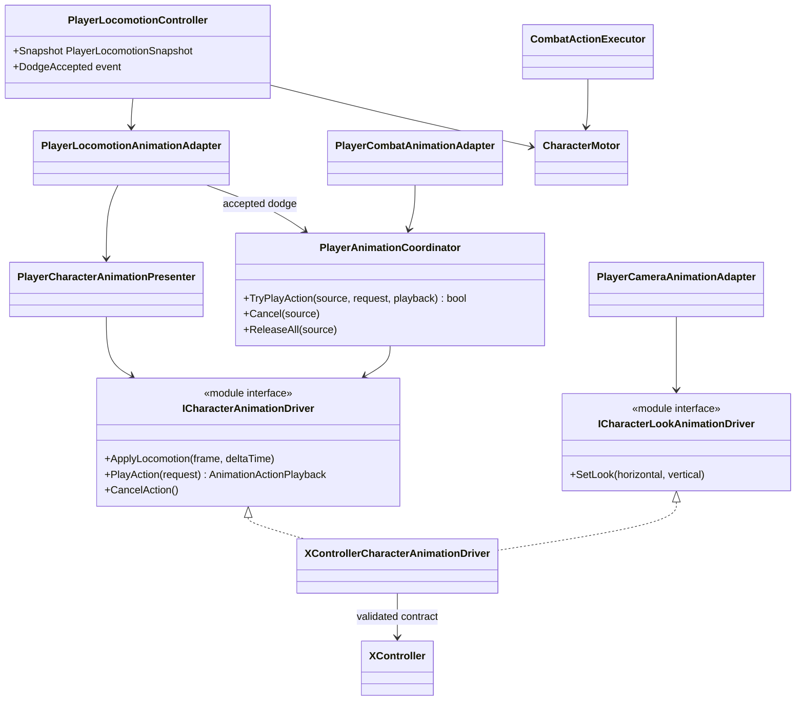

# Project S — Player animation presentation

## Boundary

Player animation displays confirmed gameplay state. Locomotion, dodge
eligibility, combat timing, hit windows, damage and translation remain in
gameplay code. The Animator Controller owns motion selection, Blend Trees and
visual crossfades.

## Ownership and update flow

- `PlayerLocomotionController` owns `Idle / Run / Jump / Fall / Dodge` gameplay
  state and publishes an immutable snapshot.
- `PlayerCharacterAnimationPresenter` converts that snapshot to a rig-neutral
  locomotion frame.
- `PlayerAnimationCoordinator` arbitrates finite action priority:
  `Death > Reaction > Traversal > Combat > Locomotion`.
- `XControllerCharacterAnimationDriver` is the only parameter writer. The same
  scoped instance presents locomotion, finite actions and body/head look.
- `XController.controller` is the manually authored visual graph. No editor
  setup tool creates or rewrites its states, motions, Blend Trees or transitions.
- `CombatActionDefinition.DurationSeconds` owns gameplay action duration. No
  combat rule reads clip length or Animator normalized time.
- Root motion is disabled. Dodge and attack movement go through
  `CharacterMotor`, including normal collision sweeps and grounding.

## Transition model

Transitions are content authored in Animator. Runtime code supplies the
semantic `Action` trigger together with `ActionId` and `ActionVariant` and never
calls `Animator.CrossFade` to choose a finite-action state. `CancelAction`
returns supported dodge and attack states to `Move` through explicit `0.10 s`
fixed-time transitions.

The current action contract is:

| Action | Id | Variant | State |
| --- | ---: | ---: | --- |
| Dodge | 1 | 0 | `Locomotion/Roll/RollFront` |
| Dodge | 1 | 1 | `Locomotion/Roll/RollBack` |
| Light attack | 2 | 0...3 | `Attack/BaseAttack1...4` |

The controller consumes its historical `MovementType`, `MovementDirection`,
`FallingDuration`, `OnGround` and `SpeedMultiplier` parameters. `BodyLookX/Y`
and `HeadLookX/Y` drive the additive `BodyLook` and `HeadLook` layers from the
camera/targeting presentation path. Jump anticipation remains gameplay-owned
regardless of the current animation graph.

## Weapon override contract

Every weapon uses an `AnimatorOverrideController` whose base controller is
`XController`. Layers, parameters, state machines and state names therefore
remain identical; only animation clips are replaced.

The source motions assigned to `RollFront`, `RollBack` and `BaseAttack1...4`
are unique override slots. Do not reuse one source clip for two semantically
different states because a single override would then replace both usages.
Replacement clip names follow the same slot names for readability, although
Unity technically keys the override by the source clip asset.

## Current content

The Player prefab references the restored `XController.controller`. The
UMotion-authored runtime exports and generated KurtzPel controller were removed;
the extracted KurtzPel source pack remains available only as a local reference.
The production Avatar, clips and controller motions can be replaced while
preserving the gameplay contracts above.
