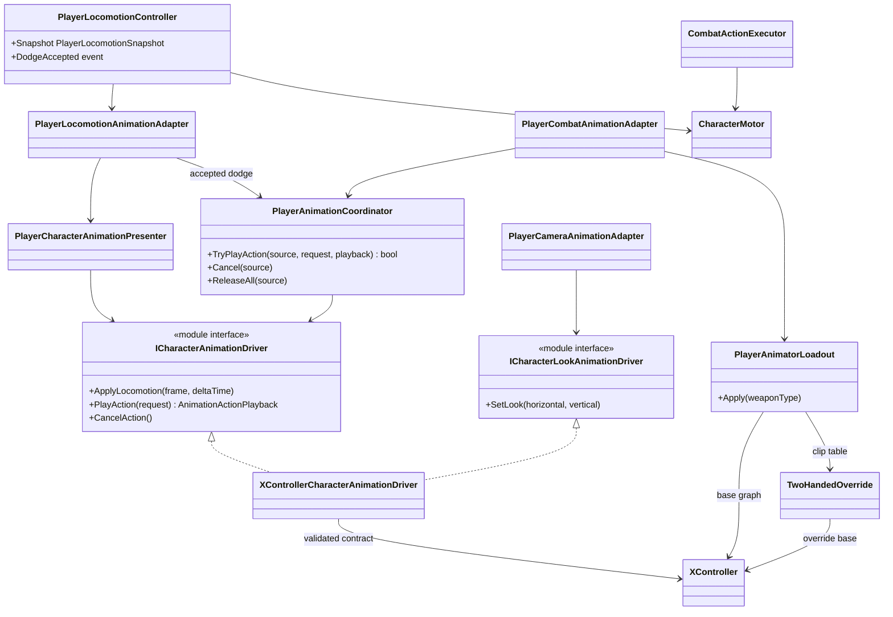

# Project S — Player animation presentation

## Boundary

Player animation displays confirmed gameplay state. Locomotion, dodge
eligibility, combat timing, hit windows, damage and translation remain in
gameplay code. The Animator Controller owns motion selection, Blend Trees and
visual crossfades.

## Ownership and update flow

- `PlayerLocomotionController` owns `Idle / Run / Jump / Fall / Dodge` gameplay
  state and publishes an immutable snapshot.
- `PlayerCharacterAnimationPresenter` converts that snapshot to a rig-neutral
  locomotion frame.
- `PlayerAnimationCoordinator` arbitrates finite action priority:
  `Death > Reaction > Traversal > Combat > Locomotion`.
- `XControllerCharacterAnimationDriver` is the only parameter writer. The same
  scoped instance presents locomotion, finite actions and body/head look.
- `XController.controller` is the manually authored visual graph. No editor
  setup tool creates or rewrites its states, motions, Blend Trees or transitions.
- `CombatActionDefinition.DurationSeconds` owns gameplay action duration. No
  combat rule reads clip length or Animator normalized time.
- Root motion is disabled. Dodge and attack movement go through
  `CharacterMotor`, including normal collision sweeps and grounding.

## Transition model

Transitions are content authored in Animator. Runtime code supplies the
semantic `Action` trigger together with `ActionId` and `ActionVariant` and never
calls `Animator.CrossFade` to choose a finite-action state. `CancelAction`
returns supported dodge and attack states to `Move` through explicit `0.10 s`
fixed-time transitions.

The current action contract is:

| Action | Id | Variant | State |
| --- | ---: | ---: | --- |
| Dodge | 1 | 0 | `Locomotion/Roll/RollFront` |
| Dodge | 1 | 1 | `Locomotion/Roll/RollBack` |
| Light attack | 2 | 0...3 | `Attack/BaseAttack1...4` |
| Sheathe two-handed | 3 | 0 | `SwitchWeapon Layer/TwoHanded_Sheathe` |
| Draw two-handed | 3 | 1 | `SwitchWeapon Layer/TwoHanded_Unsheathe` |

The controller consumes its historical `MovementType`, `MovementDirection`,
`FallingDuration`, `OnGround` and `SpeedMultiplier` parameters. `BodyLookX/Y`
and `HeadLookX/Y` drive the additive `BodyLook` and `HeadLook` layers from the
camera/targeting presentation path. Jump anticipation remains gameplay-owned
regardless of the current animation graph.

`ActionSpeed` is a presentation-only parameter enabled on `BaseAttack1...4`.
`CombatActionDefinition.DurationSeconds` is passed as the expected duration of
the semantic request. The driver caches clip lengths for the currently assigned
Runtime Animator Controller and calculates `clip length / expected duration`.
Consequently a base clip and its weapon override can have different source
lengths while their hit, chain, cancel and completion windows remain on one
gameplay-owned timeline. Controller reassignment invalidates this cache; no clip
lookup or allocation is performed per frame.

## Weapon override contract

Every weapon uses an `AnimatorOverrideController` whose base controller is
`XController`. Layers, parameters, state machines and state names therefore
remain identical; only animation clips are replaced.

`PlayerAnimatorLoadout` owns runtime controller selection. It validates all
configured overrides during scene composition and rejects a missing controller,
duplicate weapon binding, or an override built on another base graph. `Unarmed`
uses `XController` directly; `TwoHanded` uses
`Overrides/TwoHanded.overrideController`.

Draw selects the incoming animation loadout before its transition starts, but
the gameplay weapon and rig change only at normalized commit time `0.50`.
Sheathe keeps the outgoing loadout until the clip finishes, changes gameplay
state at the same commit point, and returns to the base controller at completion.
Cancellation restores the loadout for the weapon that actually reached commit.

Weapon transitions run for `1.00 s`, matching the current draw/sheathe clips.
Their Animator states start returning to `Waiting` at normalized time `0.90`
through a `0.10 s` fixed-duration blend. The combat executor advances once per
rendered frame with `UniTask.NextFrame`, so a single `Time.deltaTime` cannot be
counted multiple times.

The source motions assigned to `RollFront`, `RollBack` and `BaseAttack1...4`
are unique override slots. Do not reuse one source clip for two semantically
different states because a single override would then replace both usages.
Replacement clip names follow the same slot names for readability, although
Unity technically keys the override by the source clip asset.

## Current content

The Player prefab references `XController.controller` as its unarmed base and
contains one explicit `TwoHanded` override binding. The current override replaces
16 slots: idle, forward/back walk, run and sprint, forward/back roll, skill,
four base attacks, draw and sheathe. Jump, fall, landing and look-layer clips
remain inherited from the base controller. Additional weapon styles extend the
serialized binding list without changing gameplay or Animator state names.

The four attack states use `0.10 s` Any State entry blends. Their natural exit
starts at normalized time `0.90` and blends to locomotion for `0.10 s`; an
explicit `CancelAction` transition uses the same fixed blend. A new combo step
interrupts the current attack only after gameplay accepts its buffered command
inside the configured chain window.
