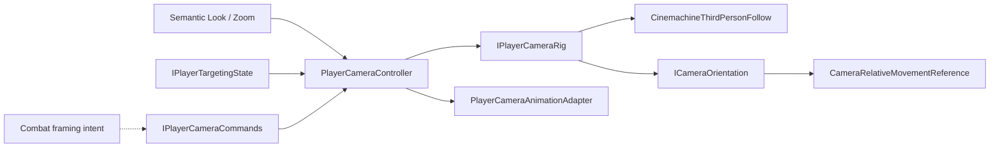

# Project S — Player Camera

## Ответственность

Player Camera владеет только состоянием камеры игрока: free look, слежением за подтверждённой целью, zoom, shoulder side, gravity roll, cursor gating и временным framing. Она не выбирает combat target, не меняет locomotion state и не управляет `CharacterMovement`.

`CinemachineThirdPersonFollow` остаётся техническим adapter. Collision и obstacle avoidance берутся из настроенного camera prefab; gameplay-код не обращается к Cinemachine API.

`ModeChanged` публикуется как изолированный read-event уже после подтверждённой
смены camera state. Ошибка presentation/UI consumer логируется на player root и
не прерывает camera lifecycle.

## Дерево классов

```mermaid
classDiagram
    direction LR

    class IPlayerInput {
        <<input port>>
        +Look Vector2
        +Zoom Vector2
        +CursorRequested
    }
    class PlayerCameraController {
        +Mode PlayerCameraMode
        +Enable()
        +Disable()
        +TickPresentation(deltaTime)
        +LateTick(unscaledDeltaTime)
        +Recenter()
        +SwapShoulder()
        +SetFraming(distanceOffset, fovOffset)
        +ToggleGravityOrientation()
    }
    class IPlayerCameraCommands {
        <<command port>>
    }
    class IPlayerCameraState {
        <<state port>>
        +Mode PlayerCameraMode
        +IsCursorActive bool
        +IsGravityInverted bool
    }
    class IPlayerCameraRig {
        <<rig port>>
        +Distance float
        +FieldOfView float
        +ShoulderSide float
        +SetOrientation(rotation)
    }
    class ICameraOrientation {
        <<read-only view port>>
        +Position Vector3
        +Forward Vector3
        +Right Vector3
    }
    class CinemachineCameraRig {
        <<Cinemachine adapter>>
    }
    class IPlayerTargetingState {
        <<target state port>>
        +IsTargetLocked bool
        +CurrentTarget Transform
        +AimPosition Vector3
    }
    class IPlayerCameraPresentation {
        <<presentation port>>
        +Tick(hasTarget, targetPosition, deltaTime)
    }
    class PlayerCameraAnimationAdapter {
        <<animation adapter>>
    }
    class IPlayerActorTransform {
        <<actor read port>>
        +Root Transform
        +Forward Vector3
    }
    class CameraRelativeMovementReference {
        <<locomotion adapter>>
    }
    class PlayerCameraComposition {
        <<composition>>
    }

    IPlayerCameraCommands <|.. PlayerCameraController
    IPlayerCameraState <|.. PlayerCameraController
    PlayerCameraController --> IPlayerInput
    PlayerCameraController --> IPlayerTargetingState
    PlayerCameraController --> IPlayerCameraRig
    PlayerCameraController --> IPlayerCameraPresentation
    PlayerCameraController --> IPlayerActorTransform
    ICameraOrientation <|-- IPlayerCameraRig
    IPlayerCameraRig <|.. CinemachineCameraRig
    IPlayerCameraPresentation <|.. PlayerCameraAnimationAdapter
    PlayerCameraAnimationAdapter --> IPlayerActorTransform
    CameraRelativeMovementReference --> ICameraOrientation
    PlayerCameraComposition ..> CinemachineCameraRig : constructs
    PlayerCameraComposition ..> PlayerCameraController : constructs
```

## Поток данных

- Input передаёт семантические значения; controller не знает о keyboard, mouse, gamepad или binding path.
- Targeting публикует read-only state. Камера не запускает physics query и не выбирает цель.
- Locomotion читает только `ICameraOrientation`; зависимость от `Character.CameraTransform` устранена.
- Camera controller и head-look adapter читают actor только через `IPlayerActorTransform`; combat/traversal API класса `Character` им недоступен.
- Head-look adapter измеряет направление от стабильного camera follow target,
  а не от анимируемой кости головы. Результат additive pose поэтому не становится
  входом следующего кадра и не создаёт feedback/jitter значений.
- Combat в будущем сможет задавать временный framing через `IPlayerCameraCommands`, не получая доступ к Cinemachine.

## Режимы и lifecycle

`FreeLook` интегрирует look input в yaw/pitch с ограничением pitch. `TargetLock` плавно ориентирует follow target на `AimPosition`. При потере цели controller автоматически возвращается в `FreeLook`.

Переход между `FreeLook` и `TargetLock`, а также вход или выход из cursor mode,
обнуляет только velocity углового smoothing. Текущие yaw/pitch сохраняются,
поэтому камера продолжает из фактической позы, но не наследует импульс старой
цели при следующем lock-on.

Camera follow/look origin задаётся отдельным root-relative transform и не может
находиться внутри Animator hierarchy. Иначе поза головы двигает источник, из
которого вычисляется следующая поза головы, создавая feedback-loop и скачки
`BodyLook/HeadLook`. Player prefab также обязан явно ссылаться на свой единственный
Humanoid Animator и Cinemachine follow rig; это проверяет XController contract
validator до Play Mode.

Camera rig smoothing и Cinemachine orientation остаются в `LateTick` на
unscaled time. Animation presentation отделена от них: `TickPresentation`
выполняется в gameplay `Update` сразу после targeting и до обычной Animator
evaluation. Поэтому attack/reaction policy успевает записать веса
`BodyLook/HeadLook` в тот же visual frame, а не на кадр позже. Smoothing pose
использует scaled presentation delta и корректно замораживается при hit stop.

Camera rig регистрируется `PlayerCameraComposition` из существующих serialized-ссылок `ThirdPersonController`, а сам composition-блок вызывается единственным `GameLifetimeScope`. Имена полей сохранены, поэтому prefab и сцена не требуют миграции. При уничтожении scope runtime-экземпляр Cinemachine camera удаляется через `IDisposable`.

Поворот, zoom, FOV и shoulder interpolation используют unscaled delta time: камера остаётся отзывчивой во время hit stop. Head-look animation использует scaled delta time и замораживается вместе с gameplay presentation.

## Расширение

- `Recenter`, `SwapShoulder` и `SetFraming` уже являются командами, но не получили bindings: action asset меняется только отдельным решением вместе с keyboard/gamepad mappings.
- Camera shake должен быть отдельным presentation adapter через Cinemachine Impulse. Он не должен менять `ICameraOrientation`, иначе shake начнёт влиять на movement и gameplay queries.
- Альтернативный Unity camera stack реализует `IPlayerCameraRig`; controller и targeting при этом не меняются.

Camera feature остаётся в `_App/Core`, пока его authoring, gravity policy и combat framing не стабилизированы в реальной игре. Сейчас это не кандидат на преждевременный UPM package.
